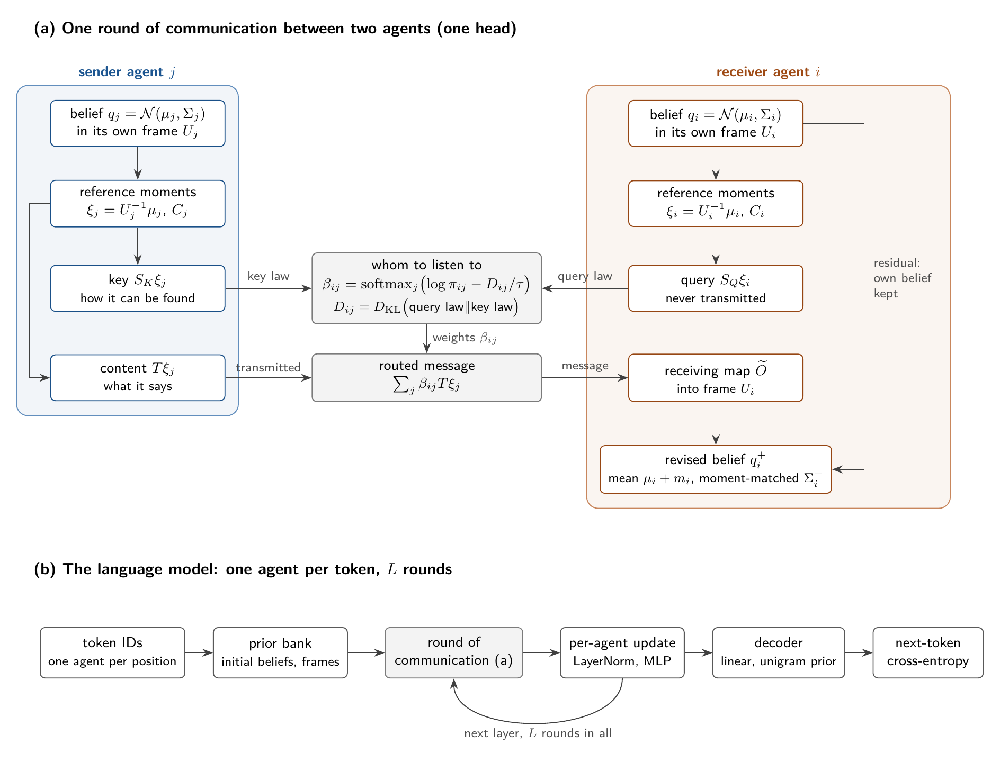
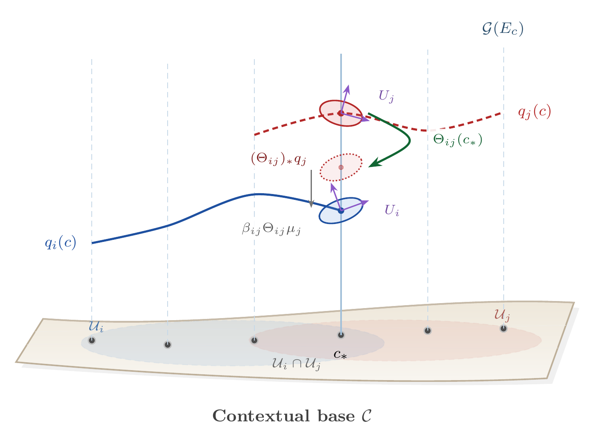

# VFE_3.0

VFE_3.0 is an experimental language model built as a population of communicating
agents. Every token is modeled as an agent. Each agent holds a Gaussian belief (a mean and a
covariance) expressed in its own internal coordinate frame. One attention layer is one round
of communication among the agents: every agent decides whom to listen to,
every sender transmits a low-rank part of what it believes, and every receiver brings what
it hears back into its own frame and revises its belief. The decision of whom to hear and
the content that is heard pass through separate learned interfaces, one set per head:

| Interface | Belongs to | Role in the exchange |
|---|---|---|
| Query map $S_{Q,h}$ | receiver | what the receiver asks about; it is compared, never transmitted |
| Key map $S_{K,h}$ | sender | how the sender can be found |
| Sending map $T_h$ | sender | what the sender says: the transmitted content |
| Receiving map $O_h$ (or $\widetilde O_h$ in a content-link chart) | receiver | how the receiver absorbs what it heard into its full state |
| Frame $U_i$ | each agent | the agent's private coordinate system |

The routing weights are each receiver's distribution over whom to hear, computed from a
Gaussian divergence between the receiver's query law and each sender's key law under a
causal prior over sources. Under a declared binary compatibility record these weights are
the exact posterior of the source label (v2 manuscript, Theorem `thm:probabilistic_status`),
as they would be for any nonnegative routing cost, so this posterior reading does not by
itself distinguish the model from a conventional softmax router; what distinguishes it is
the cost, a Gaussian divergence between belief laws. Within one attention step on
full-covariance states, every interface acts on reference coordinates, so an agent's private
change of frame changes nothing that any other agent computes, and the messages transform
covariantly. The default and launcher configurations do not keep this property across the
whole model: the diagonal family cannot represent $g\Sigma g^\top$, and local
`block_coordinates` and `decode_coordinates` apply the block norm, the block MLP and the
decoder to frame-dependent coordinates. Setting `family="gaussian_full"` with
`block_coordinates="reference"` and `decode_coordinates="reference"` on the
projected-predictive route with `rope_mode` `none` or a comparison mode (frame-space RoPE
folds a rotation into the content frame; these admit a `none` or `layernorm` norm and the
coordinate, Gaussian-template or prototype block MLP, all conjugated by the realized frame)
gives the frame-covariant path when three further conditions hold: the decode mode has a
reference-coordinate reading (`linear`, `diagonal_chunked` or `full_chunked`) and the validator
admits it for the family, a prior-bank decoder scores against its own untied bank
(`untie_decode_bank=True`; a tied bank returns the encoder's tables, which move with the frames),
and no type-level frame dropout acts (`phi_type_dropout=0`). For the full list of conditions,
including the fixed-coordinate caps that must stay off, see `vfe3/gauge_covariant.py`, which
implements the launcher switch `fully_gauge_covariant`, and `gauge_covariance_failures`, which
names the flags a resolved configuration misses.
In this sense the model expresses coordination among agents as inference: whom to trust, how
much to absorb, and how uncertain each agent remains after the exchange.

The primary configuration in `train_vfe3.py` uses **full-input/full-output projected
attention with predictive-content readout**. Its attention step directly aggregates
content, with a residual connection. Given routing costs, the attention weights are the
entropy-regularized (Gibbs) minimizer, as they are for any softmax attention; what is
specific to this model is the cost itself, a Gaussian KL divergence between projected
moments. A single latent variational free energy for the complete language model
is not established; the predictor trains on supervised next-token cross-entropy.

This is a refactored and extended version of an earlier iteration `V3_Transformer' (see repo). 

## Architecture

<p align="center">
  
</p>

The figure is drawn in TikZ ([`assets/agent_round.tex`](assets/agent_round.tex), build
commands in its header).

The current launcher also enables a block MLP and block LayerNorm, which act on each
agent separately between rounds (although these features are not theoretically principled 
under the current gauge theoretic construction). Communication is causal: an agent hears 
only agents at earlier or equal positions, and next-token targets enter the training loss.

| Symbol | Meaning |
|---|---|
| $K$ | Dimension of every agent's belief state (`embed_dim`). |
| $H$ | Number of communication heads, or channels (`n_heads`). |
| $d=K/H$ | Comparison and content dimension per head in the equal-head implementation. |
| $\ell$ | Layer index, one round of communication; suppressed below. |
| $U_i$ | Invertible realized frame of agent $i$. |
| $(\mu_i,\Sigma_i)$ | Gaussian mean and covariance of agent $i$'s belief. |
| $\beta_{ij}^{(h)}$ | Receiver $i$'s weight on sender $j$ in head $h$. |

## Agents: beliefs, frames, and links

Agent $i$ carries a belief $q_i$, a prior $p_i$ from the token's prior bank, and a frame
$U_i$, its private coordinate system. Geometrically the agents are sections of bundles over
a single base point, the shared context: the theory starts from a principal bundle of frames
with structure group $G=\mathrm{GL}(K,\mathbb R)$ and its associated vector and Gaussian-state
bundles, and a frame section and a belief section are distinct objects. The finite token
model uses token-indexed fibers and a reference trivialization; it does not require a smooth
contextual base or discretize a continuum connection.

<p align="center">
  
</p>

*Statistical sections, frames, and a group link (Figure 1 of the v2 manuscript; TikZ source
[`assets/bundle_geometry.tex`](assets/bundle_geometry.tex)).* Over a general contextual base
$\mathcal C$, the curves are the beliefs $q_i$, $q_j$ of two agents, sections of the
statistical bundle over their overlapping domains. The token model keeps only the fiber over
the single context $`c_*`$ (solid line), where the glyphs carry the frames $U_i$, $U_j$. The
green arrow applies the group link $\Theta_{ij}=U_ie^{L_{ij}}U_j^{-1}$, the dotted contour is
the pushforward $`(\Theta_{ij})_*q_j`$, which the receiver's belief need not equal, and the gray
arrow is the contribution $\beta_{ij}\Theta_{ij}\mu_j$ to the receiver's mean.

Write an agent's belief and its moments in reference coordinates as

$$
q_i=\mathcal N(\mu_i,\Sigma_i),\qquad
\xi_i=U_i^{-1}\mu_i,\qquad
C_i=U_i^{-1}\Sigma_i U_i^{-\top}.
$$

The full-Gaussian theory assumes $\Sigma_i\succ0$. The current launcher selects
`gaussian_diagonal`; the projected route also admits `gaussian_full`. Saved configs
naming `gaussian_diagonal_exact` load as `gaussian_diagonal` (the same function and
parameters); `gaussian_frame_diagonal` was retired on 2026-10-01 and revived on 2026-10-18
with the semantics described below, under which a saved config naming it loads. A diagonal stored
state still yields dense projected covariances through the frames. Whether the two families
compute the same function depends on the covariance contracts: under
`predictive_covariance="moment_matched"` the diagonal family keeps the diagonal of the local
moment-matched covariance (the moment projection onto diagonal Gaussians) while
`gaussian_full` keeps it dense, so the two differ; they coincide only when no seam densifies the
covariance, as under `"passthrough"` (see the configuration section below).

`family="gaussian_block"` keeps one SPD $d\times d$ covariance block per head, the smallest
SPD family closed under the block_glk congruence. It is stored in the dense $(K, K)$ layout
with zero off-head blocks, and the moment-matched update returns the head blocks
$U_{i,h}[C_i^{\mathrm{att}}]_{hh}U_{i,h}^\top$, the moment projection onto the family, which
does not depend on the frame. It is defined on the kernel predictive readout with compact
head-block frames (block_glk, block_so, block_co, block_sl, block_borel, block_unipotent,
block_glmc or an equal-block so_n or su_n tower, any tying), edge links off, a block MLP whose
covariance is read through its head-block projection (`posterior` needs
`block_mlp_inference="mean_field"`), no CG coupling, and the `linear`,
`diagonal_chunked` or `full_chunked` decoders (the diagonal decoder reads
$\mathrm{diag}\Sigma_i$, exact up to a per-position constant). `gaussian_full` admits the
`diagonal_chunked` decoder on the same terms. On either family that decoder runs no Cholesky
factorization, so unlike `full_chunked` it excludes no position whose covariance is not positive
definite. With identity frames
(`gauge_transport="off"`), `prior_covariance_table="block_cholesky"` replaces the diagonal
variance table by per-type head blocks $C_{vh}=L_{vh}L_{vh}^\top$ (log-diagonal Cholesky,
`sigma_chol_embed`), so that `mu_embed` and the blocks hold $(\xi_v, C_v)$ and the model
represents what the learned-frame reference arm represents without a frame table, provided that
arm has no positional frames (`pos_phi="none"`): a positional frame makes the reference moments
depend on the position, which no per-type table reproduces. It needs a full-layout family and an
untied decode bank (or the linear decoder).

`family="gaussian_frame_diagonal"` keeps the covariance diagonal in reference coordinates,
$\Sigma_i=U_i\mathrm{diag}(c_i)U_i^\top$, and stores the reference variances $c_i$ in the
$(\ldots, K)$ layout. The passive action leaves $c_i$ fixed, so the family is closed under every
structure group, and the moment-matched update returns $c_i^+=\mathrm{diag}C_i^{\mathrm{att}}$
plus the floor in reference coordinates ($f c_{p,i}$, $f \mathrm{mean}(c_i)$, or their elementwise
maximum), a frame-independent projection whose reference trace does not grow with the frame
condition number (audit 2026-10-17 item 3). The router and the update read $(U_i^{-1}\mu_i, c_i)$,
which makes the comparison covariance $S\mathrm{diag}(c_i)S^\top$ with no frame product. It
is defined on the kernel predictive readout with edge links off, no frame-space RoPE, no CG
coupling, a `none` or `layernorm` block norm with a `coordinate` block MLP (local coordinates
push $U_i\mathrm{diag}(c_i)U_i^\top$ and read back $\mathrm{diag}(U_i^{-1}SU_i^{-\top})$;
reference coordinates push $\mathrm{diag}(c_i)$ and keep the diagonal), the `linear` or
`diagonal_chunked` decoders (the latter reads $(\xi_i, c_i)$ in reference coordinates, or
$\mathrm{diag}\Sigma_i$ in local ones, and needs `untie_decode_bank=True`, since a tied bank
would pair the encoder's local-frame mean with the reference variance $c_v$; audit 2026-10-20 item
59), and the table Fisher step only with `pos_phi="none"` and `phi_type_dropout=0`.
That step preconditions the mean row by the metric $U_v^{-\top}\mathrm{diag}(1/s_v)U_v^{-1}$ of
the type's layer-0 frame, the diagonal step in $\xi_v = U_v^{-1}\mu_v$; a positional frame, or
type-level frame dropout (which gives a dropped type the identity frame in that sequence), would
make the metric an average over occurrences, which the step does not form.

### Whom to listen to: query and key

A receiving agent decides whom to hear by comparing what it asks with how each sender
presents itself. Each head reads all $K$ reference coordinates through

$$
S_{Q,h},S_{K,h}\in\mathbb R^{d\times K}.
$$

The query measures the receiver and the key measures the sender in a common
$d$-dimensional comparison space. The query is the receiver's own question and is never
transmitted; the key is the part of the sender's belief that makes it findable:

$$
Q_{i,h}=\mathcal N(S_{Q,h}\xi_i,S_{Q,h}C_iS_{Q,h}^{\top}),\qquad
K_{j,h}=\mathcal N(S_{K,h}\xi_j,S_{K,h}C_jS_{K,h}^{\top}).
$$

The routing cost is the directed Gaussian divergence

$$
D_{ij}^{(h)}=D_{\mathrm{KL}}(Q_{i,h}\Vert K_{j,h}).
$$

Setting `relational_routing="noisy_query"` (predictive route only) replaces this cost by the
noisy-query cost of the remark `rem:noisy_query` in the v2 supplement
(`GL(K)_supplementary_v2.tex`). Writing $Q_{i,h}=\mathcal N(a_i,V_{Q,i})$ and
$K_{j,h}=\mathcal N(b_j,V_{K,j})$ as above, with $W_{ij}=V_{Q,i}+V_{K,j}$,

$$
D_{ij}^{(h)}=\tfrac12(a_i-b_j)^{\top}W_{ij}^{-1}(a_i-b_j)+\tfrac12\log\det W_{ij}-\tfrac12\log\det V_{Q,i}
=-\log\mathcal N(a_i;b_j,W_{ij})-\tfrac12\log\det(2\pi V_{Q,i}).
$$

At unit temperature ($\tau_h=1$, that is `kappa_beta` $=1/\sqrt d$) and while no cost reaches the
`kl_max` clamp, the Gibbs row of the next section,
$\beta_{ij}^{(h)}\propto\pi_{ij}^{(h)}\mathcal N(a_i;b_j,W_{ij})$, is the exact posterior of the
source label when the projected query mean is a noisy measurement of a draw from the key law, so
query uncertainty flattens the row. The last term is a row constant that keeps the cost
nonnegative. The rule adds no parameters, and a model trained with Gaussian-KL routing loads
unchanged. On the dense comparison route it factors $W_{ij}$ for every token pair, after a
factorization of each query and key covariance for its status check, where the KL cost needs one
factor per key. When the projected comparison covariances are structurally diagonal
(`rope_mode="comparison_invariant"` with at most one unrotated coordinate per head and
`projected_factorization="gram"`), both costs take a closed form with no factorization.

Positive-definite projected covariances require full row rank of the comparison
maps. Their rows are initialized orthonormally, then trained as free matrices;
the implementation does not continually orthonormalize them.

The two measurement maps $S_{Q,h}U_i^{-1}$ and $S_{K,h}U_j^{-1}$ do not uniquely
specify a map back into the receiver's full state. Content transmission supplies
that additional choice.

### What is said and how it is heard: sending and receiving maps

A sender transmits only a $d$-dimensional part of its $K$-dimensional belief, and the
receiver must decide how that partial message enters its full state. The full-width sending
and receiving maps have shapes

$$
T_h\in\mathbb R^{d\times K},\qquad O_h\in\mathbb R^{K\times d}.
$$

The sender extracts content through $T_hU_j^{-1}$ from its own frame; the receiver places it
through $U_iO_h$ into its own frame. Their composition is the matrix link from agent $j$ to
agent $i$,

$$
L_{ij}^{(h)}=(U_iO_h)(T_hU_j^{-1}).
$$

Each head can read and write every state coordinate through a smaller channel.
$T_h,O_h$ start at corresponding block placements, but their other input columns
and output rows are trainable. **Full input/output describes access scope, not
full covariance.** These interfaces select and place content; no Shannon
channel-capacity or coding theorem is assumed.

A link can be rank deficient even though its endpoint frames are invertible.
It is an additional map on associated vector fibers, not generally a group-valued
principal-bundle transition function. The flat frame identification

$$
\Omega_{ij}=U_iU_j^{-1}
$$

is recovered when the intervening processing map is the identity. Generally,
$O_hT_h\ne I_K$ and $L_{ij}L_{jk}\ne L_{ik}$. Such processing effects do not imply
curvature of the flat reference connection.

### Heads as communication channels

Each head is a separate low-rank channel with its own query, key, sending, and receiving
maps, and each receiver routes every channel independently. The current `block_glk`
implementation couples the number of equal frame blocks to the number of heads. The theory distinguishes them: a full-input/output head
can access several frame blocks. Calling each such head an irreducible
representation requires additional restrictions on its interface maps.
Block-diagonal frames alone also do not imply statistical independence of
Gaussian blocks.

## Routing and message passing

Each receiving agent spreads its attention over the agents it may hear. Let
$\pi_{ij}^{(h)}$ be a normalized prior on the permitted sources, with zero
mass outside causal support, and let $\tau_h>0$. At fixed states, minimizing

$$
\mathcal F_i^{(h)}(\beta)
=\sum_j\beta_{ij}^{(h)}D_{ij}^{(h)}
+\tau_h\sum_j\beta_{ij}^{(h)}
\log\frac{\beta_{ij}^{(h)}}{\pi_{ij}^{(h)}}
$$

over source probabilities gives

$$
\beta_{ij}^{(h)}
=\mathrm{softmax}_j\left(\log\pi_{ij}^{(h)}-D_{ij}^{(h)}/\tau_h\right).
$$

This Gibbs identity holds for any cost placed in a softmax, including the dot-product
score of ordinary attention, so it does not by itself distinguish this model. The
model-specific content is the choice of $D_{ij}^{(h)}$ as a Gaussian KL divergence
between projected moments, which the construction posits rather than derives.
The projected routes always include the attention entropy; entropy regularization
determines the Gibbs weights without an iterative gradient update over
them. The temperature depends on the routing law. Under `gaussian_kl`, `noisy_query` and
`mean_distance` it is $\tau_h=\kappa\sqrt{d}$ with $\kappa$ = `kappa_beta` (so `kappa_beta=1`
gives $\tau_h=\sqrt d$), rescaled per layer and head under `learn_attention_temperature`. Under
`noisy_key` and the minimal-agent readout it is exactly 1 and `kappa_beta` is unread: the
learned key or channel noise sets the sharpness. Position
can enter through learned positional frames (`pos_phi="learned"`), through rotary positions
(`rope_mode`: folded into the frame under `"frame"` or `"frame_value"`, or applied to the
projected comparison moments under `"comparison"` or `"comparison_invariant"`), or through an ALiBi source
prior (`beta_attention_prior="causal_alibi"`). The launcher dictionary in `train_vfe3.py`
holds the current choice and each run records its own in `config.json`. The best run so far
(K = 192, 25.12 test perplexity) uses the ALiBi prior together with comparison-invariant rotary
positions and no positional frames; the paper-arms base (K = 128, 35.06) uses the ALiBi prior
without rotation; the earlier K = 128 run (34.48 test perplexity) used the uniform `causal`
prior with learned positional frames and no rotation.
`attention_window` (default 128) is read only by the windowed prior `causal_windowed`; under every
other prior it is inactive.

Runtime numerical KL bounds apply before softmax. Finite `kl_max` clips large
energies; `float("inf")` removes the upper ceiling. Under
`routing_kl_max_reference="absolute"` or `"row_min"` the clamped quantity also keeps a
nonnegative floor; under `"query_shifted"` and `"query_shifted_v1"` the shifted cost is clamped from above only
and can be negative. The implemented energy can therefore differ from the unmodified
KL above.

The message a receiver assembles from what it heard, and its revised mean, are

$$
m_i=\sum_h\sum_j\beta_{ij}^{(h)}L_{ij}^{(h)}\mu_j,\qquad
\mu_i^{\mathrm{attn}}=
\begin{cases}
\mu_i+m_i,&\text{with attention residual},\\
m_i,&\text{without attention residual}.
\end{cases}
$$

The code extracts values, pools sources, applies output maps, sums heads, and
applies the receiver frame. It need not materialize every $K\times K$ pair link.
These formulas use a common score/value frame, as under `rope_mode="none"`; the
rotary-position policies can give comparison and content distinct realized frames.

Under `predictive_covariance="passthrough"`, `predictive_content` leaves covariance
unchanged **within this attention step**. Under `predictive_covariance="moment_matched"`
it replaces the covariance by the exact moment-matched covariance of the predictive
kernel (Theorem `thm:probabilistic_status` (2) of the v2 manuscript): source covariances
pushed through the head maps, cross-head terms, the between-source spread, the residual
persistence term, and the prior-anchored floor $f\Sigma_{p,i}$, with $f$ =
`predictive_covariance_floor` and $\Sigma_{p,i}$ the token's local prior covariance (the layer
prior, the embedding prior under `prior_handoff_sigma=0`). This floor, the default
`predictive_covariance_floor_mode="prior"`, involves no frame, so a common reference change
leaves the covariance unchanged. It replaced the floor $f(\mathrm{tr}C_i/K)I$ in reference
coordinates on 2026-10-12, which remains selectable as `"relative"`; `"max"` takes the larger of
the two (elementwise on the diagonal family, the whitened spectral maximum
$f\Sigma_{p,i}^{1/2}\max(W_i,I)\Sigma_{p,i}^{1/2}$ on full layouts, with $W_i$ the relative floor
whitened by $f\Sigma_{p,i}$). Both modes read the frame through $\mathrm{tr}C_i$: they are covariant
under the local action $U_i\mapsto g_iU_i$ but change under a non-orthogonal common reference
change. A configuration saved before then records no floor
mode and no `phi_frame_condition_max` (added the same day), and `config_from_serialized` reloads
it with `"relative"`, the floor it trained under; one saved between 2026-10-12 and the
floor-mode field (2026-10-16) carries `phi_frame_condition_max` and reloads with `"prior"`.
Neither is a routed population
joint law. Subsequent block transforms and
stack handoff have separate covariance policies, and neither contract is exact Gaussian
propagation through an entire nonlinear layer.

**There is no gradient-based inner belief E-step on this branch.** Source means,
routing scores, frames, and content maps retain their outer training graphs.
Outer learning therefore still differentiates through the attention computation.

### Transformer correspondence

Content aggregation has the usual value/output factorization, expressed through
frames. If every projected key covariance in a head equals $C_K$, write
$a_i=S_Q\xi_i$ and $b_j=S_K\xi_j$. Then

$$
-D_{\mathrm{KL}}(Q_i\Vert K_j)
=a_i^\top C_K^{-1}b_j-\frac12 b_j^\top C_K^{-1}b_j
+\text{row constant}.
$$

The score contains a dot product **and a key-norm bias**. Ordinary dot-product
routing additionally requires the bias to be constant or canceled by a specified
source prior, with appropriate temperature scaling. Varying key covariances retain
further uncertainty-dependent terms. The current model does not impose this limit.

## Content-link charts and edge-dependent links

A message travels from the sender's frame to the receiver's frame through a link. This
section concerns how that link is parameterized: one shared group element per layer, or a
link that depends on the pair of agents that communicate.

### Content-link charts

`content_link_chart` selects the effective receiving map built from the stored
factors $(O,T)$. With the row stack $T=[T_1;\cdots;T_H]$ square and invertible (tiled
heads, $Hd=K$) and $L=OT$,

$$
\widetilde O_{\text{affine}}=O,\qquad
\widetilde O_{\text{first-order}}=T^{-1}+O,\qquad
\widetilde O_{\text{exponential}}=T^{-1}+O\varphi_1(TO)=e^{L}T^{-1},
$$

with $\varphi_1(Z)=\sum_{n\ge1}Z^{n-1}/n!$. Writing $\Pi_h=T^{-1}\Delta_hT$ for the
oblique projector onto head $h$'s block ($\Delta_h$ selects that block) and
$\Pi(\beta_{ij})=\sum_h\beta_{ij}^{(h)}\Pi_h$, the exponential-chart message is

$$
m_i=U_i\sum_je^{L}\Pi(\beta_{ij})\xi_j ,
$$

so each head keeps the oblique component of the source that no other head reads, and one
group element $e^{L}\in\mathrm{GL}^+(K)$ transports the routed components into the
receiver: the shared-generator link $\Theta_{ij}=U_ie^{L}U_j^{-1}$ of the v2 manuscript
(Theorem `thm:routed_transport`). The affine chart is the standard value/output path, and
stored $O=0$ means zero content there but the head-routed flat transport in the other two
charts. The non-affine charts invert $T$ in float64. The first-order chart needs no matrix
function, and the exponential chart evaluates the product form $e^{L}T^{-1}$ with one $K\times K$
matrix exponential, not $\varphi_1$; at the default `content_link_exp_precision="fp64"` that
exponential is float64 as well. Under `"fp32"` the exponential $e^{L}$ and the
$2K\times 2K$ exponential of its backward run in IEEE fp32 whatever `fp32_matmul_precision` is,
while $T^{-1}$ and the products stay in float64. $\widetilde O$ then agrees with the float64 chart
to about $10^{-6}$ relative whatever $\mathrm{cond}(T)$ is, but the gradients of $T$ and $O$ carry
a relative error of about $\epsilon_{32}\mathrm{cond}(T)$ ($10^{-4}$ to $10^{-3}$ at
$\mathrm{cond}(T)=10^3$), and no speedup has been measured. The option is read only by the
projected-predictive kernel readout with edge links off; the receiver of
`attention_mode="projected_gradient"` and the edge links keep the float64 chart. Within a forward,
every layer's chart is evaluated in one batched call (`shared_content_charts`) per chart, width,
device and exponential precision, except on layers with edge links, which evaluate their own.

### Edge-dependent links

With one generator per layer, every triangle holonomy $\Theta_{ik}^{-1}\Theta_{ij}\Theta_{jk}$
is conjugate to $e^{L}$, so a layer's link field has a single holonomy class.
`content_link_edges` gives every edge $j\to i$ its own reference link

$$
G_{ij}=g_ie^{L}E_{ij},\qquad E_{ij}=I_K+A_i\Phi_{ij}B_j^\top,\qquad
\hat x_i=\frac{\xi_i}{(K^{-1}\lVert\xi_i\rVert^2+10^{-12})^{1/2}},
$$

with rank-$r$ factors $A_i,B_j\in\mathbb R^{K\times r}$ read by learned linear maps from the
RMS-normalized reference mean $\hat x$, which is invariant under the passive frame action.

| Mode | Factors | Link | Holonomy |
|---|---|---|---|
| `"lowrank"` (curved) | $A_i=a(\hat x_i)$, $B_j=b(\hat x_j)$, $g_i=I$, $\Phi_{ij}=\varphi_1(B_j^\top A_i)$ | $G_{ij}=e^{L}\exp(A_iB_j^\top)$ | varies from triangle to triangle |
| `"pure_gauge"` (pure-gauge control, holonomy conjugate to $e^{L}$) | shared basis $A$, $B_j=b(\hat x_j)$, $g_i=\exp(AB_i^\top)$, $\Phi_{ij}=-\varphi_1(-B_j^\top A)$ | $G_{ij}=g_ie^{L}g_j^{-1}$ | every triangle conjugate to $e^{L}$ |

Both follow from $\exp(AB^\top)=I+A\varphi_1(B^\top A)B^\top$. The pure-gauge arm has the same
kind of content dependence and no holonomy beyond the shared class, so it is the control
that separates curvature from content-dependent transport; it is not parameter-matched
($K^2r+Kr$ against $2K^2r$ parameters per layer). The sender map $b$ starts at zero, so both
modes start exactly at the exponential chart. The message factors as
$m_i=U_ig_i\widetilde O(z_i+TA_iy_i)$, where $z_i$ stacks the pooled head values
$\sum_j\beta_{ij}^{(h)}T_h\xi_j$, $y_i=\sum_j\Phi_{ij}c_{ij}$, and
$c_{ij}=\sum_h\beta_{ij}^{(h)}(T^{-\top}B_j)_h^\top T_h\xi_j$, so under a strictly causal routing
prior (every registered prior is one) the curved mode needs one $r\times r$ matrix function per
causal edge, while a prior that is not strictly causal evaluates all $N^2$ pairs; the control
needs two per token, and the moment-matched covariance gains rank-$r$ corrections. The argument
of $\varphi_1$ is zeroed on masked pairs before evaluation, so large factors on future pairs
cannot produce non-finite values. Edge links require `content_link_chart="exponential"`,
`attention_mode="projected_predictive"` and equal heads. The full-link gradient path refuses
edge-enabled models. The post-hoc map invariants (`vfe3/posthoc/maps.py`) accept them and report
the shared generator $e^{L}$ (the $B=0$ link), with rows marked `link_shared_generator_only`; the
context-dependent edge links are reported by the model diagnostics (`relational_edge_*`).

### Latent receiver factors

`content_link_latent=True` (curved mode only) treats the receiver factor $A_i$ as a latent
variable with prior $\mathcal N(a(\hat x_i),\sigma_L^2I)$ and estimates it per context.
Only the receiver factor is inferred: a sender factor $B_j$ enters every later receiver's
links, so inferring it would leak future tokens into position $j$. The link energy is a
modeling choice, not the layer free energy restricted to $A_i$. With the transport covariance
fixed by choice at $Q_i=(\mathrm{tr}C_i/K)I$, which makes the energy scale-free, profiling out
the receiver's next-layer mean in a one-transition filtering approximation reduces it to the
dimensionless predictive variance $\mathrm{tr}C_i^{\mathrm{att}}/(2\mathrm{tr}C_i/K)$ (the
moment-matched covariance without its floor). Nothing in this term rewards a link for carrying
content; it penalizes predictive spread. The per-receiver energy is

$$
\mathcal F_i(A_i)=\frac{\mathrm{tr}C_i^{\mathrm{att}}(A_i)}{2\mathrm{tr}C_i/K}
+\frac{\lVert A_i-a(\hat x_i)\rVert_F^2}{2\sigma_L^2}
+\lambda_W\sum_{i-w\le k\lt j\le i}w_{ijk}\tfrac12\lVert W_{ijk}-I\rVert_F^2 ,
$$

where the optional loop prior compares two-step routes across layers through
$W_{ijk}=(G_{ik}^{\ell+1}G_{kk}^{\ell})^{-1}G_{ij}^{\ell+1}G_{jk}^{\ell}$ with weights from
the routing prior. The upper layer's shared generator cancels in $W_{ijk}$, so the
shared-generator model is loop-flat. The estimate is $T$ damped steps
$A\leftarrow(1-\rho)A+\rho(A-\sigma_L^2\nabla_A\mathcal F_i(A))$; the inner step is the unit
natural-gradient step in the prior's Fisher metric, and its fixed points are the stationary
points of $\mathcal F_i$. The steps are unrolled for the outer gradient, and $\sigma_L\to0$
returns the amortized curved mode. The undamped step converges locally only while $\sigma_L^2$ times the
curvature of the energy stays below 1, and that curvature grows with $\varphi_1(B_j^\top A_i)$,
which no fixed $\sigma_L$ bounds. By default the step runs unguarded, as specified, so compare
`val_relational_latent_energy_final` with `val_relational_latent_energy_initial` before
long runs. `content_link_latent_guard=True` keeps a receiver's previous iterate wherever a step
would raise its $\mathcal F_i$ or make it non-finite, decided on one more detached energy evaluation
per step. The receivers decouple, so a receiver that descends takes the specified step with its
unrolled graph unchanged, $\mathcal F_i$ never increases, and a kept receiver is not retried with
a shorter step.

| Setting | Default | Meaning |
|---|---|---|
| `content_link_edges` | `"off"` | `"off"`, `"lowrank"`, or `"pure_gauge"` |
| `content_link_edge_rank` | `4` | factor rank $r$, $1\le r\le K$ |
| `content_link_latent` | `False` | latent receiver factors (requires `"lowrank"`) |
| `content_link_latent_steps` | `1` | fixed-point steps $T$ |
| `content_link_latent_sigma` | `0.1` | prior width $\sigma_L$ |
| `content_link_latent_damping` | `1.0` | damping $\rho\in(0,1]$ |
| `content_link_latent_guard` | `False` | keep the previous iterate where a step raises $\mathcal F_i$ or is non-finite (requires latent factors) |
| `content_link_loop_weight` | `0.0` | loop-prior weight $\lambda_W$ (requires latent factors) |
| `content_link_loop_window` | `1` | loop window $w$, or `None` for every loop |

Measured on the CPU (one thread), $\varphi_1$ forward and backward costs about 11.6, 42, 193
and 961 ms per thousand edges at $r=$ 4, 8, 16 and 32, and the curved mode adds $2K^2r$
parameters per layer (524,288 at $K=128$, four layers, $r=4$, about 40 percent of that model's
context-processing parameters). One readout layer at $K=192$, $N=256$, batch 1 took 0.42 s
without gradients and 1.35 s with them for the exponential chart, 0.83 s and 2.74 s curved,
0.54 s and 1.83 s pure gauge, and 1.95 s and 6.76 s with latent factors at $T=1$. At batch 8
over six layers the latent readouts keep about 62 GB of saved tensors (37 GB with
`predictive_covariance_checkpoint`), so latent arms at that shape need the checkpoint and
`grad_accum_steps` of 4 or more; GPU cost was not measured. The tests are
`tests/test_edge_links_20261005.py`, `tests/test_latent_links_20261005.py` and their
independent brute-force references `tests/test_edge_links_reference_20261005.py` and
`tests/test_latent_links_reference_20261005.py`. The derivations are in
`Research/manuscripts/Attention/edge_latent_links.tex`; the implementation record is the daily
log `docs/2026-10-05.md`, a local record (see [Working records](#working-records)).

## Configuration and training

The editable launcher dictionary is distinct from the defaults in
[`VFE3Config`](vfe3/config.py). These selectors describe the primary route,
rather than a complete standalone configuration:

```python
config.update(
    attention_mode="projected_predictive",
    attention_residual=True,
    relational_routing="gaussian_kl",       # or "noisy_query"
    content_link_chart="exponential",       # "affine" | "first_order" | "exponential"
    content_link_edges="off",               # "lowrank" | "pure_gauge": edge-dependent links
    predictive_covariance="moment_matched", # or "passthrough"
    gauge_group="block_glk",
    gauge_transport="on",
    n_e_steps=1,
    family="gaussian_diagonal",
    encode_mode="per_token",
    pos_phi="learned",                      # learned positional frames
    rope_mode="none",
    beta_attention_prior="causal",          # uniform causal source prior
    kappa_beta=1,                           # tau_h = sqrt(d)
    norm_type_block="layernorm",
    use_block_mlp=True,
    block_mlp_mode="coordinate",            # GELU MLP, covariance passthrough
    decode_mode="linear",                   # prior-bank KL readouts: "diagonal_chunked", "full_chunked"
    decode_unigram_prior=True,
    untie_decode_bank=True,
    m_phi_update_mode="adamw",              # frame updates
    amp_dtype="bf16",
    fp32_matmul_precision="highest",        # TF32 is not enabled
)
```

These are the method selections of the runs reported under [Results](#results); widths,
depths, and rates change from run to run and are recorded in each run's `config.json`.

Two switches rewrite a configuration onto a declared route and leave every other key as given.
`train_vfe3.py` and `ablation.py` carry them as module switches, and `parameter_optimization.py`
pins ablation.py's switches to its own `SEARCH_CONFIG` values for the length of a search.
`fully_gauge_covariant` (`vfe3/gauge_covariant.py`) sets what makes every forward map covariant
under $U_i\mapsto g_iU_i$: frame transport, a family that represents $g\Sigma g^\top$, reference
decode coordinates, reference block coordinates unless the block norm and MLP are covariant on
their own, an untied bank for every prior-bank decoder (the decode mode itself is kept), no
fixed-coordinate cap or trust region, RoPE only in comparison space, the total-KL self term and no
type-level frame dropout. `principled_exact_route` (`vfe3/exact_route.py`) puts the
model on the exact route: the minimal agent's exact source posterior with its moment-matched
covariance and no predictive covariance ceiling, the exact cue/result memory in reference
coordinates with no block norm, the `gaussian_frame_diagonal` family, and the `diagonal_chunked`
decoder at unit temperature on the belief's own covariance (`decode_covariance="belief"`), together
with everything the gauge switch requires except the frame condition bound, which it keeps as
configured. Neither switch makes the training trajectory covariant: the frame M-step is chart AdamW
on the exponential coordinates of the frame table, which transform nonlinearly under the action
and are normalized coordinatewise.

The divergence (Gaussian KL), the flat connection with reference frames (links also
include O @ T), filtering gradient roles, the unrolled estimator, the Fisher mean step,
the Mahalanobis-ball mean trust region, and the fixed in-stack frame (no E-step phi
update) are no longer selectors: they are the only behavior, and
`config_from_serialized` drops a saved value equal to it (or inert for that config) and
refuses any other as retired. Equal heads and at least two heads are required. Consult
the validator for the complete admission rules.

| Setting | Effect on the predictive route |
|---|---|
| `attention_mode="projected_predictive"` | Selects projected comparison and direct content aggregation (internal read-only views: `relational_mode="projected_filtering"`, `relational_readout_mode="predictive_content"`). |
| `e_q_mu_lr`, `e_q_sigma_lr` | Unread by the predictive readout. |
| `lambda_alpha_mode`, `b0`, `c0` | Unused by the predictive readout. They set the outer self-coupling, which `mstep_self_coupling_weight` $w$ (default 0, off) adds to the loss as the profiled energy $w\,\mathrm{mean}_ic_0\log(1+D_i/b_0)$ of $D_i=D(q_i^\star\Vert p_i)$ (summed over coordinates under `state_dependent_per_coord`), whose gradient is $w\,\mathrm{mean}_i\alpha_i^\star\nabla D_i$ with $\alpha_i^\star=c_0/(b_0+D_i)$. `self_kl_max` (default `None`, which reads `kl_max`) clamps $D_i$: each coordinate on its own under `state_dependent_per_coord`, the summed divergence under `state_dependent`. Under an infinite clamp a token whose divergence is not finite is dropped from the mean. |
| `m_relational_score_lr` | Outer rate for $S_Q,S_K$ across layers. |
| `m_relational_content_lr` | Outer rate for $T,O$ (and edge-link factor maps) across layers. |
| `content_link_chart="exponential"` | Receiving map $e^{OT}T^{-1}$; see [Content-link charts](#content-link-charts). |
| `predictive_covariance="moment_matched"` | Replaces the covariance by the predictive kernel's moment-matched covariance plus the prior-anchored floor $f\Sigma_p$. |
| `predictive_readout="minimal_agent"` | Replaces the kernel readout by each receiver's exact Gaussian conditioning on a noisy comparison record whose key is tied to the content ($S_K=T$, no $O$). Routing is the source posterior at temperature 1, so `relational_routing`, `kappa_beta` and `kl_max` are unread. `minimal_agent_inference="exact"` combines per-head exact posteriors by assumed-density filtering; `"mean_field"` uses KL labels and an information-form fusion, with `minimal_agent_cavi_steps` coordinate-ascent sweeps. |
| `predictive_covariance="spread_corrected"` | Minimal agent with mean-field inference only. Restores the between-source spread that the mean field drops: the mean-field covariance $P$ plus the linearized label spread $\sum_h PS_h^\top R'_hS_hP$, $R'_h=\sum_j\beta_{ij}^{(h)}d_jd_j^\top$, plus the floor; invariant under a reference change. |
| `relational_routing="noisy_key"` | Kernel readout only. Routes on $D_{\mathrm{KL}}(\mathcal N(a_i,V_{Q,i})\Vert\mathcal N(b_j,V_{K,j}+n_hI))$ at temperature 1, with a learned per-head key noise $n_h$ (`routing_key_log_noise`, initialized from `relational_key_noise`, score learning rate, no weight decay). The cost is invariant only under the joint map $(S_Q,S_K,n_h)\mapsto(cS_Q,cS_K,c^2n_h)$, so the post-hoc map invariants (`vfe3/posthoc/maps.py`) report the comparison-map scale in noise units, $\lVert S\rVert/\sqrt{n_h}$ (`scale_rms_noise_units`), with `scale_rms` and `conserved_S_drift` NaN. The post-hoc hidden-temperature reading is `not_applicable` on this route, and the post-hoc routing decomposition covers it, with the key law $V_{K,j}+n_hI$ at temperature 1, under every `routing_kl_max_reference` and with tied comparison maps. |
| `diagnose_agent_elbo` | Default `False`. At the evaluation cadence, logs per layer the ELBO of the minimal agent's posterior and of each prototype-agent block, the evidence of the declared record model and their gap, in nats per token; computed without autograd and never in the loss. With coupled heads the minimal agent's evidence is an assumed-density value, so its gap is not guaranteed nonnegative. The minimal agent also logs a 64-draw importance-sampled evidence under its posterior q with the effective sample size fraction of the weights (`is_ess`); with heterogeneous source covariances the mean-field q is narrower than the posterior mixture, single receivers can be off by more than a nat, and a low `is_ess` flags them. The mean-field minimal agent also reports the channel-noise M-step optimum $n_h^\star$ (`channel_noise_mstep`) as a diagnostic; the learned noise is not set to it. |
| `block_mlp_mode="prototype_agents"` | Replaces the feed-forward block MLP by the minimal-agent model on $M$ = `block_mlp_expansion`·$K$ template agents. `block_mlp_inference` selects `"mean_field"` (KL-label responsibilities and a power posterior, `block_mlp_cavi_steps` sweeps) or `"exact"` (the mixture posterior); `block_mlp_covariance="posterior"` returns the template posterior covariance; `block_mlp_em_weight>0` adds an EM M-step term on the templates; `block_mlp_template_init` is `"absolute"` or `"working_variance"`. `"working_variance"` draws the template means from the block inputs without replacement over their distinct rows; with fewer distinct rows than templates, the remaining templates are drawn rows plus an isotropic jitter of the measured working variance, and `prototype_calibration.json` records `distinct_inputs` and `jittered_templates` per layer. |
| `family="gaussian_diagonal"` | Keeps the diagonal of the local moment-matched covariance; `gaussian_full` keeps it dense, so the two differ on this route; see below. |
| `encode_mode="per_token_additive"` | Capacity-matched $\Omega=I$ control; requires `pos_phi="none"`, and either `rope_mode="none"` or comparison-space RoPE (`"comparison"` or `"comparison_invariant"`). |
| `routing_kl_max_reference` | Projected kernel router only. `"absolute"` (default) clamps $D_{ij}$ at `kl_max`; `"row_min"` clamps the row gap $D_{ij}-\min_{j:\mathrm{admissible}}D_{ij}$, with the row minimum carrying its subgradient, which leaves $\beta$ the exact softmax wherever no gap reaches `kl_max` and keeps the cost order of a row whose every cost exceeds it. `"query_shifted"` clamps $D_{ij}-c_i-m_i$ from above only, where $c_i$ is the query-only row constant of the cost ($-(r+\log\det G_i)/2$ for the Gaussian KL and `noisy_key`, $-\log\det G_i/2$ for `noisy_query`, $0$ for `mean_distance`) and $m_i$ is the mean of the key log-volumes $\ell_j=\tfrac12\log\det G_j$ over the row's admissible keys ($\tfrac12\log\det(G_j+n_hI)$ under `noisy_key`, the broadened key law it scores, and $0$ for `mean_distance`). Both are row constants, so $\beta$ equals the absolute route's wherever nothing is capped, and the shifted costs can be negative. The tested quantity is invariant under a joint rescaling of a head's comparison maps by $c$, which leaves the KL unchanged, so map growth along that flat direction cannot push a head onto the cap (audit 2026-10-20 item 1). Under `noisy_key` the cost, and the tested quantity with it, is invariant only under the joint map $(S_Q,S_K,n_h)\mapsto(cS_Q,cS_K,c^2n_h)$: scaling the maps alone changes the cost and $\beta$. `"query_shifted_v1"` is the earlier form without $m_i$, which kept the key log-determinant in the clamped cost; configurations saved with `"query_shifted"` before the change reload as `"query_shifted_v1"`. `relational_score_weight_decay` (default 0) is an opt-in decoupled decay on $S_Q,S_K$, and `relational_content_weight_decay` (default 0) the same on $T,O$. |
| `learn_attention_temperature` | Default `False`. `True` learns $\tau_{\ell,h}=\kappa_h\sqrt{d_h}\exp(3\tanh(\delta_{\ell,h}/3))$ per layer and head (`routing_log_temperature`, zero at initialization, no weight decay, score learning rate) on both projected routes. The offset $3\tanh(\delta/3)$ equals $\delta$ to first order and stays inside $(-3,3)$ with nonzero gradient everywhere; it replaced a hard clamp of $\delta$ to $[-3,3]$ whose gradient vanished outside the window, so a saved nonzero offset reloads at a different temperature than under the clamp. It acts after the `kl_max` clamp, so a fully capped absolute-reference row stays at the attention prior $\pi$ (uniform under a causal mask). Not with `predictive_readout="minimal_agent"`. |
| `tie_comparison_maps` | Default `False`. `True` sets $S_K:=S_Q$ (no `raw_score_k`) on the `projected_predictive` kernel readout, so under `gaussian_kl` and `mean_distance` routing $D_{ii}=0$ and the flat-alignment case $D_{ij}=D_{\mathrm{KL}}(q_i\Vert(\Omega_{ij})_*q_j)$ under one map is testable. Under `noisy_key`, $D_{ii}=D_{\mathrm{KL}}(\mathcal N(a_i,G_i)\Vert\mathcal N(a_i,G_i+n_hI))>0$, and a broader key can score below it; under `noisy_query`, $D_{ii}=\tfrac d2\ln2$. |

Relational rates of `None` inherit `m_p_mu_lr`; `0.0` freezes that role's
parameters while retaining its forward operation. Score and content groups have
zero weight decay unless `relational_score_weight_decay` or `relational_content_weight_decay`
gives the comparison maps or the content maps $T,O$ a decoupled decay; the noise and temperature
scalars of the score group and the edge-link maps stay undecayed.

Four numerical safeguards trade cost for conditioning; each is at its cheapest setting by default.

| Setting | Effect |
|---|---|
| `phi_frame_condition_max` | Default `None`. A number $\kappa_{\max}>1$ bounds $\mathrm{cond}_2(U_i)\le\kappa_{\max}$ after each accepted step: through $\kappa_2(e^X)\le e^{\mathrm{spread}(\mathrm{sym}X)}$, the eigenvalue spread of the traceless symmetric part of every head block of each frame factor is bounded, keeping the trace and the skew part. Without a positional factor the token frame's spread is limited to $\log\kappa_{\max}$. Under `pos_phi="learned"` a positional row's spread is limited to $\log\kappa_{\max}/2$, and the token frame receives the remainder, $\log\kappa_{\max}$ minus the realized positional spread $s_h$ of its head (the maximum over positions), so the budget is not split evenly. Under `pos_phi="frozen"` the frozen positional factor is not bounded, the token frame again receives $\log\kappa_{\max}-s_h$, and a frozen factor whose spread alone reaches $\log\kappa_{\max}$ is refused when the model is built or a checkpoint is loaded. `block_glk`, `block_glmc` and `block_sl` with `m_phi_update_mode="adamw"` and `encode_mode="per_token"` only (inert, since $\mathrm{cond}_2=1$, for `block_so`, `block_co`, `so_n` and `su_n`; refused for `block_borel` and `block_unipotent`). Capping the symmetric spread is a sufficient condition, an equality only for normal blocks: a generic $d=32$ block is projected at a realized condition of about 0.85 to 0.95 $\kappa_{\max}$ and a shear- or rotation-dominated block at much less, so `frame_projection_count` (the rows the bound changed), not `vertex_cond_max`, shows whether it binds; metrics rows also carry `frame_bound_flagged_rows`, `frame_bound_decomposed_rows` and `frame_bound_float64_rows`. The skew and trace parts are left to `phi_weight_decay`, and without `phi_mstep_max_matrix_norm` a token row whose Lie-algebra element exceeds `transport_chart_max_norm` is refused in the forward and ends the run, which configuration construction warns about. |
| `projected_factorization` | Factorization of the projected Gaussian-KL scorer. `"gram"` (default) factors the float32 Gram matrix (error $O(\epsilon\kappa^2)$); `"gram_certified"` also rebuilds entries that factor but fail a condition certificate; `"cholesky_qr2_certified"` factors by CholeskyQR2 (error $O(\epsilon\kappa)$) where the scorer has source roots, and an entry that passes its factor certificate but fails the Gram certificate keeps its factor while its pairs leave the centered GEMM for triangular-solve tiles. The scorers without a source-root factor route (the minimal agent, `noisy_query`, `noisy_key` and `comparison_invariant`) run `"cholesky_qr2_certified"` as `"gram_certified"`; under `noisy_key` the certified modes rebuild flagged and failed keys from the augmented root $[X,\sqrt{n_h}I]$, whose Gram is the broadened key law $G+n_hI$. The certified modes are costly on CUDA. |
| `frame_pair_escalation_tol` | Default `None`. A tolerance in $(0,1)$ recomputes a frame producer call in float64 when its float32 frame pair has $\epsilon_{32}\kappa_F(U)$ above it; about 7 times the cost of an escalated step. The verdict is one per producer call, so one ill-conditioned token moves every position and sequence of the batch to float64 frames, and prefix and batch invariance then hold only to rounding; `None` keeps the frame precision independent of the input. |
| `predictive_covariance_precision` | Default `"fp32"`. `"fp64"` computes the kernel moment-matched covariance update in float64 from float32 beliefs and casts it back, removing the float32 round-trip error amplified by about $\kappa(U)^2$ (positive-but-wrong variances that `predictive_covariance_fp64_escalation` does not see); the minimal agent does not read it. The cost is not measured; the estimate is about twice the step time at $K=128$. |

Two further numerics options act on the log-variance tables and on the frame inverse.

| Setting | Effect |
|---|---|
| `sigma_log_floor_mode` | Default `"absorbing"`. The log-variance tables (`sigma_log_embed` and an untied `decode_sigma_log_embed`) read $\max(e^{l},\epsilon)$, whose derivative in $l$ is exactly zero below $\log\epsilon$, so neither optimizer moves an entry that has crossed the floor, whatever the loss prefers. `"projected"` raises every entry below $\log\epsilon+2^{-16}$ to that value after each accepted optimizer step, where the variance map has a nonzero derivative again; entries above the floor are unchanged. Inert under `prior_covariance_table="block_cholesky"` without an untied decode variance table. |
| `frame_inverse_adjoint_precision` | Default `"fp64"`: the backward of the stored float32 frame inverse $U^{-1}$, which the producers form in float64, is the float64 adjoint $-U^{-\top}GU^{-\top}$, two float64 batched GEMMs per frame block in every backward. `"fp32"` forms the same adjoint from the stored inverse in IEEE fp32, a rounding-level change of the frame gradients (entrywise within about $(d+1)\epsilon_{32}\lvert U^{-\top}\rvert\lvert G\rvert\lvert U^{-\top}\rvert$ for block width $d$), with the stored frames unchanged. Inert under `gauge_transport` `"off"` or `"frozen"`. |

`projected_factorization`, `frame_pair_escalation_tol`, `frame_inverse_adjoint_precision`,
`relational_tile_mib`, `relational_diag_moments_kernel` and `fp32_matmul_precision` (unless it is
`None`) are process-global: building a `VFEModel` installs them for the whole process, so a later
construction with other values governs the forwards of every model already built. Such a
construction emits `NumericPolicyWarning` when a live model was built with different values, and
`VFEModel.apply_numeric_policy()` reinstalls a model's own values before it is used again. On CUDA
`fp32_matmul_precision="medium"` gives the same TF32 cuBLAS GEMMs as `"high"` (bf16 reaches only
oneDNN CPU GEMMs), so the precision-retry ladder, which replays a failed or non-finite step under
stricter policies up to `"highest"`, skips the redundant `"high"` rung there.

`relational_tile_mib` (default 32) is the byte budget, in MiB, of one tile of the relational
scorer and of the routed spread's query rows. A larger budget dispatches fewer kernels and holds
more transient memory; values change only by float32 reduction order, and every loop above
32 MiB stays checkpointed, so a raised budget changes the tile count and never what autograd
saves. It sizes the CPU and fallback projection tiles and the moment-matched spreads only: on CUDA
the diagonal comparison route with `relational_diag_moments_kernel="triton"`, passthrough
covariance and `pair_kl_gemm_tol=None` reads no tile budget, and `summary.json` records the scorer
tile loops that ran as `relational_tile_loops`, beside `diag_moments_kernel`. A routed-spread tile
is sized with every batch axis included, so the budget bounds the whole tile rather than one
sequence's share. When the routing prior is $-\infty$ above the
diagonal (every causal prior), the readout sees it from the prior tensor and each spread tile of
query rows $[i, i+s)$ contracts only the sources $[0, i+s)$, with at least four tiles; the dropped
terms are $0\cdot x$, so values and gradients are unchanged. Its step-time effect on CUDA is not
measured.

The diagonal comparison route of the kernel router (`rope_mode="comparison_invariant"` with
`gaussian_kl`, `noisy_query` or `noisy_key` routing under `projected_factorization="gram"`, whose
projected comparison covariances are structurally diagonal; see
[Whom to listen to: query and key](#whom-to-listen-to-query-and-key)) has the opt-in settings
below. All but `routing_causal_tiles` act only on the `gaussian_diagonal` family. None is bitwise
neutral, but each moves values and gradients at float32 rounding level at most. Their step-time
effect on CUDA has not been measured.

| Setting | Default | Effect |
|---|---|---|
| `pair_kl_gemm_shift` | `"first_key"` | Center about which the pair-KL GEMM of the Gaussian KL and the noisy key expands the Mahalanobis term (`noisy_query` has no expansion there). `"first_key"` takes the first key's projected mean in every coordinate; `"rotation_aware"` takes zero in the coordinates the comparison RoPE rotates and the first key's mean in the unrotated one, since rotated means carry a common offset as a position-dependent vector that no single shift removes. `pair_kl_gemm_tol` (default `None`), a tolerance in nats above which a (batch, head) slice is rescored by direct differences, judges each slice by an a-priori error estimate of the expansion that runs. |
| `relational_type_moments` | `False` | `True` evaluates the comparison variances $\mathrm{diag}(SU_i^{-1}\Sigma_iU_i^{-\top}S^\top)$ once per distinct token type of the batch and gathers them to the occurrences, wherever the forward certifies them type-determined: the per-token table encode, frames deduplicated by token id (`pos_phi="none"`, no frame-space RoPE, no type-level frame dropout in a training forward), and a router covariance that is the encoded tensor itself, as when every covariance seam before the layer passes it through. Any other forward or layer evaluates every occurrence. The projected means and the costs are unchanged, and the occurrence cotangents of a type are summed by a deterministic sorted segment sum. |
| `relational_shared_canonical_mean` | `False` | `True` forms $\xi_i=U_i^{-1}\mu_i$ once per layer for the router's projected means and the readout's content instead of each forming it; the costs and the readout are unchanged, and the two cotangents of $\xi$ are summed before the frame adjoint. |
| `routing_causal_tiles` | `False` | `True` runs the pair cost, the `kl_max` reference and cap, the Gibbs weights and the content contraction per query tile $[i_0,i_1)$ against the keys $[0,i_1)$ only, $(T+1)/(2T)$ of the $N\times N$ grid for $T$ equal tiles. It needs a strictly causal prior (every registered prior is one) and `pair_kl_gemm_tol=None`; the tiles follow the routed-spread plan (at most $\lceil N/4\rceil$ rows, fewer when `relational_tile_mib` asks for it), and a prior that is not strictly causal, or a diagnostic capture, runs the full grid. |

Every M-step AdamW group reads `adam_beta1` (default 0.9), `adam_beta2` (default 0.999, a
second-moment window of $1/(1-\beta_2)$ steps) and `adam_eps` (default $10^{-8}$), torch's
defaults, and `config.json` records them; the table Fisher and manifold frame steps keep no Adam
moments, and the row-lazy frame step reads all three. `block_mlp_bias_weight_decay` (default
`None`) keeps the `nn.Linear` biases of the coordinate, gauge-gate and canonical-frame block MLPs
in the one block-MLP group at `weight_decay`; a value moves them to a group of their own at that
decay, so 0 exempts them as the LayerNorm affine and the linear-decode bias are exempt, and under
`grad_clip_scope="group"` that group is its own clip set. `relational_content_weight_decay`
(default 0) gives the content maps $T,O$ a decoupled AdamW decay, as `relational_score_weight_decay`
does for the comparison maps: on the kernel readout each head's message is exactly flat along
$(T_h,O_h)\mapsto(D_hT_h,O_hD_h^{-1})$ for every invertible $D_h$, so without decay the position
on that orbit drifts and sets the effective step on the link $OT$. The log variances and log
weights of the `gaussian_template` and `prototype_agents` templates take no decay.

Under `m_phi_update_mode="pullback_group"`, `m_phi_group_differential_mode` selects how the
strict Frobenius-pullback direction evaluates the trivialized exponential differentials
$\Psi_R(z)=(e^z-1)/z$ and $\Psi_L(z)=(1-e^{-z})/z$ at $z=\mathrm{ad}_\varphi$. The default
`"series"` truncates their power series at a certified order between 8 and 128; `"spectral"`
evaluates the exact Daleckii-Krein closed form from one eigendecomposition of the chart block,
trading the truncation error for a conditioning one, and uses the series whenever that
eigenbasis fails its condition or imaginary-residue guard. The optimizer checkpoints the
route, and a resumed run keeps the saved one.

Under `m_phi_update_mode="pullback_group"` or `"fisher_group"`, `m_phi_group_trust_radius`
$R$ is an upper bound on each row's right-factor step $\|\eta s\xi\|_F$, the embedded
Frobenius norm of the body generator; under `fisher_group` it bounds that Frobenius norm,
not the Fisher norm, so unlike `m_table_fisher_trust_radius` it does not bound the per-step
KL. `m_phi_group_retraction="group_log"` realizes $R$ exactly. The default `"chart"`
retraction also accepts every step only after a fixed $10^{-6}$ check of the exact right
product, a residual quadratic in the step, so away from the identity frame it halves a
trust-saturated step before $R$ binds: in the derivation of 2026-09-28 the certified step
falls from about $4\times10^{-2}$ at $\|\varphi\|_F=0.05$ to $7\times10^{-3}$ at
$\|\varphi\|_F=1.7$ ($d=6$), and a larger $R$ changes nothing there. The optimizer reports
the halvings as `phi_group_backtracks_mean` and `phi_group_backtracks_max` on both retractions.

Two opt-in optimizer toggles address the rare-row mechanisms of the 2026-10-20 audit; both
default to the dense AdamW behavior. `m_phi_sparse_rows=True` (only with
`m_phi_update_mode="adamw"`) steps `phi_embed` with row-lazy AdamW (`vfe3/sparse_row_optim.py`):
a row that is neither among the step's input tokens nor carries a nonzero gradient takes no
moment update, no step and no decoupled decay, and a stepped row's bias correction uses its own
step count $k_v$, which the optimizer state checkpoints as `row_step`. Under dense AdamW a row
revisited after a long gap moves about $\min(\sqrt T, 31.6) \mathrm{lr}$ per coordinate whatever
its gradient; the row-lazy step moves a first touch by $\mathrm{lr}$. The moment tables stay
dense, so the step does not save memory. `m_decode_update_mode="fisher"` (prior-bank decode with
`untie_decode_bank=True`) replaces AdamW on `decode_mu_embed` and `decode_sigma_log_embed` with
the natural-gradient step of the Gaussian Fisher metric $\mathrm{diag}(1/t_v, 1/2)$
weighted by the step's target counts, $(m_v, l_v) \mathrel{-}= \eta (N/\max(c_v,1)) (t_v\odot
\nabla_m, 2\nabla_l)$, bounded per row in Fisher norm and never clipped; it shares
`m_table_fisher_lr` and `m_table_fisher_trust_radius` with the encoder table step
(`vfe3/table_optim.py`), and the decode AdamW rates only schedule it and set its decay. The encoder
table step computes on the rows of the step's input tokens only, with the decoupled decay kept
dense. Its metrics rows carry `table_fisher_step_norm_mean`, the realized Fisher norm of the
scheduled step, and `table_fisher_unscheduled_step_norm_mean`, the trust-scaled step before the
schedule factor, which the `table_step_collapse` alarm reads because the scheduled norm falls with
the schedule; the decode step writes the same columns as `decode_fisher_*`.

Under `m_phi_update_mode="pullback_group"` with `m_phi_group_retraction="group_log"`, a row
whose blocks lie inside the principal strip (margin 0.25) and satisfy
$\max_h\kappa_2(U_h)\le10^3$ takes the closed-form direction $\xi=U^{-1}\bar G$, and
`m_phi_group_log_fallback` routes the other rows. The default `"series"` uses the certified
strict pullback direction, whose dense structure constants ($3\cdot 8 n_{\rm gen}^2 d^2$
bytes per block against a 512 MiB budget) limit `block_glk` to $d_{\rm head}\le16$.
`"eigenbasis"` recovers $\bar G$ on each off-strip block by inverting
$\Psi_L(\mathrm{ad}_{X^\top})$ in the eigenbasis of the chart block, which is exact wherever
$\Psi_L$ is invertible and is the series direction without its $10^{-6}$ Gram ridge, and it
rejects the rows with $\max_h\kappa_2(U_h)>10^3$. It builds no structure constants, so the
budget does not apply. A rejected row keeps its chart. The eigenbasis gate is the spectral
round-off budget $\kappa_F(V)^2(\gamma_{8d}+r_{\rm eig})\le10^{-10}$ that the `fisher_group`
off-strip solve also uses. Since $\kappa_F(V)\ge d$ it is tight at $d=32$: it rejected all
48 random non-normal off-strip blocks of a $d=32$ probe (median $\kappa_F(V)\approx120$) and
passed every one at $d\le8$.

The belief-Fisher frame metric of `fisher_group` vanishes on the stabilizer of each belief, so
it is completed by `m_phi_fisher_rotation_weight` $\lambda$. Under
`m_phi_fisher_completion="rotation"` (default) the weight acts on every rotation of the
whitened generator, which also stiffens the rotations that move the mean, so no $\lambda$
gives the natural gradient there. `"stabilizer"` puts it on the stabilizer only: the
token-frame step is then the pseudo-inverse belief-Fisher natural gradient on the
Fisher-visible directions plus a kernel step proportional to $1/\lambda$. It is refused with
`pos_phi="learned"`, whose pooled positional metric has no stabilizer-only form.

When every covariance contract passes the covariance through
(`predictive_covariance="passthrough"`, `block_mlp_covariance="passthrough"` and
`block_norm_covariance="passthrough"`),
`family="gaussian_full"` computes the same function as `gaussian_diagonal` with the
rank-matched decoder: the encoder stores the covariance as the diagonal of a per-token
table and no seam densifies it, and a float64 probe with shared parameters gives identical
losses and an exactly zero off-diagonal covariance. `predictive_covariance="moment_matched"`
densifies it, so on a moment-matched route the diagonal family keeps only the diagonal of the
local moment-matched covariance and the two families differ. Which case a route is in follows
from its covariance contracts, which the launcher dictionary sets and each run records in
`config.json`. A genuinely full covariance requires `gaussian_full` together with
`block_mlp_covariance="delta_full"`, `block_norm_covariance="pushforward"` or
`"pushforward_moment"`, `predictive_covariance="moment_matched"`, or the covariance updates of
`attention_mode="projected_gradient"`. Of the two LayerNorm pushforwards, `"pushforward"` is the
delta method at the norm's scale $s$, capped at the sphere bound where $\Sigma/s^2$ is large, so
there it keeps the delta method's near rank-one radial shape; `"pushforward_moment"` evaluates the
same expression at the effective scale $s_{\mathrm{eff}}^2=s^2+\mathrm{tr}(\Pi\Sigma\Pi)/K$ with a
span floor, a moment estimate of the LayerNorm output at every $\Sigma/s^2$ (within 4% per
coordinate of Monte Carlo at $K=128$). Both are read only under `norm_type_block="layernorm"`.
`layernorm_fused=True` (default `False`) evaluates the affine block LayerNorm as one fused
`F.layer_norm` call instead of standardizing and then scaling and shifting; it agrees with the
default form to float32 rounding, but its gradients are not bitwise equal, and it is read only with
`layernorm_affine=True` and `norm_type_block="layernorm"`.
`VFE3Config.inactive_fields()`
reports this equivalence when it holds, together with every other setting that no active path reads
(for example `lambda_beta`, `sigma_max`, and the congruence-precision knobs on this
route), and `train_vfe3.py` prints the inactive settings it names explicitly at every
launch.

The gauge-frame contrast needs a capacity control. `gauge_transport="off"` removes
the per-token frame table and the positional table together with the group structure,
so on its own it cannot separate frame structure from lookup capacity. The
`per_token_additive` encoder keeps the same learned $(V,n_{\mathrm{gen}})$ table but
applies it as an additive mean shift with $\Omega_{ij}=I$; it is admitted on the projected
routes only with `pos_phi="none"`, and with either `rope_mode="none"` or comparison-space
RoPE, since a positional frame (or RoPE folded into the frame) would reintroduce a
non-identity transport, while comparison-space RoPE rotates only the projected comparison
moments and does not enter $U_i$. A gauge on/off result on this route should
be reported against that arm.

The launcher constructs `VFE3Config` from its dictionary with a per-run seed
override. The model creates one `RelationalOperators` instance per layer and the
stack passes the matching instance to the attention step. Saved configurations
and provenance identify experiments; mutable launcher widths and rates are not
fixed architectural constants.

### Token priors and language-model loss

`PriorBank.encode` initializes states from learned token priors. Token and
configured positional components form the frames. The input bank is present under
every decoder; there is no `use_prior_bank` switch.

The linear decoder `decode_mode="linear"` reads
$z_{iv}=(W\mu_i+b)_v+\kappa\log u_v$ from the final mean (the unigram term under
`decode_unigram_prior=True`), which discards the covariance; the reported K = 128 run decoded
this way. With `decode_second_order=True` (diagonal family, local decode coordinates) training
instead minimizes the second-order expected log-loss
$\mathrm{CE}(\mu_i)+\frac12\mathrm{tr}(\Sigma_i\mathrm{Cov}_{p_i}(w))$, with $\mathrm{Cov}_{p_i}(w)$ the
covariance of the decoder rows $w_v$ under the predicted distribution $p_i$, so the covariance
enters the training loss; evaluation keeps the plug-in cross-entropy. Its per-coordinate variance
of $w$ is formed from chunk moments about each chunk's most probable row, with the moment GEMM at
IEEE fp32, combined over chunks by the law of total variance and clamped at zero, so it does not
cancel as the softmax concentrates. The prior-bank decoder
`decode_mode="full_chunked"` instead gives each vocabulary item $v$ a Gaussian $p_v$ (an
untied copy of the token tables under `untie_decode_bank=True`) and combines the divergence
to it with the corpus unigram log-prior,

$$
z_{iv}=-\frac{D_{\mathrm{KL}}(q_i\Vert p_v)}{\tau_{\mathrm{eff}}}+\kappa\log u_v,
$$

with $\tau_{\mathrm{eff}}$ the effective decode temperature, $u_v$ the add-one-smoothed
training-split unigram frequency, and $\kappa$ = `unigram_kappa`.
The softmax of these logits defines a normalized autoregressive model. With
$\mathcal T$ the unmasked targets and $M=|\mathcal T|$,

$$
p_\theta(x_{i+1}\mid x_{\le i})=\mathrm{softmax}(z_i)_{x_{i+1}},\qquad
\mathcal L_{\mathrm{CE}}=-\frac1M\sum_{i\in\mathcal T}
\log p_\theta(x_{i+1}\mid x_{\le i}).
$$

Under either decoder, outer backpropagation trains enabled prior, frame, interface,
MLP, normalization, and decoder parameters. Optional outer penalties are separate
choices. This loss is not the same scalar as the variational routing objective.

The `diagonal_chunked` and `full_chunked` decoders stream the vocabulary in chunks of
`decode_chunk_size`. With `decode_ce_triton=True` (the default since 2026-10-21) and CUDA
tensors, each chunk's score assembly, clamp, temperature, unigram term, online log-sum-exp, target
gather and their backward run in fused Triton kernels (`vfe3/kernels/kl_decode.py`), while the
cross-term GEMMs stay in cuBLAS under the same IEEE fp32 pin. The logits are the same; the
log-sum-exp and the backward sums differ at fp32 rounding. At B = 64, N = 128, K = 20 and
V = 50257, the launcher shape when the kernels landed on 2026-10-12, an RTX 5090 took 7 ms
instead of 48 ms for the diagonal decode forward and backward on the idle device, and 87 ms
instead of 127 ms for a `full_chunked` training step, with peak memory 3.5 GB instead of 5.7 GB;
other shapes were not measured. On either route a chunk's workspace is recomputed in backward only
when `decode_ce_checkpoint` decides so: under `"auto"` when the chunk's estimated activation bytes
exceed 2 GiB, under `"auto_aggregate"` when the whole vocabulary's do. Below that threshold every
chunk's workspace (on the fused route, its cross term) is kept for backward, so the decoder then
holds memory of order $BNV$. CPU tensors always run the torch loop, and `summary.json` records
the kernel that ran as `decode_ce_kernel`.

On both routes the forward cross-term GEMM runs at IEEE fp32 whatever `fp32_matmul_precision` is,
while its two backward GEMMs ($\partial\mathrm{lhs}=G\,\mathrm{rhs}$ and
$\partial\mathrm{rhs}=G^\top\mathrm{lhs}$) run under the process policy. Under a TF32 policy they
round their operands, and the decode-variance gradient loses accuracy as the variances shrink
against the squared spread of the means about their vocabulary centroid. In an emulated-TF32 CPU
probe its relative error stayed below $5\times10^{-3}$ while the ratio of squared centered means
to variances was near 1 or below, and reached about $3\times10^{-2}$ at a ratio of 10 and $0.2$ at
100. `decode_backward_ieee_fp32=True` (default `False`) runs the two backward GEMMs at IEEE fp32
as well, giving up their TF32 speed (unmeasured);
it is inert under `"highest"`, under `decode_av_precision="fp64"` and on CPU tensors, whose fp32
GEMMs are IEEE in any case. `decode_bank_triton=True` (default `False`; read only with
`decode_ce_triton` on CUDA tensors, and it needs triton) prepares the decode bank's right factor
$[1/\sigma_v,(\mu_v-c)/\sigma_v]$, with $c$ the vocabulary centroid of the means, and its bias in
one fused Triton kernel with a closed-form backward in $\mu_v$ and $\log\sigma_v$
(`vfe3/kernels/decode_bank.py`), instead of about forty vocabulary-table-sized torch kernels per
step; it differs from the torch preparation at rounding level, and its speedup is unmeasured. Every
fused Triton function (the KL decode and expected-likelihood cross-entropies, the diagonal
comparison moments, the cue/result memory and the decode bank preparation) is differentiable once:
a second derivative through any of them raises, also toward a leaf that reaches it through a
nonlinear map.

`decode_av_precision` (default `"fp32"`) sets the precision of the prior-bank decoders' $a_v$
reduction. `"fp64"` upcasts the decode tables and the query before any factor is formed, so its
logits are those of a float64 bank, and `decode_ranking_fp64_escalation`, which recomputes an
uncertain float32 decode argmax in float64, leaves them unrefined. `PriorBank.reference_decode`,
the slow reference decode against which the fused kernels are checked, reads the query in the
coordinates `decode` reads: it takes the realized frame (`canonical_frame`) under
`decode_coordinates="reference"` and for `gaussian_frame_diagonal`, and a local-coordinate bank
refuses one.

Prior-bank divergence decoders such as `diagonal_chunked` and `full_chunked` are
available on both supported projected routes. With
`predictive_covariance="passthrough"`, the predictive readout replaces only the mean.
Projected-gradient attention preserves covariance only when its sigma update is disabled.
If no later seam rewrites
covariance, the belief covariance stays at its encode value, so the covariance terms of
the KL readout depend on the input token and the vocabulary item alone. With frozen
$\Sigma_q$ they form a context-free (input token, vocabulary) bias table added to every
logit at scale $1/\tau_{\mathrm{eff}}$, a lookup channel that bypasses attention,
normalization, and the MLP. A gain from switching a linear decode to `full_chunked` in
this passthrough setting cannot be credited to uncertainty-aware decoding without a
control arm for that channel.

With `predictive_covariance="moment_matched"`, the predictive readout instead replaces
both the mean and covariance with its kernel's moments. The resulting covariance
depends on context and does not reduce to the frozen input-token bias table. Context
dependence alone does not establish calibration quality or predictive benefit; those
require matched empirical comparisons.

### Full-link belief revision

`attention_mode="projected_gradient"` uses full-width comparison and content maps,
freezes incoming source and routing values for an inference episode, and updates the
receiver mean and covariance against a frozen receiver energy. Multiple E-steps reuse
this episode context. Sources and routing retain their outer gradient graph. This
objective differs from predictive content aggregation. The derivations are in Section
`sec:receiver_inference` of `Research/manuscripts/Attention/GL(K)_supplementary_v2.tex`.

The receiver law is the channel likelihood: it scores the receiver's partial law
$P_h\xi_i$ against each sender's $d$-dimensional message $T_h\xi_j$ as an expected
likelihood with channel floor $\nu I_d$, $\nu$ = `relational_receiver_noise`. It counts the
receiver entropy once, so its minimizer is the exact tempered Gaussian posterior, and
directions no head observes stay at the prior. `relational_receiver_measurement` picks the
measurement $P_h$ of $\xi_i$: `"inverse"` (default) reads it through the head rows of
$O'^{-1}$, formed from the chart factors ($T e^{-OT}$ under the exponential chart), whose
frozen-context minimizer is the kernel mean for equal channel precisions and vanishing
self-coupling, and which is invariant under $(U,T,S,O')\mapsto(Uh,Th,Sh,h^{-1}O')$;
`"adjoint"` reads it through $O_h'^\top$, which agrees with the inverse only for orthogonal
$O'$ and is kept for charts too ill-conditioned for the inverse's float64 certificate. The
`ambient_alignment` law (a sum of KLs to $K$-dimensional laws with noise $\nu I_K$, counting
the entropy $\alpha+\sum_h\lambda_h$ times) and the `relational_receiver_law` field were
removed on 2026-10-12. `relational_receiver_update="closed_form"` (default) applies the exact frozen-context
natural-parameter update with damping `relational_receiver_damping` in $(0,1]$
($1$ is the minimizer of the energy with $\alpha$ frozen at the current iterate). Every accepted
`lambda_alpha_mode` recomputes $\alpha$ from the receiver at each E-step, so under
`lambda_alpha_mode="state_dependent"` that update is one majorize-minimize step on the profiled
energy $c_0\log(b_0+D)+G$ and further E-steps continue the iteration;
`"closed_form_profiled"` returns the limit of those steps, the fixed point
$\alpha=c_0/(b_0+D(q^\star(\alpha)))$ reached from the current state, in one scalar root
solve per receiver with implicit gradients (not available per coordinate). Only
`closed_form_profiled` at $\rho=1$ makes extra E-steps leave the belief unchanged, up to the
root solve's tolerance. `"euler"` is the explicit
Fisher step governed by `e_q_mu_lr`, `e_q_sigma_lr` and the trust radii; it is stable
only for `e_q_mu_lr` below $2/\lambda_{\max}(\Sigma\Lambda)$. Serialized configs that
predate `relational_receiver_update` reload with `euler`; a `projected_gradient` config that
ran `ambient_alignment` (saved explicitly, or predating the law field) is refused, as is any
config with the removed `lambda_alpha_mode="constant"`. Configs that predate
`relational_receiver_measurement` reload with `"adjoint"`.

Both supported attention modes have fixed full input and output. Every head reads
and writes all $K$ state coordinates through a reduced $d$-dimensional channel ($d=K/H$ with
equal heads). Q/K/T have shape $(H,d,K)$ and O has shape $(H,K,d)$, so under Gaussian-KL
routing the maps contribute $4K^2$ parameters per layer. `tie_comparison_maps` drops the key map
($3K^2$), noisy-key routing adds the $H$ key noises (`routing_key_log_noise`),
`learn_attention_temperature` adds $H$ temperature offsets, the minimal-agent readout keeps only
the query map and $T$ with $H$ channel noises ($2K^2+H$: no key map and no stored O), and the
edge modes add $2K^2r$ (`"lowrank"`) or $K^2r+Kr$ (`"pure_gauge"`). There are no configurable
input/output scope fields or identity-content arm.

`projected_gradient` takes `lambda_alpha_mode` `state_dependent` or
`state_dependent_per_coord` (the last on `gaussian_diagonal` only), `n_e_steps>=1`, `relational_routing="gaussian_kl"`,
`family` in {`gaussian_diagonal`, `gaussian_full`} (`gaussian_block` and `gaussian_frame_diagonal`
are refused: they are defined on the projected-predictive kernel readout only), at least two heads,
filtering, and unrolled updates. `predictive_covariance` and `attention_residual` are
predictive-readout fields: under `projected_gradient` they are inert (listed by
`inactive_fields()`), not refused. Under `euler` its inner mean and covariance learning
rates are active and need calibration; under `closed_form` they are inert.

Serialized retained-mode configurations with historical full/full scopes are accepted
and have those keys removed. Head-scoped configurations, identity content, and the
retired `transported` and `projected_conditional` modes require explicit architecture
migration; the loader never silently translates them into a different forward.

## Geometry and scope

For consistently transformed full Gaussian data, the passive endpoint change

$$
\mu_i\mapsto g_i\mu_i,\quad
\Sigma_i\mapsto g_i\Sigma_i g_i^\top,\quad
U_i\mapsto g_iU_i
$$

leaves reference measurements and routing invariant and yields

$$
L_{ij}^{(h)}\mapsto g_iL_{ij}^{(h)}g_j^{-1}.
$$

This is a property of the attention construction, not an unrestricted symmetry
guarantee for the entire executable model. Diagonal projection, coordinate
LayerNorm, nonlinear MLPs, numerical clipping, and a fixed vocabulary decoder
each require their own analysis. Full-Gaussian theory and the selected executable
approximation should remain distinct.

## Results

Every result below is on WikiText-103 with the GPT-2 BPE tokenizer (50,257 types) and the
evaluation of `vfe3.train.evaluate`, which scores 280,541 test targets. Perplexities are per
BPE token on the test split. Context length, evaluation stride, checkpoint and seed count are
stated per subsection. Within a run nothing is selected on the test split, but run directories
are named by test perplexity and the recipes compared here were chosen across runs by those
names, so single-run test perplexities are not untouched held-out estimates; the validation
perplexities are reported beside them. The paper-arms comparison is an exception for its paired
differences and its decision verdict only: its arms and decision rule were registered before the
runs. Its base run, which is also the evaluated arm's (6, 3) replicate, was trained, tested and
named by its test perplexity before it was selected as the base on October 25, so the absolute
test perplexities of that table fall under the caveat above.

### Best run so far: K = 192

| | |
|---|---|
| Run | `D:/DATA_KEEP/25.12_wikitext-103_K192_block_glk_mlp_s6` |
| **Test perplexity** | **25.12** (CE 3.224 nats) |
| Validation perplexity | 24.53 (CE 3.200 nats, step 120,000; the best checkpoint is the final one) |
| Width, heads, layers, context | 192, 6 of width 32, 8, 256 |
| Updates and tokens | 120,000 at batch 32 (983.0M tokens, about 8.4 epochs) |
| Model seed, data seed | 6, 3 |
| Total parameters | 353,288,833 (context processing 5,912,448) |
| Positions | ALiBi source prior (slope 1.0) with comparison-invariant rotary positions (base 100), no positional frames |
| Evaluation | windows of 256 tokens at stride 64, final weights |
| Wall time, RTX 5090 | 29,550 s |

The model is the projected-predictive route with Gaussian-KL routing, the diagonal Gaussian
family on six $\mathrm{GL}(32)$ frame blocks, the exponential content chart, the attention
residual, a coordinate block MLP of expansion 8 with covariance passthrough, the chunked
diagonal decoder ($\tau=0.1$, unigram prior) and no decay on the stored covariance. The
optimizer is per-group AdamW (prior means 0.02, frames 0.002, score 0.0075, content 0.001,
MLP 0.0025) with 250 warmup steps, cosine decay to zero, weight decay 0.06 and 0.2 on the
frames. The run had no skipped updates and no numerical fallbacks. Its validation CE (3.200)
sits 0.545 nats above the CE of its fixed 32,768-target training sample scored under the same
evaluation protocol (2.655): this train-sample gap is `generalization_gap_fixed` in `metrics.csv`,
`final_val_ce` minus `train_sample_ce_final` in `summary.json`. At eight epochs the run has
therefore entered a memorization regime that the one-epoch comparisons below exclude. Its last
logged training loss (2.831) is not comparable with validation CE, since it scores every
position of disjoint training windows, which the trainer documents as biasing that comparison.
It is one seed, and no conventional transformer has been trained at this width, depth and
budget.

### Registered paper arms at K = 128, one epoch (October 26, 2026)

`paper_arms.py` with base `k128_paper_arms`
(`vfe3_runs/35.06_wikitext-103_K128_paper-arms`: $K=128$, four heads, six layers, ALiBi
without rotation, otherwise the configuration above) trained eleven arms for 15,000 updates
of 32 by 256 tokens (122.9M tokens, about 1.05 epochs) at the seed pairs (6, 3), (23, 23) and
(54, 54): 33 runs, all completed, one of which is the base run itself, reused as the evaluated
arm's (6, 3) replicate rather than retrained. Statistics are test CE at the best-validation
checkpoint, paired by seed pair, with 95% Student-t intervals on two degrees of freedom. The full
report is the record `docs/paper-arms-results_2026-10-26.md` (see
[Working records](#working-records)).

| Arm | Test perplexity (mean ± SD) | Paired test CE minus evaluated (nats) | 95% interval | Wall time per run |
|---|---|---|---|---|
| Evaluated: learned frames | 35.16 ± 0.18 | 0 | | 83 min |
| Covariance-blind routing (mean distance) | 35.23 ± 0.31 | +0.002 | [−0.010, +0.015] | 51 min |
| Identity frames, per-type additive table of the frame table's size | 41.00 ± 0.18 | +0.154 | [+0.142, +0.166] | 77 min |
| Frames frozen at random initialization | 43.24 ± 0.13 | +0.207 | [+0.190, +0.224] | 75 min |
| Identity frames | 43.47 ± 0.39 | +0.212 | [+0.178, +0.247] | 74 min |
| Conventional, matched total parameters (width 1024) | 29.96 ± 0.04 | −0.160 | [−0.171, −0.149] | 39 min |
| Conventional, matched context-processing parameters | 57.99 ± 0.54 | +0.500 | [+0.482, +0.519] | 8 min |
| Per-type read table, ALiBi (as run) | 50.43 ± 0.17 | +0.361 | [+0.346, +0.375] | 11 min |
| Per-type read table, ALiBi, the VFE run's $\beta_2$ and decay | 39.61 ± 0.26 | +0.119 | [+0.091, +0.147] | 11 min |
| Per-type read-and-write table, ALiBi | 50.03 ± 0.16 | +0.353 | [+0.336, +0.370] | 28 min |
| Per-type read table, ALiBi, shared post-norm | 50.96 ± 0.08 | +0.371 | [+0.362, +0.380] | 11 min |

The registered decision rule (`vfe3.paper.tables.decision_rule`, margin
$\max(2\,\mathrm{SE},0.03)$ nats) returns **stands**: the read-table comparator is worse by
0.361 nats, frozen frames by 0.207 and the equal-size capacity table by 0.154. Of the
0.212-nat cost of removing the frames, the equal-size additive per-type table recovers 0.058
(about 27%) and random frozen frames recover 0.005. Both are differences between two controls'
paired differences, which the registered rule does not compute. From the two intervals the
capacity table's recovery has a paired t statistic of at least about 5, while the frozen-frame
difference is below what three seeds resolve. Most of the cost of removing the frames is
therefore not recovered by additive capacity of this form, though about a quarter is; a per-type
multiplicative map without group structure is untested. Two results limit the broader claim.
The conventional transformer of matched total parameters is better by 0.160 nats, spending
about 126M parameters on context processing against 2.0M, at half the wall time and an untuned
hidden-matrix rate (0.003 scaled by 128/1024). Changing the read-table comparator's Adam
$\beta_2$ and weight decay to the VFE run's ($\beta_2=0.999$, no decay on matrices, 0.1 on the
table), with its learning rate unchanged, cuts its gap from 0.361 to 0.119 nats. That rate
was not re-tuned under the new settings, so 0.119 nats is the frame model's advantage over the
better of the two comparator settings tried, an upper estimate of its advantage over a tuned
comparator rather than a measurement of it. Mean-distance routing matches Gaussian-KL routing at
61% of the wall time.

The rule makes a clause undetermined, while still reporting its statistics, when a run it lists has
no selected test value, a seed pair the plan registered (`paper_arms.seeds` in the manifest) has no
run with one, or the clause arm's recorded data identity or evaluation protocol differs from the
evaluated arm's; `paper_arms.py` lists a finished run whose best-weights test failed as a recorded
failure of its row. The verdict above has not been re-rendered under these conditions.

Per step, the VFE model learns faster early than every conventional arm: it leads the
matched-total transformer by 0.153 nats of training CE at step 1,000, the validation curves
cross near step 4,700, and the transformer is ahead thereafter. That arm's untuned rate
confounds the early lead. The frame gaps, by contrast, are present from step 500 and widen
through training, though part of the learned frames' late training advantage does not carry
to validation.

### K = 128 against a parameter-matched conventional transformer

This earlier comparison uses context 128, evaluation windows of 128 tokens at stride 32, and
final training weights, with one seed per arm.

| | VFE | Conventional transformer |
|---|---|---|
| Run | `34.48_wikitext-103_K128_block_glk_linear_mlp_s6` | `55.10_wikitext-103_K128_baseline_block_read_s6` |
| **Test perplexity** | **34.48** (CE 3.540 nats) | 55.10 (CE 4.009 nats) |
| Best validation perplexity | 32.94 (step 140,000) | 53.65 (step 150,000) |
| Width, heads, layers, context | 128, 4 of width 32, 4, 128 | same |
| Updates and tokens | 150,000 at batch 32 (614.4M tokens, 5.26 epochs) | same |
| Model seed, data seed | 6, 3 | same |
| Context-processing parameters | 1,315,584 | 1,317,632 |
| Per-type tables | 225,201,617 (frames 205,852,672) | 218,768,721 (read maps 205,852,672) |
| Parameters read per token (unique) | 7,807,185 | 7,805,009 |
| Total parameters | 227,041,489 | 220,086,353 |
| Optimizer | per-group AdamW rates (score 0.01, content 0.0025, MLP 0.005, prior means 0.005, frames 0.003), Adam betas (0.9, 0.999) | AdamW 3e-3 (best of a 6,000-step sweep over 3e-4 to 3e-3), Adam betas (0.9, 0.95) |
| Weight decay | 0.1 on the frame and positional-frame tables, 0.01 on the block MLP, 0 on the mean and decode tables, the attention maps and the LayerNorm affine | 0.1 on every matrix and table (embedding, attention, MLP, decoder, read-map table), 0 on gains and biases |
| Positions | learned positional frames, uniform causal prior | ALiBi |
| Wall time, RTX 5090 | 58,897 s | 5,238 s |

The VFE model is the projected-predictive route with Gaussian-KL routing between full
$32\times32$ projected covariances at $\tau=\sqrt{32}$, the exponential content chart,
attention residual, moment-matched predictive covariance (floor $10^{-4}$), the diagonal
Gaussian family on four $\mathrm{GL}(32)$ frame blocks, one shared LayerNorm, a
$128\to1024\to128$ GELU MLP, and an untied linear decoder with a unigram prior. The
conventional model is `vfe3/baseline.py` (built by `train_baseline.py` with
`BaselineConfig.matched_to` from the VFE run) with `per_type_table="block_read"`: a
per-type, head-block-diagonal read map, shared by every layer and applied to the attention
input, whose table has exactly the size of the VFE token-frame table. The two models
therefore match in context-processing parameters (to 0.16 percent), in per-type table size
(exactly), and in unique parameters read per token (to 0.03 percent), and they see the same tokens
in the same order. Counting each layer's read of a module that every layer applies, the VFE count
adds its shared block LayerNorm (and a block MLP tied across layers) once per further layer;
`parameter_breakdown` (`vfe3/run_resources.py`) reports that count as
`parameter_reads_per_token_with_layer_reuse`. The test gap is 0.469 nats per token, a perplexity
ratio of 1.60.
Earlier protocol-matched pairs without the per-type table (39.77 against 90.15 at $K=128$,
52.91 against 117.63 at $K=64$, at a different token budget) matched non-embedding parameters
but differed 16- to 17-fold in total parameters, and their baselines ran at a learning rate of
6e-4, which the later 6,000-step sweep places well below its optimum; this comparison removes
the parameter confound.

What it does not establish: (1) compute is not matched; the VFE run took 11.2 times the
baseline's wall time on the same GPU, and a compute-matched baseline has not been trained;
(2) each arm has one seed (the nearest measured seed spread is about 0.6 perplexity at
$K=30$); (3) the baseline's learning rate was chosen by a 6,000-step sweep, and the choice
does not carry to the full horizon: an extended sweep (4e-3, 5e-3, 7e-3;
`vfe3_runs/baselines/lr_sweep.json`) selected 5e-3 on validation, but the 150,000-step run at
5e-3 reached 56.58 test perplexity
(`vfe3_runs/baselines/56.58_wikitext-103_K128_baseline_block_read_s6`), worse than the
55.10 at 3e-3; the VFE rates were not swept; (4) the optimizers differ beyond the learning
rate: the baseline decays every matrix and table at 0.1 with Adam $\beta_2=0.95$, while the
VFE run decays only its frame tables (0.1) and block MLP (0.01), leaves its mean and decode
tables and attention maps undecayed, and uses $\beta_2=0.999$; no baseline with the VFE decay
allocation and $\beta_2$ has been trained; (5) the frames act on both sides
of every link ($U_j^{-1}$ to read, $U_i$ to write) while the read map acts on one side, and
the VFE model also stores per-type variances (6.4M parameters, 3 percent of the total) and
positional frames (524,288 parameters) where the baseline uses parameter-free ALiBi. The
comparison therefore sets the construction together with its optimizer configuration against
a conventional transformer with an equally large per-type table and its own conventional
optimizer configuration; it does not separate the two, and it does not identify which
ingredient (two-sided frames, divergence routing, propagated covariance, the exponential
chart) produces the gap.

`BaselineConfig.matched_to` refuses a base whose block MLP is tied across layers or whose
`block_mlp_mode` is neither `coordinate` nor `canonical_frame`, the two modes whose per-layer count
the dense MLP reproduces, and it accepts the $H\times L$ key noises `routing_key_log_noise` of a
noisy-key base as unmatched parameters. `BaselineConfig.attention_kernel` (default `"explicit"`,
the explicit softmax) also takes `"fused"`, which requires `deterministic=False` and calls
`F.scaled_dot_product_attention` in fp32 with the log-prior as an additive mask and a pairwise
RoPE; it changes the baseline's forward at rounding level.

### Edge-dependent links at K = 20

| Arm (`content_link_edges`, $r=4$) | Test perplexity | Best validation perplexity | Wall time |
|---|---|---|---|
| `"pure_gauge"` | 116.88 | 117.50 | 5,684 s |
| `"lowrank"` | 116.94 | 117.46 | 12,059 s |
| `"off"` (exponential chart) | 116.46 | 116.15 | 3,424 s |

All three runs use $K=20$ (two heads of width 10), four layers, 30,000 updates at batch 32,
seed 6, the exponential chart and the coordinate MLP (`vfe3_runs/edge-links-ablations/`);
their configs differ only in `content_link_edges`. Neither edge mode improves on the
edges-off chart: on test the off arm is 0.0036 nats per token better than pure-gauge and
0.0041 better than lowrank, and the two edge arms differ by 0.0005 nats. These test gaps are
below one two-run-difference standard deviation (about 0.0053 nats, measured at $K=30$ over
three seeds sharing one data order, and assumed to transfer to $K=20$), and the final
validation gaps (0.0116 and 0.0112 nats, also in favor of edges off) sit at its two-SD
threshold. One seed at this size cannot resolve effects below about 0.01 nats, so the result
is a null of low severity rather than evidence of no effect; the edge modes cost 1.7 times
(pure-gauge) and 3.5 times (lowrank) the wall time. Zeroing the edge sender map
of the trained edge models (which returns every link to $e^{L}$ while keeping the trained
$T$ and $O$) raises the cross-entropy on 16 validation windows by 1.22 nats for the
pure-gauge model and 10.2 nats for the curved one (an unsaved probe, with no run artifact);
since the rest of each model co-adapted to its edges, this shows co-adaptation, not that the
edges carry useful structure. The curved model's last layer reaches edge parts
$\lVert E_{ij}-I\rVert_F$ of order $10^3$ on average and above $10^5$ at most in the logged
diagnostics, a numerical risk at larger width. Small-width results validate the
implementation and do not settle behavior at $K\ge128$.

## Implementation map

| Responsibility | Source |
|---|---|
| Defaults, compatibility, inactive-setting advisories | [`config.py`](vfe3/config.py) |
| Route switches: the principled exact route and the fully gauge-covariant model | [`exact_route.py`](vfe3/exact_route.py), [`gauge_covariant.py`](vfe3/gauge_covariant.py) |
| Per-layer interfaces and factorized aggregation | [`relational_operators.py`](vfe3/model/relational_operators.py) |
| Minimal-agent readout: exact Gaussian conditioning on a noisy comparison record | [`minimal_agent.py`](vfe3/model/minimal_agent.py) |
| Edge-dependent links, latent receiver factors, loop prior | [`edge_links.py`](vfe3/model/edge_links.py) |
| Conventional-transformer baseline and its launcher | [`baseline.py`](vfe3/baseline.py), [`train_baseline.py`](train_baseline.py) |
| Projected Gaussian scoring | [`relational_scoring.py`](vfe3/relational_scoring.py) |
| Attention priors (causal, ALiBi, windowed) | [`attention_prior.py`](vfe3/attention_prior.py) |
| Projected routing score and predictive readout | [`relational.py`](vfe3/gradients/relational.py) |
| Full-link receiver law (the channel likelihood), gradients and closed-form update | [`full_link.py`](vfe3/gradients/full_link.py) |
| Gibbs weights and optional objectives | [`free_energy.py`](vfe3/free_energy.py) |
| Runtime branch selection | [`e_step.py`](vfe3/inference/e_step.py) |
| Encoding and alternative decoders | [`prior_bank.py`](vfe3/model/prior_bank.py) |
| Fused Triton kernels: KL-decode cross-entropy, decode bank preparation, diagonal comparison moments, expected likelihood, cue/result memory | [`kernels/`](vfe3/kernels/) |
| Groups, frames, and reference transport | [`geometry/`](vfe3/geometry/) |
| Model and stack | [`model.py`](vfe3/model/model.py), [`stack.py`](vfe3/model/stack.py) |
| Block transforms | [`block.py`](vfe3/model/block.py), [`block_mlp.py`](vfe3/model/block_mlp.py) |
| Block-MLP alternatives: prototype agents and the cue/result memory | [`prototype_agents.py`](vfe3/model/prototype_agents.py), [`cue_result_memory.py`](vfe3/model/cue_result_memory.py), [`cue_result.py`](vfe3/kernels/cue_result.py) |
| Outer optimizer and training | [`train.py`](vfe3/train.py) |
| Frame optimizers and the frame condition bound, the table Fisher step, row-lazy AdamW | [`gauge_optim.py`](vfe3/gauge_optim.py), [`table_optim.py`](vfe3/table_optim.py), [`sparse_row_optim.py`](vfe3/sparse_row_optim.py) |
| Run directory, finalization and the artifacts of [Outputs and diagnostics](#outputs-and-diagnostics) | [`run_artifacts.py`](vfe3/run_artifacts.py) |
| Scaling-cell record contract shared by `scaling.py` and `scaling_analysis.py` | [`scaling_contract.py`](vfe3/scaling_contract.py) |
| Belief representations and families | [`belief.py`](vfe3/belief.py), [`families/`](vfe3/families/) |

Registries expose distribution, divergence, transport, encoding, decoding, and
other extension points. Configuration guards and runtime contracts determine
which combinations the projected route supports.

## Running the repository

### Installation and data

Use Python 3.10 or newer. Install the project and its development, data, and visualization
extras from the repository root:

```powershell
python -m pip install -e ".[dev,data,viz]"
```

The `viz` extra serves the optional publication figures. Without its `arabic-reshaper` and
`python-bidi`, Arabic token labels fall back to their ids instead of failing the figure.

Real-corpus entrypoints are cache-only. They expect pre-tokenized `.pt` streams or
`.bin` streams with their sidecars under `~/.cache/tokenized_cache`. The loaders do not
download, tokenize, or replace a missing real corpus with synthetic data.

That applies to the loaders, not to the corpus builders. The word-level WikiText-103 cache is
built by a script that does fetch and tokenize:

```powershell
python build_wikitext103_word_cache.py
```

It pins the corpus revision, tokenizes on whitespace, and writes the caches of its `DATASET`,
`wikitext-103-word` or `wikitext-103-word-eos`, plus their vocabulary sidecar. Setting
`DATASET = "wikitext-103-word"` (or the `-eos` stream) in an entrypoint selects them, and
`vocab_size` follows the dataset automatically. The `wikitext-103-word` vocabulary is the measured
reference set (267,734 ids: the training split's distinct tokens, with the corpus's own `<unk>`
marker at id 0), with 101,425,671, 213,886 and 241,211 training, validation and test tokens.
`wikitext-103-word-eos` appends one `<eos>` (id 1) to every row, blank rows included, which
reproduces the published WikiText-103 stream: vocabulary 267,735 and 103,227,021, 217,646 and
245,569 tokens. Both vocabularies are far larger than the GPT-2 vocabulary, so token tables and
vocabulary readout can dominate parameter and memory cost.
Setting `MIN_COUNT` in `build_wikitext103_word_cache.py` and rebuilding applies a frequency
cutoff that trades vocabulary size against OOV. New builds store the ids as int32 (`TOKEN_DTYPE`),
and the loader reads int32 and int64 caches alike; since the dtype is part of the payload digest
that runs bind, a `FORCE` rebuild of a cache that runs still resume from needs
`TOKEN_DTYPE = "int64"`, the dtype of the existing caches.

The GPT-2 BPE cache that every reported `wikitext-103` run reads
(`wikitext-103_{train,validation,test}_tiktoken_tokens.pt`, dated 2026-05-02; validation
245,021 tokens, SHA-256 `b88ffdc3...`, test 280,542 tokens) was built outside this repository and
has no provenance manifest, so the loader records it as `tokenizer_provenance_status =
"filename_inferred_unverified"`. Its sidecar records only token and source-character counts. Its
recipe was reconstructed on 2026-10-21 by decoding it and comparing with the pinned Hugging Face
`Salesforce/wikitext` `wikitext-103-v1` parquet (revision `6231e49f`), and is: take the split's
rows in stored order, drop the empty rows, join the remaining rows (each of which ends in its own
newline) with `"\n\n"`, replace the markers `" @-@ "`, `" @,@ "` and `" @.@ "` by `"-"`, `","` and
`"."`, and encode with tiktoken's `gpt2` encoding, with no `<|endoftext|>` between rows or
articles. The text contains no `<unk>`, so its source is the raw text (`wikitext-103-raw-v1`) rather
than the `<unk>`-masked `wikitext-103-v1` it was compared with; the raw parquet is not in the local
cache and was not downloaded, so the source was not confirmed byte for byte. Under this recipe every
compared line without `<unk>` matches except 3 of 7,382 validation lines, 0 of 8,672 test lines and 5
of the first 60,339 training lines, where a row-final comma marker keeps a trailing space or a
similar whitespace detail differs. The other spacing of the tokenized text (spaces around ordinary
punctuation) is kept. Per-token perplexities on this stream are therefore not comparable with
standard raw-v1 or v1 numbers: removing the markers also removes about 1.7 GPT-2 tokens per marker
that the standard streams score (audit 2026-10-20 item 30). Word-normalized figures
(`vfe3/posthoc/calibration.py`) are the comparable quantity. A later source-bound GPT-2 cache of
`wikitext-103-v1` with upstream and tokenizer manifests sits in
`~/.cache/tokenized_cache/wikitext-103-v1_hf-6231e49_tiktoken-gpt2_source-bound-v2/`; the loader
does not read it. `vfe3.data.datasets.publish_cache_provenance(dataset, split)` writes the
tokenizer-provenance manifest for an existing cache without rebuilding it, which binds the payload
digest and tokenizer but not this text recipe.

`build_wikitext103_gpt2_cache.py` applies this recipe to `wikitext-103-raw-v1` at revision
`6231e49f`, fetching about 300 MB of parquet on its first run. By default, when the caches of its
`DATASET` exist and `FORCE` is False, it encodes each split, compares it token by token with the
existing stream and writes nothing; `PUBLISH_MANIFEST = True` then publishes the
tokenizer-provenance manifests, but only when all three splits match. A build writes the ids as
int32 (`TOKEN_DTYPE`), a meta file with the counts, the recipe and the source revision, and the
manifest. Publishing a manifest, like a rebuild, changes the source identity that checkpoints and
selected models bind, so do either only when no resume is pending. Bits per character of the
GPT-2 stream and of the word streams count different texts (1,136,998 against 1,138,080
validation characters and 1,279,334 against 1,276,399 test characters: raw against
`<unk>`-masked words, merged against spaced markers, blank rows dropped against kept), so they
do not compare across the two tokenizations of this corpus.

### Click-to-run workflow

Entrypoints do not parse command-line configuration. Edit the configuration dictionary
near the top of the selected script, then run it directly:

```powershell
python train_vfe3.py
```

Use a CUDA-enabled PyTorch environment for GPU training. On the author's workstation
this is `C:/anaconda/python.exe`; bare `python` resolves to a CPU-only installation.
The launcher checks CUDA availability, so the wrong interpreter can select CPU.

| Entrypoint | Scope |
|---|---|
| [`train_vfe3.py`](train_vfe3.py) | Primary cached-corpus training, evaluation, and finalization path. |
| [`ablation.py`](ablation.py) | Named architecture and configuration ablations. [Sweep and paper drivers](#sweep-and-paper-drivers) describes this driver and the six below it. |
| [`scaling.py`](scaling.py) | Independent baseline with width, depth, joint-size, and training-budget grids; the module docstring and the `CONFIG` and `ROUTES` comments document its settings. |
| [`scaling_analysis.py`](scaling_analysis.py) | Fits and figures of a `scaling.py` sweep from its run records, with no model run. |
| [`parameter_optimization.py`](parameter_optimization.py) | Joint quasi-random hyperparameter search through the ablation runner. |
| [`paper_arms.py`](paper_arms.py) | Plans, validates and trains the registered main-results arms of the v2 manuscript and writes their manifest, `m2_manifest.json`. |
| [`paper_artifacts.py`](paper_artifacts.py) | Assembles the manuscript tables and figures from run directories, or from the manifest that `CONFIG["manifest"]` names; it refuses command-line arguments. |
| [`multiseed_analysis.py`](multiseed_analysis.py) | Across-seed digest of an identical-config multi-seed run. |
| [`posthoc_eval.py`](posthoc_eval.py) | Post-hoc analyses of one trained run, with no training. |
| [`make_figures.py`](make_figures.py) | Regenerates eligible figures from a saved run. |
| [`average_checkpoints.py`](average_checkpoints.py) | Scores the uniform average of two or more checkpoints of one run (for example `best_model.pt` and `final_model.pt`) on its validation and test streams under the run's protocol; writes `<run>/averaged_eval.json`, which names each input's step (`best_step` and `evaluated_step` of `summary.json` for `best_model.pt` and `final_model.pt`) and lists groups of bitwise-identical inputs, with a warning for each. |
| [`build_wikitext103_word_cache.py`](build_wikitext103_word_cache.py), [`build_wikitext103_gpt2_cache.py`](build_wikitext103_gpt2_cache.py) | Corpus cache builders; see [Installation and data](#installation-and-data). |

Weight averaging during training is opt-in: `weight_ema_decay` (None by default) keeps an
exponential moving average of the trainable weights from `weight_ema_start_frac` of
`max_steps`, updated after each accepted update (or every `weight_ema_update_interval`
accepted updates with the decay of that many steps; `weight_ema_device = "cpu"` holds it in
host memory). Each evaluation also scores the EMA weights (`val_ema_ce`, `val_ema_ppl` in
`metrics.csv`), `best_model.pt` stays selected on the raw weights, checkpoints carry the
average under `weight_ema` so a resume continues it, and finalization records validation
and test at the EMA weights (`val_ema_*`, `test_ema_*`) beside the raw numbers; the
validation-only finalizer of an ablation cell records `val_ema_*` and `weight_ema_status`. Under
`weight_ema_device = "cpu"` with parameters on the GPU, each update copies the trainable
parameters into persistent pinned host buffers (about 1.4 GB per update at the October 31
launcher shape, and one host copy of the average) with non-blocking copies, and a worker thread
applies the update, which the next update and every read of the average join first. `posthoc_eval.py` with `CONFIG["ema_weights"]` set
(`PosthocOptions.ema_weights`, default `False`) also evaluates the average held by the latest
`checkpoints/step_*.pt` as the pseudo-checkpoint `ema_weights`, checked against `val_ema_ce` and
`test_ema_ce` when its update count matches `summary.json`.

### Sweep and paper drivers

`ablation.py` sweeps `VFE3Config` fields around its own `BASELINE_CONFIG`, one run directory per
cell, and selects on validation only. `CONFIG["save_model_artifacts"]` (default `True`) makes every
cell write `best_model.pt` and a resumable terminal checkpoint, which the validation finalizer
writes once, after validation; `False` writes lightweight cells with validation metrics only, and
since the key is part of the cell contract a change re-runs the cells. At startup `validate_sweeps`
builds each arm's configuration as `run_single` builds its cell (through `_cell_cfg_dict`, at the
sweep's own horizon) and refuses a contrast that is inert on every arm or whose arms resolve to
one effective configuration (`VFE3Config.route_fingerprint`). It checks the configuration only, so
a refusal that only model construction raises still arrives when the cell is launched. Startup also
prints the explicit `BASELINE_CONFIG` settings that no active path reads. A configuration failure
is recorded as `error_kind` `"config"`, an `OSError` or a CUDA out-of-memory error inside a cell as
`"environment"`, which a resumed run retries, and a training crash as `"train"`, which stays
terminal unless `CONFIG["retry_failed"]` is True.

`sweep_results.csv` carries each row's overrides as sorted JSON and leaves out, with their labels
logged, the rows of a registered sweep that its current `SWEEPS` definition no longer produces. The
best arm of a sweep has the lowest seed-mean validation CE and is shown at
$\exp(\overline{\mathrm{CE}})$, the geometric-mean perplexity; the noise-floor line reads the
collector-admitted rows of the shared baseline and prints the $t_{n-1,0.975}\sqrt2$ SD half-width of
a two-run difference, and the sensitivity figure draws only sweeps with at least two shared seeds.
A complete sweep from another comparison cohort (seed design, horizon, data or code) is analyzed
and rendered, and only the cross-sweep summary and the sensitivity figure keep the first cohort.
Mid-sweep refreshes of `sweep_results.csv` and `cell_attempts.json` are best effort, while the
terminal publication waits up to 600 s for a locked file, such as a CSV open in a spreadsheet,
before it raises and leaves `sweep_meta.json` at `"running"`. Under `LR_WIDTH_TRANSFER` each width
trains one shared cell at multiplier 1 (label `K=<K>,H=<H>,baseline`), an interior optimum is
refined by a three-point parabola in log rate (`refined_multiplier` and `refined_lr` in
`lr_width_transfer_fit.json`), and the exponent is fitted to the refined optima. The
`exact_route_*` sweeps run at two or more layers, `exact_route_regression_rank` pins
`block_memory_triton=False`, and the projected-gradient sweeps require
`relational_routing="gaussian_kl"`.

`scaling.py` trains the routes of its `ROUTES` table, one cell per size and seed. `infer_T` needs
`attention_mode="projected_gradient"` in its `config`, since the projected-predictive route admits
only `n_e_steps=1`; `grow_K_mup` is described at the end of
[Theory and manuscripts](#theory-and-manuscripts), and `preview_routes` counts each cell's parameters exactly,
from two whole-model builds at tiny vocabularies (the count is affine in $V$). Every cell writes
`final_validation.json` from its final weights, as `train_vfe3.py` does, and `scaling_cell.json`,
which records the Git identity at the cell's start and `package_code_sha256`, equal to the
`code_identity_sha256` of its provenance. Reuse of a finished cell and drift during an invocation are
judged by that executable-source digest: a changed digest marks the invocation incomplete, while a
tree change outside the executable sources only sets `git_identity_drift` in
`scaling_design.json`. The `scaling_failure.json` of a failed cell carries its `attempt_contract`
(configuration digest, dataset, data seed, token cap, per-split source identities and code digest),
names its `ROUTES` key as `route` and keeps the analysis tag as `route_tag`; the failure is terminal
only for the experiment whose contract it carries, and `retry_failed` retrains it.

`scaling_analysis.py` harvests the cells under its `input_dir`. When that directory and its parent
hold no `scaling_design.json`, it uses the single child sweep that holds one, so the shipped
`vfe3_scaling_results` pairs with `scaling.py`'s `vfe3_scaling_results/standard`, and it prints
every searched path when no design is found, or the competing sweeps when several are. Every fit,
F-test and fitted figure weights each size by $n_i/s^2$, with $n_i$ its seed count and $s^2$ the
pooled pure-error variance of log CE. The interval on the plain-law exponent is the pure-error
Student-t interval, or, without replicate seeds, the residual t interval on $m-2$ degrees of
freedom; the bootstrap generator is fixed, so `n_bootstrap` should stay near its default of 2000.
The interval of the offset law $E+AN^{-\alpha}$ is withheld (`alpha_ci_status` `"unassessed"`)
when the offset fit, or more than 2.5 percent of its bootstrap refits, puts $E$, $A$ or $\alpha$ on
a box bound; the two-parameter law and its interval are then reported beside it, and an identified
offset law carries a bootstrap interval for $E$. `scaling_summary.json` records these under
`pooled_fit` (`alpha_ci_status`, `at_bound`, `offset_identification`, `two_parameter` and `E_ci`),
and it and `SCALING_ANALYSIS.md` add `pooled_fit_best_weights`, the law fitted to the test CE at the
validation-selected weights, and `final_vs_best_validation`, the cells whose final weights sit
further above their best validation point than their seed spread. The two `grow_K_mup` arms are
fitted as separate series. `scaling_ce_vs_flops.png` plots three times the measured forward FLOPs
times the tokens, falling back to the analytic estimate and then to $6ND$, with labels that name
the cost model, and `ppl_vs_embed_dim_offset.png` pools the `embed_dim` routes without the muP arm.

`parameter_optimization.py` draws Sobol candidates that change every enabled parameter together
and labels each by its draw index (`joint_{draw:04d}`), so a label and its cell stay put when an
anchor is added or a draw is rejected; the ablation runner trains, selects on validation and
resumes them, and the cells keep metrics and reports but no weights. Its `SEARCH_CONFIG` takes
`retry_failed`, which retrains under resume the candidates whose earlier attempt failed, and
`principled_exact_route` and `fully_gauge_covariant`, to which ablation.py's two switches are
pinned for the search (all three `False` by default; ablation.py's own switches are not read
then). A multi-seed confirmation runs in its own sweep directory,
`parameter_optimization_multiseed/`, and reuses the cells a single-seed screen trained. The
manifest (schema 4) records the `route_switches`, the `joint_sweep` and the executed baseline as
`model_config`.

`paper_arms.py` resolves every registered arm against its base run; with `dry_run=True` it only
resolves, validates and prints the plan. `CONFIG["checkpoint_every"]` (default `None`, one training
checkpoint at the end of each run) set to $N$ makes every VFE run also write a resumable checkpoint
every $N$ steps and makes a relaunch resume an interrupted VFE run of the plan's configuration from
its latest checkpoint. Word-level rows are trained under the base's `one_epoch` directory whatever
the launch budget. A launch of some of the arms keeps the seed pairs the existing manifest records
and verifies the unselected rows against their resolved configurations, so shrinking the
experiment needs the manifest moved aside, and a row whose every change is inert, or which the base
already is, prints as inapplicable. The block-Cholesky arm is inapplicable on a base with positional
frames, and wherever it resolves on a base with the table Fisher step, it and the covariant-stack
arm both run `m_table_update_mode="adamw"`. `paper_artifacts.py` reads its run keys from `CONFIG`, or, with
`CONFIG["manifest"]` set to a JSON manifest such as `m2_manifest.json`, from the manifest alone,
and `paper_artifacts.json` records each key's origin.

`multiseed_analysis.py` compares seeds by their executable-source digests (`code_identity_sha256`
and `process_code_identity_sha256`) when their records carry them and by the Git triple otherwise,
and `allow_mixed_code_identity` admits a cohort whose seeds differ. Its seed-stability ranking
compares cross-entropy-scale metrics only, since the coefficient of variation of a perplexity
scales with the cross-entropy.

### Focused validation

Locate tests relevant to the changed path:

```powershell
rg --files tests | rg "relational|predictive|projected"
```

Run selected files with `python -m pytest tests/<selected_file>.py`. The pytest
configuration already supplies quiet output. The Triton-interpreter tests, which hold the CPU
checks of the fused kernels that `decode_ce_triton` and `relational_diag_moments_kernel="triton"`
select, need an interpreter with triton. Without one they skip rather than fail, so a green run of
those files under the bare CPU interpreter, which has no triton on the author's workstation, has
not exercised the kernels. The CPU lanes run through `run_cpu_tests.py`, which hides CUDA, pins
one thread per worker and runs the worker lanes in parallel; when the launching interpreter lacks
triton, a final serial lane runs the Triton-interpreter tests under `$CUDA_PYTHON`
(`C:/anaconda/python.exe` by default), and the runner refuses to start when no interpreter with
triton is available unless that is explicitly allowed. Those tests carry the `triton` marker,
which `tests/pytest_policy.py` puts on every test of a file whose source runs the Triton
interpreter or tests for triton, so a new file of that kind needs no registration. A lane whose
interpreter has triton runs with `$env:VFE3_REQUIRE_TRITON` set to 1, under which a test that
skips for want of triton fails, and every lane prints its skips grouped by reason. For
device-aware CUDA tests, select a CUDA-enabled interpreter and set
`$env:VFE3_TEST_DEVICE = "cuda"`. Setting that
variable alone does not make a CPU-only PyTorch installation CUDA-capable.
CPU model tests should use tiny dimensions. Tests own their configuration through
`tests.profiles.test_config(**overrides)` or the smaller `tiny_config(**overrides)`
profile. Both supply every constructor field explicitly from a checked-in test
mapping, so editing `vfe3/config.py` defaults does not choose test behavior. Set
any toggle a test depends on in its local overrides. Use `config_values(**overrides)`
for dictionaries passed to launchers or serialized-config loaders, and monkeypatch
the launcher dictionary inside the test instead of asserting live experiment settings.
When adding a config field, add an explicit test baseline value in `tests/profiles.py`;
the schema coverage check in `tests/test_config_isolation.py` identifies omissions.
A test that needs CUDA must be registered in `CUDA_TESTS` (or, for one parametrization,
`CUDA_PARAM_TESTS`) of `tests/pytest_policy.py`, which marks it `cuda` for
`check_gpu_tests.py`; outside the CUDA lane an unregistered test whose skip reason names the GPU
(cuda, gpu, cusolver, cublas or cudnn) fails, while an expected failure is left alone.
`CUDA_MIRROR_TESTS` lists CPU tests that the CUDA lane also runs on the device and that
`check_gpu_tests.py` requires, among them the float32 scorer, diagonal-moments, frame-reuse and
projection-numerics contracts. `check_gpu_tests.py` keeps each run's JUnit report, with the
recorded parity errors and kernel timings, under `.verification/gpu_tests/`.

`tests/conftest.py` seeds the torch, legacy NumPy and `random` generators to 0 before every test
and restores after every test the fp32 matmul policy and the scorer's tile globals, the
uninitialized-memory fill, the deterministic-algorithms mode, the cuDNN flags, the cuBLAS
workspace setting and the thread count. Every callable that `vfe3` hands to
`torch.utils.checkpoint` is classified in `tests/test_audit_20261031_tests_infra_checkpoint.py` as
pinned to IEEE fp32, elementwise or run under its caller's policy, since a checkpoint recomputes
in backward under the policy current then; a new checkpoint call fails that test until it is
classified.

### Working records

`docs/` holds the author's working records: daily change logs (`docs/<date>.md`), audit reports,
investigation notes and implementation plans. The directory is gitignored, so these records are
local and are not committed; some earlier ones were force-added and remain in the repository. A
`docs/` file that this README or a code comment cites may therefore be absent from a clone. This
README, the field comments of `vfe3/config.py` and the module docstrings are the maintained
reference.

## Outputs and diagnostics

When a [`RunArtifacts`](vfe3/run_artifacts.py) instance is supplied, a run directory under
`vfe3_runs/` becomes the durable record.

| Artifact | Contents |
|---|---|
| `config.json` | Full configuration plus run metadata. |
| `metrics.csv` | Periodic training, validation, and diagnostic rows. The step-time columns `train_forward_ms_mean`, `train_backward_ms_mean`, `train_optimizer_ms_mean`, `train_post_update_ms_mean` and `train_step_other_ms_mean` sum to `train_step_ms_mean`. |
| `checkpoints/step_<N>.pt` | Resumable model, optimizer, RNG, configuration, and step state. A checkpoint written at the step whose weights `best_model.pt` holds stores those weights once. |
| `best_model.pt` | Semantic best-validation model bundle with configuration fingerprint. |
| `final_model.pt` | Fully trained weights with configuration and code identity; used for final testing and reports, and replayed by the finalization figure worker. |
| `final_validation.json` | Validation metrics at the final training step. |
| `test_results.json` | Held-out test evaluation of the final training weights, with the evaluated step recorded. |
| `provenance.json` | Git, environment, and dataset provenance. `source_identity_status` follows the executable-source digest (`source_identity_basis`), and the full-tree Git comparison is kept as `git_identity_status`. |
| `resume_provenance.json` | Written by a resumed run: the saved and current configuration fingerprints, and beside them drift fingerprints without the fields a resume may change (`config_drift_excluded_fields`). |
| `summary.json` | Headline end-of-run values and timing; the kernels that ran (`decode_ce_kernel`, and `diag_moments_kernel` with its call counts, which leave out the finalize-time probes) and the scorer tile loops that ran (`relational_tile_loops`); `last_checkpoint_step`; `test_best_bits_per_token`; failed saves counted under `diagnostics_failures` (`best_model_save`, `checkpoint_save`); and a `scheduler` block that names the decode groups apart and gives each group's executed rate (`update`, `table_fisher`, `step_lr_base`, `step_lr_floor`). |
| `pure_path_report.json` | Configuration audit attempted during every finalization; write failures are logged and skipped. Its `on_theory_pure_path` is False under every current route, since the legacy facet `canonical_attention_entropy` holds only without the relational record that every VFE configuration carries. |
| `diagnostics/divergence_spikes.jsonl` | Every divergence-spike event; an event is attributed when it is reported or exceeds the peak severity of its burst, and the others carry `"attribution": "skipped: ..."`. |
| `research.json` and figure files | Optional research probes and diagnostic or publication-oriented plots. The finite-difference gradient check records its device and kernels (`fd_gradient_device`, `fd_gradient_kernels`) and validates the torch adjoints only. |

A checkpoint without GradScaler state, from a bf16 or fp32 run, resumes an fp16 run with the
scaler at its initial scale and a warning. An ablation cell's resumable terminal checkpoint is
written once, by its validation finalizer, which embeds the best bundle it selected.
`loss_spike_skip_nats` (default `None`) rejects the update of a step whose training loss exceeds
the divergence monitor's loss EMA by more than that many nats. After
`LOSS_SPIKE_REBASELINE_REJECTIONS` (100) consecutive rejections the next update is accepted without
the threshold and its loss becomes the EMA, so a level shift cannot reject every later update; a
smaller `max_consecutive_skips` aborts at its count first, and a resume from that checkpoint makes
the accepted update.

Finalization always attempts the research records and, in an isolated worker process, the history
figures and the model-replay publication set; no setting skips them.
`generate_embedding_figures` (default `False`) adds only the slow semantic-geometry analysis of
`best_model.pt` under `figures/semantics/`. `make_figures.py` later regenerates the model-replay
publication set, missing depth/phi probes, and every history dashboard supported by the run's
persisted metrics. It streams the worker's output to its log while the worker runs and ignores its
`n_e_steps` setting. After a report, `figures/` holds one invocation's set: a figure of the
driver's inventory that this invocation skipped or failed is removed, for example a finalize-time
test-split figure that a later validation report skips under its 8 GB guard, and a report whose
model replay is refused still draws the history figures. `feature_probes.json` is a run-root
record, not a figure. The full-resolution `loss_curve.png` is drawn only at finalization, from the
in-memory per-step loss history, which the run does not persist, so `make_figures.py` cannot
redraw it; `metrics.csv` keeps the cadence-sampled losses. Numeric artifacts remain available when
optional visualization fails.

### Figure registry and report selection

`vfe3/viz/figures.py` registers every figure generator under a name through `register_figure`;
`get_figure` resolves that name to a callable at call time. Registration and report selection are
separate steps: a registered generator is merely available, and becomes production-reachable only
when some report driver selects it by name through a `vfe3.viz.specs.FigureSpec` (name,
output filename, and an adapter mapping a shared context to that generator's kwargs or to `None`
to skip) dispatched by `emit_registered_figures`. `emit_registered_figures` isolates failures per
spec and publishes each output atomically (a same-directory temporary file replaces the target
only after a nonempty write succeeds), so one builder crashing, or an adapter returning `None`,
withholds only that one figure.

Scalar diagnostics have no name registry. `VFEModel.diagnostics()` returns what
`_relational_diagnostics` computes from one diagnostic snapshot, together with the layer and head
extremes of `_layer_guard_maxima`. A new scalar is computed in `_relational_diagnostics`; its
held-out column joins the matching `_VAL_*_DIAG_KEYS` tuple of `vfe3/train.py`, and a column that a
figure, table or analysis reads is declared in `METRIC_COLUMNS` of `vfe3/metrics_schema.py`.

Two production drivers dispatch through this seam. `scaling_analysis.analyze()` writes
`capacity_scaling.png` and `pareto_frontier.png` under `<input_dir>/figures/` alongside the
existing `scaling_points.csv` / `scaling_summary.json` / `SCALING_ANALYSIS.md` / legacy figures;
both read `vfe3.viz.sweep_adapters.aggregate_validation_points`, which collapses seeds into one
point per `(route, label)` keyed on each run's persisted `best_val_ppl` (never a test metric), so
neither figure requires the held-out test split the rest of the scaling report uses. The
frontier leaves out the inference route and the training-budget cells (`scale_knob="max_steps"`,
`NON_PARAMETER_KNOBS`), whose longer-trained small models would otherwise dominate larger ones. An
axis or the whole figure is withheld, not fabricated, when a required route never ran or a point is
missing. `ablation.py`'s per-sweep loop writes `<sweep>_ablation_forest.png` for any sweep
declaring `paired_token_bootstrap=True` (reading each cell's persisted `val_token_nats.pt`, whose
numel and dtype must match its `ablation_result.json` marker) and `<sweep>_lr_grid_heatmap.png`
for any sweep declaring `grid_x`/`grid_y` (requiring the exact declared Cartesian product of cells,
each carrying a finite `primary_val_ppl`), alongside the existing `sweep_results.csv` /
`sweep_meta.json` / per-sweep PPL figure. In a multi-seed sweep, whose cells are named
`<label>__s<seed>`, the forest pairs each cell with its own seed's baseline cell, one row per
cell, and is withheld when any seed's baseline cell is missing. The one registered forest sweep,
`component_ablation_forest`, is kept out of `SWEEP_ORDER` and holds only its baseline arm since
the head-mixer arm left with the head mixer on 2026-10-05, so it is a stub with no component to
compare until component arms are added, and scheduling it is refused until then. No registered
sweep declares a grid: the grid sweep that fed the heatmap was retired on 2026-09-18, so only a
sweep that declares `grid_x`, `grid_y`, their value lists and `grid_baseline` reaches it. The
ablation figures render in an isolated process that imports `ablation.py` from disk; it refuses a
scope whose resolved baseline or `SWEEPS` no longer match the definitions of the run that
requested it, and the driver lists such a scope under `failed_figure_scopes`. Some registered builders are selected by no driver (`attention_graph`,
`attention_grid`, `covariance_ellipses`, `ln3_symmetry_breaking`, `estep_capacity`,
`f_ce_relationship` and `f_ce_decorrelation`), so no report produces them.

## Theory and manuscripts

This README follows `Attention/GL(K)_attention_v2.tex`. The current manuscript sources are
maintained outside this checkout in the author's `Research/manuscripts/` directory, at these
paths relative to it:

| Document | Scope |
|---|---|
| `Attention/GL(K)_attention_v2.tex` | Principal/associated bundles, comparison interfaces, matrix links, token priors, predictive composition, and transformer correspondence. |
| `Attention/GL(K)_supplementary_v2.tex` | Supporting probabilistic, covariance, nonlinear-closure, and causal-prediction results, the noisy-query routing remark `rem:noisy_query`, and receiver inference over the same channels (Section `sec:receiver_inference`): the channel-likelihood receiver energy, its exact minimizer and the updates of `attention_mode="projected_gradient"`. |
| `Attention/edge_latent_links.tex` | Edge-dependent links (curved and pure-gauge modes), their message and covariance, latent receiver factors, and the loop prior. |
| `Attention/minimal_agent_model.tex` | The minimal agent model: tied key and content with an exact Bayesian receiver (`predictive_readout="minimal_agent"`, and the prototype-agent block MLP). |
| `Attention/cue_result_memory.tex` | The cue/result generative memory: exact conditioning of a switching linear-Gaussian bank in place of the block MLP (`block_mlp_mode="cue_result_memory"`). |
| `Attention/dynamic_links.tex` | Latent link generators on a depth-by-token lattice and their variational free energy; theory beyond the implemented shared-generator chart. |
| `PIFB2.tex` | Broader contextual bundle/variational framework; not an implemented multiscale language-model specification. |

The current v2 set is maintained in that external manuscript directory. The
formulas and implementation map above describe the architecture without depending
on older manuscript copies.

The same agent model is developed beyond language as a multi-agent variational
free-energy theory in the companion `MultiAgentELBO` repository, with continuous-time
belief dynamics, latent Lie-algebra links between agents, and coarse-graining of agent
populations. This repository is its language-model instantiation: the agents are token
positions, and the base of the bundles is a single point, one context. Replacing that point
by a base of positive dimension with an induced connection would make the construction a
field of such agent populations; the theory admits that extension, and this repository does
not implement it.

The `grow_K_mup` scaling route pairs each width K with a twin that applies the muP Adam
learning-rate rule $K_0/K$ to the hidden and output matrices (relational score and content
maps, block MLP, linear readout; Yang et al. 2022, Table 3). The input tables and the E-step
rate stay at the baseline. It is the rate rule only, not full muP: the readout init variance
and the attention temperature are unchanged. Each scaled rate drives a whole optimizer group, so
the arm also scales parameters that Table 3 keeps width-independent, a stated deviation:
`m_decode_mu_lr` also drives the readout bias `output_proj_bias`, `m_block_mlp_lr` the `fc1` and
`fc2` biases of the block MLP, and `m_relational_score_lr` the per-head scalars
`routing_key_log_noise`, `routing_log_temperature` and `channel_log_noise` where they exist. At
$K=K_0$ the factor is 1, so the anchor's `_mup` cell is the trained `_fixed` anchor, published with
`reused_from` rather than trained twice. A scaling cell is refused only when one of its
overrides is inert under its own config (`_validate_cell_controls` in `scaling.py`).

Decoder memory and compute options and the independent mean and variance rates are documented in
the decoder fields of `vfe3/config.py` (`decode_ce_checkpoint`, `m_decode_mu_lr`,
`m_decode_sigma_lr`) and in the earlier record `docs/decoder-controls.md` (see
[Working records](#working-records)).
