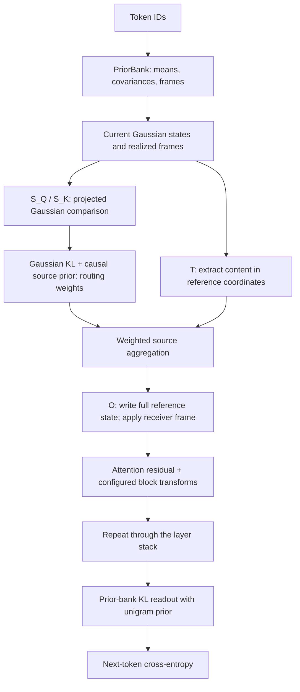

# VFE_3.0

VFE_3.0 is an experimental language model built from Gaussian attention and
learned matrix-valued communication links. Each token carries a mean, covariance, and
local frame. Query and key projections compare Gaussian observables; value and output
maps determine what content is sent and how it enters the receiver's state.

The primary configuration in `train_vfe3.py` uses **full-input/full-output projected
attention with predictive-content readout**. Its attention step directly aggregates
content, with a residual connection. Given routing costs, the attention weights are the
entropy-regularized (Gibbs) minimizer, as they are for any softmax attention; what is
specific to this model is the cost itself, a Gaussian KL divergence between projected
moments. A single latent variational free energy for the complete language model
is not established; the predictor trains on supervised next-token cross-entropy.

This is an independent local copy of `V3_Transformer`. Its source, tests, and
launcher edits were copied before cleanup; training output, caches, environments,
and the source repository's Git metadata were not copied. The Python package
remains `vfe3` to preserve imports and checkpoint parameter names. See
[cleanup and migration notes](docs/implementation/cleanup-migration-2026-09-22.md)
for the simplified configuration and compatibility boundaries.

## Architecture



Every layer has its own query, key, value, and output maps. The current launcher
also enables a block MLP and block LayerNorm. Forward computations use the available
prefix; next-token targets enter the training loss.

| Symbol | Meaning |
|---|---|
| $K$ | Total state dimension (`embed_dim`). |
| $H$ | Communication-head count (`n_heads`). |
| $d=K/H$ | Comparison and value dimension per head in the equal-head implementation. |
| $\ell$ | Layer index, suppressed below for one layer. |
| $U_i$ | Invertible realized frame at token $i$. |
| $(\mu_i,\Sigma_i)$ | Gaussian mean and covariance at that token. |
| $\beta_{ij}^{(h)}$ | Receiver $i$'s routing weight for sender $j$ in head $h$. |

## States, frames, and matrix links

The theory starts from a principal bundle of frames with structure group
$G=\mathrm{GL}(K,\mathbb R)$ and its associated vector and Gaussian-state bundles.
A frame section and a belief section are distinct objects. The finite token model
uses token-indexed fibers and a reference trivialization; it does not require a
smooth contextual base or discretize a continuum connection.

Write the state and its moments in reference coordinates as

$$
q_i=\mathcal N(\mu_i,\Sigma_i),\qquad
\xi_i=U_i^{-1}\mu_i,\qquad
C_i=U_i^{-1}\Sigma_i U_i^{-\top}.
$$

The full-Gaussian theory assumes $\Sigma_i\succ0$. The current launcher selects
`gaussian_full`; the projected route also admits `gaussian_diagonal`. Saved configs
naming `gaussian_diagonal_exact` load as `gaussian_diagonal` (the same function and
parameters); `gaussian_frame_diagonal` is retired and refused on load. A diagonal stored state can yield a dense projected covariance. On the
launcher's route the stored covariance itself stays diagonal, so `gaussian_full` computes
the same function as `gaussian_diagonal` there (see the configuration table below).

### Comparison interfaces

Each head reads all $K$ reference coordinates through

$$
S_{Q,h},S_{K,h}\in\mathbb R^{d\times K}.
$$

The query measures the receiver and the key measures the sender in a common
$d$-dimensional comparison space:

$$
Q_{i,h}=\mathcal N(S_{Q,h}\xi_i,S_{Q,h}C_iS_{Q,h}^{\top}),\qquad
K_{j,h}=\mathcal N(S_{K,h}\xi_j,S_{K,h}C_jS_{K,h}^{\top}).
$$

The routing cost is the directed Gaussian divergence

$$
D_{ij}^{(h)}=D_{\mathrm{KL}}(Q_{i,h}\Vert K_{j,h}).
$$

Setting `relational_routing="noisy_query"` (predictive route only) replaces this cost by the
noisy-query cost of Remark 9 in the v2 manuscript. Writing $Q_{i,h}=\mathcal N(a_i,V_{Q,i})$ and
$K_{j,h}=\mathcal N(b_j,V_{K,j})$ as above, with $W_{ij}=V_{Q,i}+V_{K,j}$,

$$
D_{ij}^{(h)}=\tfrac12(a_i-b_j)^{\top}W_{ij}^{-1}(a_i-b_j)+\tfrac12\log\det W_{ij}-\tfrac12\log\det V_{Q,i}
=-\log\mathcal N(a_i;b_j,W_{ij})-\tfrac12\log\det(2\pi V_{Q,i}).
$$

At unit temperature ($\tau_h=1$, that is `kappa_beta` $=1/\sqrt d$) and while no cost reaches the
`kl_max` clamp, the Gibbs row of the next section,
$\beta_{ij}^{(h)}\propto\pi_{ij}^{(h)}\mathcal N(a_i;b_j,W_{ij})$, is the exact posterior of the
source label when the projected query mean is a noisy measurement of a draw from the key law, so
query uncertainty flattens the row. The last term is a row constant that keeps the cost
nonnegative. The rule adds no parameters, and a model trained with Gaussian-KL routing loads
unchanged. It costs one $d\times d$ Cholesky factorization per token pair, where the KL cost
needs one per key.

Positive-definite projected covariances require full row rank of the comparison
maps. Their rows are initialized orthonormally, then trained as free matrices;
the implementation does not continually orthonormalize them.

The two measurement maps $S_{Q,h}U_i^{-1}$ and $S_{K,h}U_j^{-1}$ do not uniquely
specify a map back into the receiver's full state. Content transmission supplies
that additional choice.

### Sending and receiving interfaces

The full-width sending and receiving maps have shapes

$$
T_h\in\mathbb R^{d\times K},\qquad O_h\in\mathbb R^{K\times d}.
$$

The sender extracts content through $T_hU_j^{-1}$; the receiver places it through
$U_iO_h$. Their composition is the matrix link

$$
L_{ij}^{(h)}=(U_iO_h)(T_hU_j^{-1}).
$$

Each head can read and write every state coordinate through a smaller channel.
$T_h,O_h$ start at corresponding block placements, but their other input columns
and output rows are trainable. **Full input/output describes access scope, not
full covariance.** These interfaces select and place content; no Shannon
channel-capacity or coding theorem is assumed.

A link can be rank deficient even though its endpoint frames are invertible.
It is an additional map on associated vector fibers, not generally a group-valued
principal-bundle transition function. The flat frame identification

$$
\Omega_{ij}=U_iU_j^{-1}
$$

is recovered when the intervening processing map is the identity. Generally,
$O_hT_h\ne I_K$ and $L_{ij}L_{jk}\ne L_{ik}$. Such processing effects do not imply
curvature of the flat reference connection.

### Heads and frame blocks

The current `block_glk` implementation couples the number of equal frame blocks
to the number of heads. The theory distinguishes them: a full-input/output head
can access several frame blocks. Calling each such head an irreducible
representation requires additional restrictions on its interface maps.
Block-diagonal frames alone also do not imply statistical independence of
Gaussian blocks.

## Routing and predictive content

Let $\pi_{ij}^{(h)}$ be a normalized prior on the permitted sources, with zero
mass outside causal support, and let $\tau_h>0$. At fixed states, minimizing

$$
\mathcal F_i^{(h)}(\beta)
=\sum_j\beta_{ij}^{(h)}D_{ij}^{(h)}
+\tau_h\sum_j\beta_{ij}^{(h)}
\log\frac{\beta_{ij}^{(h)}}{\pi_{ij}^{(h)}}
$$

over source probabilities gives

$$
\beta_{ij}^{(h)}
=\mathrm{softmax}_j\left(\log\pi_{ij}^{(h)}-D_{ij}^{(h)}/\tau_h\right).
$$

This Gibbs identity holds for any cost placed in a softmax, including the dot-product
score of ordinary attention, so it does not by itself distinguish this model. The
model-specific content is the choice of $D_{ij}^{(h)}$ as a Gaussian KL divergence
between projected moments, which the construction posits rather than derives.
The projected routes always include the attention entropy; entropy regularization
determines the Gibbs weights without an iterative gradient update over
them. The attention-temperature policy uses `kappa_beta` and head dimensions. The
current launcher selects an unwindowed `causal_alibi` source prior; `attention_window`
is read only by the windowed priors, so the launcher's value is inactive.

Runtime numerical KL bounds apply before softmax. Finite `kl_max` clips large
energies; `float("inf")` removes the upper ceiling while retaining the nonnegative
floor. The implemented energy can therefore differ from the unmodified KL above.

The predictive message and attention output are

$$
m_i=\sum_h\sum_j\beta_{ij}^{(h)}L_{ij}^{(h)}\mu_j,\qquad
\mu_i^{\mathrm{attn}}=
\begin{cases}
\mu_i+m_i,&\text{with attention residual},\\
m_i,&\text{without attention residual}.
\end{cases}
$$

The code extracts values, pools sources, applies output maps, sums heads, and
applies the receiver frame. It need not materialize every $K\times K$ pair link.
These formulas use a common score/value frame, as in the current launcher's
`pos_rotation="none"` setting; optional rotary-position policies can give
comparison and content distinct realized frames.

`predictive_content` leaves covariance unchanged **within this attention step**.
It does not compute the covariance of a Gaussian mixture or a routed population
joint law. Subsequent block transforms and stack handoff have separate covariance
policies. Mean aggregation alone is not exact Gaussian propagation through an
entire nonlinear layer.

**There is no gradient-based inner belief E-step on this branch.** Source means,
routing scores, frames, and content maps retain their outer training graphs.
Outer learning therefore still differentiates through the attention computation.

### Transformer correspondence

Content aggregation has the usual value/output factorization, expressed through
frames. If every projected key covariance in a head equals $C_K$, write
$a_i=S_Q\xi_i$ and $b_j=S_K\xi_j$. Then

$$
-D_{\mathrm{KL}}(Q_i\Vert K_j)
=a_i^\top C_K^{-1}b_j-\frac12 b_j^\top C_K^{-1}b_j
+\text{row constant}.
$$

The score contains a dot product **and a key-norm bias**. Ordinary dot-product
routing additionally requires the bias to be constant or canceled by a specified
source prior, with appropriate temperature scaling. Varying key covariances retain
further uncertainty-dependent terms. The current model does not impose this limit.

## Configuration and training

The editable launcher dictionary is distinct from the defaults in
[`VFE3Config`](vfe3/config.py). These selectors describe the primary route,
rather than a complete standalone configuration:

```python
config.update(
    attention_mode="projected_predictive",
    attention_residual=True,
    relational_routing="gaussian_kl",     # or "noisy_query"
    gauge_group="block_glk",
    n_e_steps=1,
    family="gaussian_full",               # value-identical to gaussian_diagonal on this route
    encode_mode="per_token",
    decode_mode="full_chunked",           # prior-bank KL readout
    decode_unigram_prior=True,
    untie_decode_bank=True,
    beta_attention_prior="causal_alibi",
    fp32_matmul_precision="highest",      # TF32 is not enabled
)
```

The divergence (Gaussian KL), the flat connection with reference frames (links also
include O @ T), filtering gradient roles, the unrolled estimator, the Fisher mean step,
the Mahalanobis-ball mean trust region, and the fixed in-stack frame (no E-step phi
update) are no longer selectors: they are the only behavior, and
`config_from_serialized` drops a saved value equal to it (or inert for that config) and
refuses any other as retired. Equal heads and at least two heads are required. Consult
the validator for the complete admission rules.

| Setting | Effect on the predictive route |
|---|---|
| `attention_mode="projected_predictive"` | Selects projected comparison and direct content aggregation (internal read-only views: `relational_mode="projected_filtering"`, `relational_readout_mode="predictive_content"`). |
| `e_q_mu_lr`, `e_q_sigma_lr` | Unread by the predictive readout. |
| `lambda_alpha`, `lambda_alpha_mode`, `b0`, `c0` | Unused by predictive readout; may affect separately enabled outer self-coupling. |
| `m_relational_score_lr` | Outer rate for $S_Q,S_K$ across layers. |
| `m_relational_content_lr` | Outer rate for $T,O$ across layers. |
| `family="gaussian_full"` | Value-identical to `gaussian_diagonal` here; see below. |
| `encode_mode="per_token_additive"` | Capacity-matched $\Omega=I$ control; requires `pos_phi="none"` and `pos_rotation="none"`. |

Relational rates of `None` inherit `m_p_mu_lr`; `0.0` freezes that role's
parameters while retaining its forward operation. Score and content groups have
zero weight decay.

On this route `family="gaussian_full"` computes the same function as
`gaussian_diagonal` with the rank-matched decoder. The encoder stores the covariance as
the diagonal of a per-token table, the predictive readout keeps it, and under the
inherited `block_mlp_covariance="passthrough"` no later seam densifies it; a float64
probe with shared parameters gives identical losses and an exactly zero off-diagonal
covariance. A genuinely full covariance requires `block_mlp_covariance="delta_full"`,
`predictive_covariance="moment_matched"`, or the covariance updates of
`attention_mode="projected_gradient"`.
`VFE3Config.inactive_fields()`
reports this equivalence, together with every other setting that no active path reads
(for example `lambda_beta`, `sigma_max`, and the congruence-precision knobs on this
route), and `train_vfe3.py` prints the inactive settings it names explicitly at every
launch.

The gauge-frame contrast needs a capacity control. `gauge_transport="off"` removes
the per-token frame table and the positional table together with the group structure,
so on its own it cannot separate frame structure from lookup capacity. The
`per_token_additive` encoder keeps the same learned $(V,n_{\mathrm{gen}})$ table but
applies it as an additive mean shift with $\Omega_{ij}=I$; it is admitted on the projected
routes only with `pos_phi="none"` and `pos_rotation="none"`, since a positional frame
would reintroduce a non-identity transport. A gauge on/off result on this route should
be reported against that arm.

The launcher constructs `VFE3Config` from its dictionary with a per-run seed
override. The model creates one `RelationalOperators` instance per layer and the
stack passes the matching instance to the attention step. Saved configurations
and provenance identify experiments; mutable launcher widths and rates are not
fixed architectural constants.

### Token priors and language-model loss

`PriorBank.encode` initializes states from learned token priors. Token and
configured positional components form the frames. The input bank is present under
every decoder; there is no `use_prior_bank` switch.

The launcher decodes with `decode_mode="full_chunked"`: each vocabulary item $v$ owns a
Gaussian $p_v$ (an untied copy of the token tables under `untie_decode_bank=True`), and
the logits combine the divergence to it with the corpus unigram log-prior,

$$
z_{iv}=-\frac{D_{\mathrm{KL}}(q_i\Vert p_v)}{\tau_{\mathrm{eff}}}+\kappa\log u_v,
$$

with $\tau_{\mathrm{eff}}$ the effective decode temperature, $u_v$ the add-one-smoothed
training-split unigram frequency, and $\kappa$ = `unigram_kappa`.
The softmax of these logits defines a normalized autoregressive model. With
$\mathcal T$ the unmasked targets and $M=|\mathcal T|$,

$$
p_\theta(x_{i+1}\mid x_{\le i})=\mathrm{softmax}(z_i)_{x_{i+1}},\qquad
\mathcal L_{\mathrm{CE}}=-\frac1M\sum_{i\in\mathcal T}
\log p_\theta(x_{i+1}\mid x_{\le i}).
$$

`decode_mode="linear"` instead reads out $z_i=W\mu_i(+b)$ from the final mean and
discards the covariance. Outer backpropagation trains enabled prior, frame, interface,
MLP, normalization, and decoder parameters. Optional outer penalties are separate
choices. This loss is not the same scalar as the variational routing objective.

Prior-bank divergence decoders such as `diagonal_chunked` and `full_chunked` are
available on both supported projected routes. With
`predictive_covariance="passthrough"`, the predictive readout replaces only the mean.
Projected-gradient attention preserves covariance only when its sigma update is disabled.
If no later seam rewrites
covariance, the belief covariance stays at its encode value, so the covariance terms of
the KL readout depend on the input token and the vocabulary item alone. With frozen
$\Sigma_q$ they form a context-free (input token, vocabulary) bias table added to every
logit at scale $1/\tau_{\mathrm{eff}}$, a lookup channel that bypasses attention,
normalization, and the MLP. A gain from switching a linear decode to `full_chunked` in
this passthrough setting cannot be credited to uncertainty-aware decoding without a
control arm for that channel.

With `predictive_covariance="moment_matched"`, the predictive readout instead replaces
both the mean and covariance with its kernel's moments. The resulting covariance
depends on context and does not reduce to the frozen input-token bias table. Context
dependence alone does not establish calibration quality or predictive benefit; those
require matched empirical comparisons.

### Full-link belief revision

`attention_mode="projected_gradient"` uses full-width comparison and content maps,
freezes incoming source and routing values for an inference episode, and updates the
receiver mean and covariance against a frozen receiver energy. Multiple E-steps reuse
this episode context. Sources and routing retain their outer gradient graph. This
objective differs from predictive content aggregation. The derivations are in
`Research/manuscripts/Attention/projected_gradient.tex`.

`relational_receiver_law="channel_likelihood"` (default) scores the receiver's partial
law $O_h^\top\xi_i$ against each sender's $d$-dimensional message $T_h\xi_j$ as an
expected likelihood with channel floor `relational_receiver_noise`. It counts the
receiver entropy once, so its minimizer is the exact tempered Gaussian posterior, and
directions no head observes stay at the prior. `"ambient_alignment"` is the original
sum of KLs to $K$-dimensional laws with noise $\nu I_K$; it counts the entropy
$\alpha+\sum_h\lambda_h$ times and pulls each head's unwritten coordinates toward zero.
`relational_receiver_update="closed_form"` (default) applies the exact frozen-context
natural-parameter update with damping `relational_receiver_damping` in $(0,1]$
($1$ is the minimizer; then extra E-steps change nothing). `"euler"` is the explicit
Fisher step governed by `e_q_mu_lr`, `e_q_sigma_lr` and the trust radii; it is stable
only for `e_q_mu_lr` below $2/\lambda_{\max}(\Sigma\Lambda)$. Serialized configs that
predate these fields reload as `ambient_alignment` with `euler`.

Both supported attention modes have fixed full input and output. Every head reads
and writes all $K$ state coordinates through a reduced $d=K/H$ channel. Q/K/T have
shape $(H,d,K)$ and O has shape $(H,K,d)$; the maps contribute $4K^2$ parameters per
layer. There are no configurable input/output scope fields or identity-content arm.

`projected_gradient` requires constant alpha (positive under `channel_likelihood`),
`predictive_covariance="passthrough"`, `attention_residual=False`, `n_e_steps>=1`,
`relational_routing="gaussian_kl"`, `family` in {`gaussian_diagonal`, `gaussian_full`},
filtering, and unrolled updates. Under `euler` its inner mean and covariance learning
rates are active and need calibration; under `closed_form` they are inert.

Serialized retained-mode configurations with historical full/full scopes are accepted
and have those keys removed. Head-scoped configurations, identity content, and the
retired `transported` and `projected_conditional` modes require explicit architecture
migration; the loader never silently translates them into a different forward.

## Geometry and scope

For consistently transformed full Gaussian data, the passive endpoint change

$$
\mu_i\mapsto g_i\mu_i,\quad
\Sigma_i\mapsto g_i\Sigma_i g_i^\top,\quad
U_i\mapsto g_iU_i
$$

leaves reference measurements and routing invariant and yields

$$
L_{ij}^{(h)}\mapsto g_iL_{ij}^{(h)}g_j^{-1}.
$$

This is a property of the attention construction, not an unrestricted symmetry
guarantee for the entire executable model. Diagonal projection, coordinate
LayerNorm, nonlinear MLPs, numerical clipping, and a fixed vocabulary decoder
each require their own analysis. Full-Gaussian theory and the selected executable
approximation should remain distinct.

## Implementation map

| Responsibility | Source |
|---|---|
| Defaults, compatibility, inactive-setting advisories | [`config.py`](vfe3/config.py) |
| Per-layer interfaces and factorized aggregation | [`relational_operators.py`](vfe3/model/relational_operators.py) |
| Projected Gaussian scoring | [`relational_scoring.py`](vfe3/relational_scoring.py) |
| Projected routing score and predictive readout | [`relational.py`](vfe3/gradients/relational.py) |
| Full-link receiver laws, gradients and closed-form update | [`full_link.py`](vfe3/gradients/full_link.py) |
| Gibbs weights and optional objectives | [`free_energy.py`](vfe3/free_energy.py) |
| Runtime branch selection | [`e_step.py`](vfe3/inference/e_step.py) |
| Encoding and alternative decoders | [`prior_bank.py`](vfe3/model/prior_bank.py) |
| Groups, frames, and reference transport | [`geometry/`](vfe3/geometry/) |
| Model and stack | [`model.py`](vfe3/model/model.py), [`stack.py`](vfe3/model/stack.py) |
| Block transforms | [`block.py`](vfe3/model/block.py), [`block_mlp.py`](vfe3/model/block_mlp.py) |
| Outer optimizer and training | [`train.py`](vfe3/train.py) |
| Belief representations and families | [`belief.py`](vfe3/belief.py), [`families/`](vfe3/families/) |

Registries expose distribution, divergence, transport, encoding, decoding, and
other extension points. Configuration guards and runtime contracts determine
which combinations the projected route supports.

## Running the repository

### Installation and data

Use Python 3.10 or newer. Install the project and its development, data, and visualization
extras from the repository root:

```powershell
python -m pip install -e ".[dev,data,viz]"
```

Real-corpus entrypoints are cache-only. They expect pre-tokenized `.pt` streams or
`.bin` streams with their sidecars under `~/.cache/tokenized_cache`. The loaders do not
download, tokenize, or replace a missing real corpus with synthetic data.

That applies to the loaders, not to the corpus builders. The word-level WikiText-103 cache is
built by a script that does fetch and tokenize:

```powershell
python build_wikitext103_word_cache.py
```

It pins the corpus revision, tokenizes on whitespace, and writes the `wikitext-103-word` caches
plus their vocabulary sidecar. Setting `DATASET = "wikitext-103-word"` in an entrypoint selects
them, and `vocab_size` follows the dataset automatically. The word vocabulary is the measured
reference set (267,734 ids: the training split's distinct tokens, with the corpus's own `<unk>`
marker at id 0), which is far larger than the GPT-2 vocabulary, so token tables and
vocabulary readout can dominate parameter and memory cost.
Setting `MIN_COUNT` in `build_wikitext103_word_cache.py` and rebuilding applies a frequency
cutoff that trades vocabulary size against OOV.

### Click-to-run workflow

Entrypoints do not parse command-line configuration. Edit the configuration dictionary
near the top of the selected script, then run it directly:

```powershell
python train_vfe3.py
```

Use a CUDA-enabled PyTorch environment for GPU training. On the author's workstation
this is `C:/anaconda/python.exe`; bare `python` resolves to a CPU-only installation.
The launcher checks CUDA availability, so the wrong interpreter can select CPU.

| Entrypoint | Scope |
|---|---|
| [`train_vfe3.py`](train_vfe3.py) | Primary cached-corpus training, evaluation, and finalization path. |
| [`ablation.py`](ablation.py) | Named architecture and configuration ablations. |
| [`scaling.py`](scaling.py) | Independent baseline with width, depth, joint-size, and training-budget grids; see [scaling settings](docs/scaling-settings.md). |
| [`make_figures.py`](make_figures.py) | Regenerates eligible figures from a saved run. |

### Focused validation

Locate tests relevant to the changed path:

```powershell
rg --files tests | rg "relational|predictive|projected"
```

Run selected files with `python -m pytest tests/<selected_file>.py`. The pytest
configuration already supplies quiet output. For device-aware CUDA tests, select a
CUDA-enabled interpreter and set `$env:VFE3_TEST_DEVICE = "cuda"`. Setting that
variable alone does not make a CPU-only PyTorch installation CUDA-capable.
CPU model tests should use tiny dimensions. Tests own their configuration through
`tests.profiles.test_config(**overrides)` or the smaller `tiny_config(**overrides)`
profile. Both supply every constructor field explicitly from a checked-in test
mapping, so editing `vfe3/config.py` defaults does not choose test behavior. Set
any toggle a test depends on in its local overrides. Use `config_values(**overrides)`
for dictionaries passed to launchers or serialized-config loaders, and monkeypatch
the launcher dictionary inside the test instead of asserting live experiment settings.
When adding a config field, add an explicit test baseline value in `tests/profiles.py`;
the schema coverage check in `tests/test_config_isolation.py` identifies omissions.

## Outputs and diagnostics

When a [`RunArtifacts`](vfe3/run_artifacts.py) instance is supplied, a run directory under
`vfe3_runs/` becomes the durable record.

| Artifact | Contents |
|---|---|
| `config.json` | Full configuration plus run metadata. |
| `metrics.csv` | Periodic training, validation, and diagnostic rows. |
| `checkpoints/step_<N>.pt` | Resumable model, optimizer, RNG, configuration, and step state. |
| `best_model.pt` | Semantic best-validation model bundle with configuration fingerprint. |
| `final_model.pt` | Fully trained weights with configuration and code identity; used for final testing and reports. |
| `final_validation.json` | Validation metrics at the final training step. |
| `test_results.json` | Held-out test evaluation of the final training weights, with the evaluated step recorded. |
| `provenance.json` | Git, environment, and dataset provenance. |
| `summary.json` | Headline end-of-run values and timing. |
| `pure_path_report.json` | Configuration audit attempted during every finalization; write failures are logged and skipped. |
| `research.json` and figure files | Optional research probes and diagnostic or publication-oriented plots. |

All finalization-time plotting and plot-only model replays obey `generate_figures`. Setting it to
`False` is a strict compute and filesystem opt-out. `make_figures.py` later regenerates the
model-replay publication set, missing depth/phi probes, and every history dashboard supported by the
run's persisted metrics. A full-resolution `loss_curve.png` is available only when end-of-training
figure generation receives the in-memory per-step loss history; strict-opt-out runs persist cadence-
sampled losses rather than that complete list. Numeric artifacts remain available when optional
visualization fails.

### Figure registry and report selection

`vfe3/viz/figures.py` registers every figure generator under a name through `register_figure`;
`get_figure` resolves that name to a callable at call time. Registration and report selection are
separate steps: a registered generator is merely available, and becomes production-reachable only
when some report driver selects it by name, either through a `vfe3.viz.specs.FigureSpec` (name,
output filename, and an adapter mapping a shared context to that generator's kwargs or to `None`
to skip) dispatched by `emit_registered_figures`, or, for a scalar diagnostic, through the
`DIAGNOSTIC_METRIC_OUTPUTS` name list in `vfe3/metrics.py` that `VFEModel.diagnostics()` reads.
`emit_registered_figures` isolates failures per spec and publishes each output atomically (a
same-directory temporary file replaces the target only after a nonempty write succeeds), so one
builder crashing, or an adapter returning `None`, withholds only that one figure.

Two production drivers dispatch through this seam. `scaling_analysis.analyze()` writes
`capacity_scaling.png` and `pareto_frontier.png` under `<input_dir>/figures/` alongside the
existing `scaling_points.csv` / `scaling_summary.json` / `SCALING_ANALYSIS.md` / legacy figures;
both read `vfe3.viz.sweep_adapters.aggregate_validation_points`, which collapses seeds into one
point per `(route, label)` keyed on each run's persisted `best_val_ppl` (never a test metric), so
neither figure requires the held-out test split the rest of the scaling report uses. An axis or
the whole figure is withheld, not fabricated, when a required route never ran or a point is
missing. `ablation.py`'s per-sweep loop writes `ablation_forest.png` for any sweep declaring
`paired_token_bootstrap=True` (reading each cell's persisted `val_token_nats.pt`, whose numel and
dtype must match its `ablation_result.json` marker)
and `lr_grid_heatmap.png` for any sweep declaring `grid_x`/`grid_y` (requiring the exact declared
Cartesian product of cells, each carrying a finite `primary_val_ppl`), alongside the existing
`sweep_results.csv` / `sweep_meta.json` / per-sweep PPL figure. The two sweeps that populate these
figures, `component_ablation_forest` and `e_q_mu_sigma_lr_grid`, are registered but kept out of
`SWEEP_ORDER`, so a default ablation run does not pay for them; naming either sweep explicitly
runs it and its figure.

## Theory and manuscripts

This README follows `GL(K)_attention_v2.tex`. The current manuscript sources are
maintained outside this checkout in the author's `Research/manuscripts/` directory:

| Document | Scope |
|---|---|
| `GL(K)_attention_v2.tex` | Principal/associated bundles, comparison interfaces, matrix links, token priors, predictive composition, and transformer correspondence. |
| `GL(K)_supplementary_v2.tex` | Supporting probabilistic, covariance, nonlinear-closure, and causal-prediction results. |
| `GL(K)_gradients.tex` | Optional variational belief objectives, derivatives, and gradient updates. |
| `PIFB2.tex` | Broader contextual bundle/variational framework; not an implemented multiscale language-model specification. |

The current v2 set is maintained in that external manuscript directory. The
formulas and implementation map above describe the architecture without depending
on older manuscript copies.

The `grow_K_mup` scaling route varies `e_q_mu_lr` and requires gradient belief
updates; it rejects `predictive_content`, which does not read that rate.
Use the standard width/depth/budget grids for predictive content; see
[scaling settings](docs/scaling-settings.md).

Decoder memory/compute options and independent mean/variance rates are documented in [Decoder controls](docs/decoder-controls.md).
