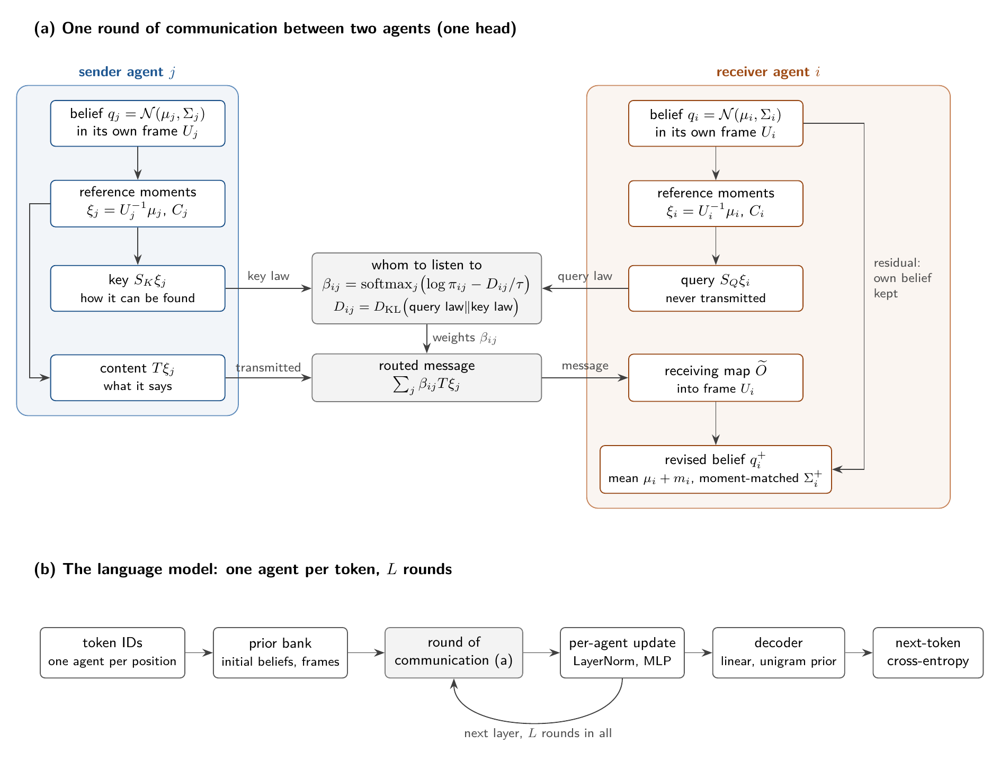
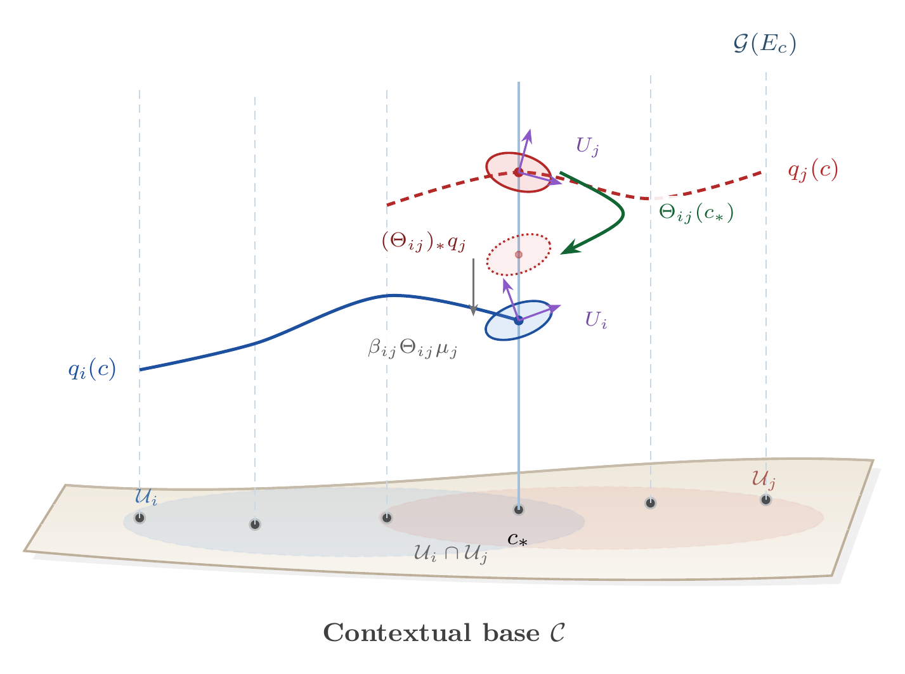

# VFE_3.0

VFE_3.0 is an experimental language model built as a population of communicating
agents. Every token is modeled as an agent. Each agent holds a Gaussian belief (a mean and a
covariance) expressed in its own internal coordinate frame. One attention layer is one round
of communication among the agents: every agent decides whom to listen to,
every sender transmits a low-rank part of what it believes, and every receiver brings what
it hears back into its own frame and revises its belief. The decision of whom to hear and
the content that is heard pass through separate learned interfaces, one set per head:

| Interface | Belongs to | Role in the exchange |
|---|---|---|
| Query map $S_{Q,h}$ | receiver | what the receiver asks about; it is compared, never transmitted |
| Key map $S_{K,h}$ | sender | how the sender can be found |
| Sending map $T_h$ | sender | what the sender says: the transmitted content |
| Receiving map $O_h$ (or $\widetilde O_h$ in a content-link chart) | receiver | how the receiver absorbs what it heard into its full state |
| Frame $U_i$ | each agent | the agent's private coordinate system |

The routing weights are each receiver's distribution over whom to hear, computed from a
Gaussian divergence between the receiver's query law and each sender's key law under a
causal prior over sources. Under a declared binary compatibility record these weights are
the exact posterior of the source label (v2 manuscript, Theorem `thm:probabilistic_status`),
as they would be for any nonnegative routing cost, so this posterior reading does not by
itself distinguish the model from a conventional softmax router; what distinguishes it is
the cost, a Gaussian divergence between belief laws. Within one attention step on
full-covariance states, every interface acts on reference coordinates, so an agent's private
change of frame changes nothing that any other agent computes, and the messages transform
covariantly. The default and launcher configurations do not keep this property across the
whole model: the diagonal family cannot represent $g\Sigma g^\top$, and local
`block_coordinates` and `decode_coordinates` apply the block norm, the block MLP and the
decoder to frame-dependent coordinates. Setting `family="gaussian_full"` with
`block_coordinates="reference"` and `decode_coordinates="reference"` on the
projected-predictive route with `rope_mode` `none` or a comparison mode (frame-space RoPE
folds a rotation into the content frame; these admit a `none` or `layernorm` norm and the
coordinate, Gaussian-template or prototype block MLP, all conjugated by the realized frame)
gives the frame-covariant path.
In this sense the model expresses coordination among agents as inference: whom to trust, how
much to absorb, and how uncertain each agent remains after the exchange.

The primary configuration in `train_vfe3.py` uses **full-input/full-output projected
attention with predictive-content readout**. Its attention step directly aggregates
content, with a residual connection. Given routing costs, the attention weights are the
entropy-regularized (Gibbs) minimizer, as they are for any softmax attention; what is
specific to this model is the cost itself, a Gaussian KL divergence between projected
moments. A single latent variational free energy for the complete language model
is not established; the predictor trains on supervised next-token cross-entropy.

This is a refactored and extended version of an earlier iteration `V3_Transformer' (see repo). 

## Architecture

<p align="center">
  
</p>

The figure is drawn in TikZ ([`assets/agent_round.tex`](assets/agent_round.tex), build
commands in its header).

The current launcher also enables a block MLP and block LayerNorm, which act on each
agent separately between rounds (although these features are not theoretically principled 
under the current gauge theoretic construction). Communication is causal: an agent hears 
only agents at earlier or equal positions, and next-token targets enter the training loss.

| Symbol | Meaning |
|---|---|
| $K$ | Dimension of every agent's belief state (`embed_dim`). |
| $H$ | Number of communication heads, or channels (`n_heads`). |
| $d=K/H$ | Comparison and content dimension per head in the equal-head implementation. |
| $\ell$ | Layer index, one round of communication; suppressed below. |
| $U_i$ | Invertible realized frame of agent $i$. |
| $(\mu_i,\Sigma_i)$ | Gaussian mean and covariance of agent $i$'s belief. |
| $\beta_{ij}^{(h)}$ | Receiver $i$'s weight on sender $j$ in head $h$. |

## Agents: beliefs, frames, and links

Agent $i$ carries a belief $q_i$, a prior $p_i$ from the token's prior bank, and a frame
$U_i$, its private coordinate system. Geometrically the agents are sections of bundles over
a single base point, the shared context: the theory starts from a principal bundle of frames
with structure group $G=\mathrm{GL}(K,\mathbb R)$ and its associated vector and Gaussian-state
bundles, and a frame section and a belief section are distinct objects. The finite token
model uses token-indexed fibers and a reference trivialization; it does not require a smooth
contextual base or discretize a continuum connection.

<p align="center">
  
</p>

*Statistical sections, frames, and a group link (Figure 1 of the v2 manuscript; TikZ source
[`assets/bundle_geometry.tex`](assets/bundle_geometry.tex)).* Over a general contextual base
$\mathcal C$, the curves are the beliefs $q_i$, $q_j$ of two agents, sections of the
statistical bundle over their overlapping domains. The token model keeps only the fiber over
the single context $`c_*`$ (solid line), where the glyphs carry the frames $U_i$, $U_j$. The
green arrow applies the group link $\Theta_{ij}=U_ie^{L_{ij}}U_j^{-1}$, the dotted contour is
the pushforward $`(\Theta_{ij})_*q_j`$, which the receiver's belief need not equal, and the gray
arrow is the contribution $\beta_{ij}\Theta_{ij}\mu_j$ to the receiver's mean.

Write an agent's belief and its moments in reference coordinates as

$$
q_i=\mathcal N(\mu_i,\Sigma_i),\qquad
\xi_i=U_i^{-1}\mu_i,\qquad
C_i=U_i^{-1}\Sigma_i U_i^{-\top}.
$$

The full-Gaussian theory assumes $\Sigma_i\succ0$. The current launcher selects
`gaussian_diagonal`; the projected route also admits `gaussian_full`. Saved configs
naming `gaussian_diagonal_exact` load as `gaussian_diagonal` (the same function and
parameters); `gaussian_frame_diagonal` is retired and refused on load. A diagonal stored
state still yields dense projected covariances through the frames. Under the launcher's
moment-matched predictive covariance, the diagonal family keeps the diagonal of the local
moment-matched covariance (the moment projection onto diagonal Gaussians) while
`gaussian_full` keeps it dense, so the two families compute different functions; they
coincide only when no seam densifies the covariance (see the configuration section below).

`family="gaussian_block"` keeps one SPD $d\times d$ covariance block per head, the smallest
SPD family closed under the block_glk congruence. It is stored in the dense $(K, K)$ layout
with zero off-head blocks, and the moment-matched update returns the head blocks
$U_{i,h}[C_i^{\mathrm{att}}]_{hh}U_{i,h}^\top$, the moment projection onto the family, which
does not depend on the frame. It is defined on the kernel predictive readout with compact
head-block frames (block_glk, block_so, block_co, block_sl, block_borel, block_unipotent,
block_glmc or an equal-block so_n or su_n tower, any tying), edge links off, a block MLP whose
covariance is read through its head-block projection (`posterior` needs
`block_mlp_inference="mean_field"`), no CG coupling, and the `linear`,
`diagonal_chunked` or `full_chunked` decoders (the diagonal decoder reads
$\operatorname{diag}\Sigma_i$, exact up to a per-position constant). With identity frames
(`gauge_transport="off"`), `prior_covariance_table="block_cholesky"` replaces the diagonal
variance table by per-type head blocks $C_{vh}=L_{vh}L_{vh}^\top$ (log-diagonal Cholesky,
`sigma_chol_embed`), so that `mu_embed` and the blocks hold $(\xi_v, C_v)$ and the model
represents what the learned-frame reference arm represents without a frame table; it
needs a full-layout family and an untied decode bank (or the linear decoder).

### Whom to listen to: query and key

A receiving agent decides whom to hear by comparing what it asks with how each sender
presents itself. Each head reads all $K$ reference coordinates through

$$
S_{Q,h},S_{K,h}\in\mathbb R^{d\times K}.
$$

The query measures the receiver and the key measures the sender in a common
$d$-dimensional comparison space. The query is the receiver's own question and is never
transmitted; the key is the part of the sender's belief that makes it findable:

$$
Q_{i,h}=\mathcal N(S_{Q,h}\xi_i,S_{Q,h}C_iS_{Q,h}^{\top}),\qquad
K_{j,h}=\mathcal N(S_{K,h}\xi_j,S_{K,h}C_jS_{K,h}^{\top}).
$$

The routing cost is the directed Gaussian divergence

$$
D_{ij}^{(h)}=D_{\mathrm{KL}}(Q_{i,h}\Vert K_{j,h}).
$$

Setting `relational_routing="noisy_query"` (predictive route only) replaces this cost by the
noisy-query cost of Remark 9 in the v2 manuscript. Writing $Q_{i,h}=\mathcal N(a_i,V_{Q,i})$ and
$K_{j,h}=\mathcal N(b_j,V_{K,j})$ as above, with $W_{ij}=V_{Q,i}+V_{K,j}$,

$$
D_{ij}^{(h)}=\tfrac12(a_i-b_j)^{\top}W_{ij}^{-1}(a_i-b_j)+\tfrac12\log\det W_{ij}-\tfrac12\log\det V_{Q,i}
=-\log\mathcal N(a_i;b_j,W_{ij})-\tfrac12\log\det(2\pi V_{Q,i}).
$$

At unit temperature ($\tau_h=1$, that is `kappa_beta` $=1/\sqrt d$) and while no cost reaches the
`kl_max` clamp, the Gibbs row of the next section,
$\beta_{ij}^{(h)}\propto\pi_{ij}^{(h)}\mathcal N(a_i;b_j,W_{ij})$, is the exact posterior of the
source label when the projected query mean is a noisy measurement of a draw from the key law, so
query uncertainty flattens the row. The last term is a row constant that keeps the cost
nonnegative. The rule adds no parameters, and a model trained with Gaussian-KL routing loads
unchanged. It costs one $d\times d$ Cholesky factorization per token pair, where the KL cost
needs one per key.

Positive-definite projected covariances require full row rank of the comparison
maps. Their rows are initialized orthonormally, then trained as free matrices;
the implementation does not continually orthonormalize them.

The two measurement maps $S_{Q,h}U_i^{-1}$ and $S_{K,h}U_j^{-1}$ do not uniquely
specify a map back into the receiver's full state. Content transmission supplies
that additional choice.

### What is said and how it is heard: sending and receiving maps

A sender transmits only a $d$-dimensional part of its $K$-dimensional belief, and the
receiver must decide how that partial message enters its full state. The full-width sending
and receiving maps have shapes

$$
T_h\in\mathbb R^{d\times K},\qquad O_h\in\mathbb R^{K\times d}.
$$

The sender extracts content through $T_hU_j^{-1}$ from its own frame; the receiver places it
through $U_iO_h$ into its own frame. Their composition is the matrix link from agent $j$ to
agent $i$,

$$
L_{ij}^{(h)}=(U_iO_h)(T_hU_j^{-1}).
$$

Each head can read and write every state coordinate through a smaller channel.
$T_h,O_h$ start at corresponding block placements, but their other input columns
and output rows are trainable. **Full input/output describes access scope, not
full covariance.** These interfaces select and place content; no Shannon
channel-capacity or coding theorem is assumed.

A link can be rank deficient even though its endpoint frames are invertible.
It is an additional map on associated vector fibers, not generally a group-valued
principal-bundle transition function. The flat frame identification

$$
\Omega_{ij}=U_iU_j^{-1}
$$

is recovered when the intervening processing map is the identity. Generally,
$O_hT_h\ne I_K$ and $L_{ij}L_{jk}\ne L_{ik}$. Such processing effects do not imply
curvature of the flat reference connection.

### Heads as communication channels

Each head is a separate low-rank channel with its own query, key, sending, and receiving
maps, and each receiver routes every channel independently. The current `block_glk`
implementation couples the number of equal frame blocks to the number of heads. The theory distinguishes them: a full-input/output head
can access several frame blocks. Calling each such head an irreducible
representation requires additional restrictions on its interface maps.
Block-diagonal frames alone also do not imply statistical independence of
Gaussian blocks.

## Routing and message passing

Each receiving agent spreads its attention over the agents it may hear. Let
$\pi_{ij}^{(h)}$ be a normalized prior on the permitted sources, with zero
mass outside causal support, and let $\tau_h>0$. At fixed states, minimizing

$$
\mathcal F_i^{(h)}(\beta)
=\sum_j\beta_{ij}^{(h)}D_{ij}^{(h)}
+\tau_h\sum_j\beta_{ij}^{(h)}
\log\frac{\beta_{ij}^{(h)}}{\pi_{ij}^{(h)}}
$$

over source probabilities gives

$$
\beta_{ij}^{(h)}
=\mathrm{softmax}_j\left(\log\pi_{ij}^{(h)}-D_{ij}^{(h)}/\tau_h\right).
$$

This Gibbs identity holds for any cost placed in a softmax, including the dot-product
score of ordinary attention, so it does not by itself distinguish this model. The
model-specific content is the choice of $D_{ij}^{(h)}$ as a Gaussian KL divergence
between projected moments, which the construction posits rather than derives.
The projected routes always include the attention entropy; entropy regularization
determines the Gibbs weights without an iterative gradient update over
them. The attention-temperature policy uses `kappa_beta` and head dimensions
($\tau_h=\kappa\sqrt{d}$; the launcher's `kappa_beta=1` gives $\tau_h=\sqrt d$). Position
can enter through learned positional frames (`pos_phi="learned"`), through rotary positions
(`rope_mode`: folded into the frame under `"frame"` or `"frame_value"`, or applied to the
projected comparison moments under `"comparison"` or `"comparison_invariant"`), or through an ALiBi source
prior (`beta_attention_prior="causal_alibi"`). The launcher dictionary in `train_vfe3.py`
holds the current choice and each run records its own in `config.json`; the reported K = 128
run (34.48 test perplexity) used the uniform `causal` prior with learned positional frames and
no rotation.
`attention_window` is read only by the windowed priors, so the launcher's value is inactive.

Runtime numerical KL bounds apply before softmax. Finite `kl_max` clips large
energies; `float("inf")` removes the upper ceiling while retaining the nonnegative
floor. The implemented energy can therefore differ from the unmodified KL above.

The message a receiver assembles from what it heard, and its revised mean, are

$$
m_i=\sum_h\sum_j\beta_{ij}^{(h)}L_{ij}^{(h)}\mu_j,\qquad
\mu_i^{\mathrm{attn}}=
\begin{cases}
\mu_i+m_i,&\text{with attention residual},\\
m_i,&\text{without attention residual}.
\end{cases}
$$

The code extracts values, pools sources, applies output maps, sums heads, and
applies the receiver frame. It need not materialize every $K\times K$ pair link.
These formulas use a common score/value frame, as under `rope_mode="none"`; the
rotary-position policies can give comparison and content distinct realized frames.

Under `predictive_covariance="passthrough"`, `predictive_content` leaves covariance
unchanged **within this attention step**. Under `predictive_covariance="moment_matched"`
it replaces the covariance by the exact moment-matched covariance of the predictive
kernel (Theorem `thm:probabilistic_status` (2) of the v2 manuscript): source covariances
pushed through the head maps, cross-head terms, the between-source spread, the residual
persistence term, and the prior-anchored floor $f\Sigma_{p,i}$, with $f$ =
`predictive_covariance_floor` and $\Sigma_{p,i}$ the token's local prior covariance (the layer
prior, the embedding prior under `prior_handoff_sigma=0`). The floor involves no frame, so a
common reference change leaves the covariance unchanged. It replaced the floor
$f(\mathrm{tr}C_i/K)I$ in reference coordinates on 2026-10-12, which remains selectable as
`predictive_covariance_floor_mode="relative"`. A configuration saved before then records no floor
mode and no `phi_frame_condition_max` (added the same day), and `config_from_serialized` reloads
it with `"relative"`, the floor it trained under; one saved between 2026-10-12 and the
floor-mode field (2026-10-16) carries `phi_frame_condition_max` and reloads with `"prior"`.
Neither is a routed population
joint law. Subsequent block transforms and
stack handoff have separate covariance policies, and neither contract is exact Gaussian
propagation through an entire nonlinear layer.

**There is no gradient-based inner belief E-step on this branch.** Source means,
routing scores, frames, and content maps retain their outer training graphs.
Outer learning therefore still differentiates through the attention computation.

### Transformer correspondence

Content aggregation has the usual value/output factorization, expressed through
frames. If every projected key covariance in a head equals $C_K$, write
$a_i=S_Q\xi_i$ and $b_j=S_K\xi_j$. Then

$$
-D_{\mathrm{KL}}(Q_i\Vert K_j)
=a_i^\top C_K^{-1}b_j-\frac12 b_j^\top C_K^{-1}b_j
+\text{row constant}.
$$

The score contains a dot product **and a key-norm bias**. Ordinary dot-product
routing additionally requires the bias to be constant or canceled by a specified
source prior, with appropriate temperature scaling. Varying key covariances retain
further uncertainty-dependent terms. The current model does not impose this limit.

## Content-link charts and edge-dependent links

A message travels from the sender's frame to the receiver's frame through a link. This
section concerns how that link is parameterized: one shared group element per layer, or a
link that depends on the pair of agents that communicate.

### Content-link charts

`content_link_chart` selects the effective receiving map built from the stored
factors $(O,T)$. With the row stack $T=[T_1;\cdots;T_H]$ square and invertible (tiled
heads, $Hd=K$) and $L=OT$,

$$
\widetilde O_{\text{affine}}=O,\qquad
\widetilde O_{\text{first-order}}=T^{-1}+O,\qquad
\widetilde O_{\text{exponential}}=T^{-1}+O\varphi_1(TO)=e^{L}T^{-1},
$$

with $\varphi_1(Z)=\sum_{n\ge1}Z^{n-1}/n!$. Writing $\Pi_h=T^{-1}\Delta_hT$ for the
oblique projector onto head $h$'s block ($\Delta_h$ selects that block) and
$\Pi(\beta_{ij})=\sum_h\beta_{ij}^{(h)}\Pi_h$, the exponential-chart message is

$$
m_i=U_i\sum_je^{L}\Pi(\beta_{ij})\xi_j ,
$$

so each head keeps the oblique component of the source that no other head reads, and one
group element $e^{L}\in\mathrm{GL}^+(K)$ transports the routed components into the
receiver: the shared-generator link $\Theta_{ij}=U_ie^{L}U_j^{-1}$ of the v2 manuscript
(Theorem `thm:routed_transport`). The affine chart is the standard value/output path, and
stored $O=0$ means zero content there but the head-routed flat transport in the other two
charts. The non-affine charts invert $T$ and evaluate $\varphi_1$ once per layer in float64.

### Edge-dependent links

With one generator per layer, every triangle holonomy $\Theta_{ik}^{-1}\Theta_{ij}\Theta_{jk}$
is conjugate to $e^{L}$, so a layer's link field has a single holonomy class.
`content_link_edges` gives every edge $j\to i$ its own reference link

$$
G_{ij}=g_ie^{L}E_{ij},\qquad E_{ij}=I_K+A_i\Phi_{ij}B_j^\top,\qquad
\hat x_i=\frac{\xi_i}{(K^{-1}\lVert\xi_i\rVert^2+10^{-12})^{1/2}},
$$

with rank-$r$ factors $A_i,B_j\in\mathbb R^{K\times r}$ read by learned linear maps from the
RMS-normalized reference mean $\hat x$, which is invariant under the passive frame action.

| Mode | Factors | Link | Holonomy |
|---|---|---|---|
| `"lowrank"` (curved) | $A_i=a(\hat x_i)$, $B_j=b(\hat x_j)$, $g_i=I$, $\Phi_{ij}=\varphi_1(B_j^\top A_i)$ | $G_{ij}=e^{L}\exp(A_iB_j^\top)$ | varies from triangle to triangle |
| `"pure_gauge"` (pure-gauge control, holonomy conjugate to $e^{L}$) | shared basis $A$, $B_j=b(\hat x_j)$, $g_i=\exp(AB_i^\top)$, $\Phi_{ij}=-\varphi_1(-B_j^\top A)$ | $G_{ij}=g_ie^{L}g_j^{-1}$ | every triangle conjugate to $e^{L}$ |

Both follow from $\exp(AB^\top)=I+A\varphi_1(B^\top A)B^\top$. The pure-gauge arm has the same
kind of content dependence and no holonomy beyond the shared class, so it is the control
that separates curvature from content-dependent transport; it is not parameter-matched
($K^2r+Kr$ against $2K^2r$ parameters per layer). The sender map $b$ starts at zero, so both
modes start exactly at the exponential chart. The message factors as
$m_i=U_ig_i\widetilde O(z_i+TA_iy_i)$, where $z_i$ stacks the pooled head values
$\sum_j\beta_{ij}^{(h)}T_h\xi_j$, $y_i=\sum_j\Phi_{ij}c_{ij}$, and
$c_{ij}=\sum_h\beta_{ij}^{(h)}(T^{-\top}B_j)_h^\top T_h\xi_j$, so the curved mode needs one
$r\times r$ matrix function per causal edge and the control two per token, and the
moment-matched covariance gains rank-$r$ corrections. The argument of $\varphi_1$ is zeroed
on masked pairs before evaluation, so large factors on future pairs cannot produce
non-finite values. Edge links require `content_link_chart="exponential"`,
`attention_mode="projected_predictive"` and equal heads; the post-hoc holonomy analysis and
the full-link gradient path refuse edge-enabled models.

### Latent receiver factors

`content_link_latent=True` (curved mode only) treats the receiver factor $A_i$ as a latent
variable with prior $\mathcal N(a(\hat x_i),\sigma_L^2I)$ and estimates it per context.
Only the receiver factor is inferred: a sender factor $B_j$ enters every later receiver's
links, so inferring it would leak future tokens into position $j$. The link energy is a
modeling choice, not the layer free energy restricted to $A_i$. With the transport covariance
fixed by choice at $Q_i=(\mathrm{tr}C_i/K)I$, which makes the energy scale-free, profiling out
the receiver's next-layer mean in a one-transition filtering approximation reduces it to the
dimensionless predictive variance $\mathrm{tr}C_i^{\mathrm{att}}/(2\mathrm{tr}C_i/K)$ (the
moment-matched covariance without its floor). Nothing in this term rewards a link for carrying
content; it penalizes predictive spread. The per-receiver energy is

$$
\mathcal F_i(A_i)=\frac{\mathrm{tr}C_i^{\mathrm{att}}(A_i)}{2\mathrm{tr}C_i/K}
+\frac{\lVert A_i-a(\hat x_i)\rVert_F^2}{2\sigma_L^2}
+\lambda_W\sum_{i-w\le k\lt j\le i}w_{ijk}\tfrac12\lVert W_{ijk}-I\rVert_F^2 ,
$$

where the optional loop prior compares two-step routes across layers through
$W_{ijk}=(G_{ik}^{\ell+1}G_{kk}^{\ell})^{-1}G_{ij}^{\ell+1}G_{jk}^{\ell}$ with weights from
the routing prior. The upper layer's shared generator cancels in $W_{ijk}$, so the
shared-generator model is loop-flat. The estimate is $T$ damped steps
$A\leftarrow(1-\rho)A+\rho(A-\sigma_L^2\nabla_A\mathcal F_i(A))$; the inner step is the unit
natural-gradient step in the prior's Fisher metric, and its fixed points are the stationary
points of $\mathcal F_i$. The steps are unrolled for the outer gradient, and $\sigma_L\to0$
returns the amortized curved mode. The undamped step converges locally only while $\sigma_L^2$ times the
curvature of the energy stays below 1, and no safeguard is implemented, so compare
`val_relational_latent_energy_final` with `val_relational_latent_energy_initial` before
long runs.

| Setting | Default | Meaning |
|---|---|---|
| `content_link_edges` | `"off"` | `"off"`, `"lowrank"`, or `"pure_gauge"` |
| `content_link_edge_rank` | `4` | factor rank $r$, $1\le r\le K$ |
| `content_link_latent` | `False` | latent receiver factors (requires `"lowrank"`) |
| `content_link_latent_steps` | `1` | fixed-point steps $T$ |
| `content_link_latent_sigma` | `0.1` | prior width $\sigma_L$ |
| `content_link_latent_damping` | `1.0` | damping $\rho\in(0,1]$ |
| `content_link_loop_weight` | `0.0` | loop-prior weight $\lambda_W$ (requires latent factors) |
| `content_link_loop_window` | `1` | loop window $w$, or `None` for every loop |

Measured on the CPU (one thread), $\varphi_1$ forward and backward costs about 11.6, 42, 193
and 961 ms per thousand edges at $r=$ 4, 8, 16 and 32, and the curved mode adds $2K^2r$
parameters per layer (524,288 at $K=128$, four layers, $r=4$, about 40 percent of that model's
context-processing parameters). One readout layer at $K=192$, $N=256$, batch 1 took 0.42 s
without gradients and 1.35 s with them for the exponential chart, 0.83 s and 2.74 s curved,
0.54 s and 1.83 s pure gauge, and 1.95 s and 6.76 s with latent factors at $T=1$. At batch 8
over six layers the latent readouts keep about 62 GB of saved tensors (37 GB with
`predictive_covariance_checkpoint`), so latent arms at that shape need the checkpoint and
`grad_accum_steps` of 4 or more; GPU cost was not measured. The tests are
`tests/test_edge_links_20261005.py`, `tests/test_latent_links_20261005.py` and their
independent brute-force references `tests/test_edge_links_reference_20261005.py` and
`tests/test_latent_links_reference_20261005.py`. The derivations are in
`Research/manuscripts/Attention/edge_latent_links.tex`; the implementation record is in
[docs/2026-10-05.md](docs/2026-10-05.md).

## Configuration and training

The editable launcher dictionary is distinct from the defaults in
[`VFE3Config`](vfe3/config.py). These selectors describe the primary route,
rather than a complete standalone configuration:

```python
config.update(
    attention_mode="projected_predictive",
    attention_residual=True,
    relational_routing="gaussian_kl",       # or "noisy_query"
    content_link_chart="exponential",       # "affine" | "first_order" | "exponential"
    content_link_edges="off",               # "lowrank" | "pure_gauge": edge-dependent links
    predictive_covariance="moment_matched", # or "passthrough"
    gauge_group="block_glk",
    gauge_transport="on",
    n_e_steps=1,
    family="gaussian_diagonal",
    encode_mode="per_token",
    pos_phi="learned",                      # learned positional frames
    rope_mode="none",
    beta_attention_prior="causal",          # uniform causal source prior
    kappa_beta=1,                           # tau_h = sqrt(d)
    norm_type_block="layernorm",
    use_block_mlp=True,
    block_mlp_mode="coordinate",            # GELU MLP, covariance passthrough
    decode_mode="linear",                   # prior-bank KL readouts: "diagonal_chunked", "full_chunked"
    decode_unigram_prior=True,
    untie_decode_bank=True,
    m_phi_update_mode="adamw",              # frame updates
    amp_dtype="bf16",
    fp32_matmul_precision="highest",        # TF32 is not enabled
)
```

These are the method selections of the runs reported under [Results](#results); widths,
depths, and rates change from run to run and are recorded in each run's `config.json`.

The divergence (Gaussian KL), the flat connection with reference frames (links also
include O @ T), filtering gradient roles, the unrolled estimator, the Fisher mean step,
the Mahalanobis-ball mean trust region, and the fixed in-stack frame (no E-step phi
update) are no longer selectors: they are the only behavior, and
`config_from_serialized` drops a saved value equal to it (or inert for that config) and
refuses any other as retired. Equal heads and at least two heads are required. Consult
the validator for the complete admission rules.

| Setting | Effect on the predictive route |
|---|---|
| `attention_mode="projected_predictive"` | Selects projected comparison and direct content aggregation (internal read-only views: `relational_mode="projected_filtering"`, `relational_readout_mode="predictive_content"`). |
| `e_q_mu_lr`, `e_q_sigma_lr` | Unread by the predictive readout. |
| `lambda_alpha_mode`, `b0`, `c0` | Unused by predictive readout; may affect separately enabled outer self-coupling. |
| `m_relational_score_lr` | Outer rate for $S_Q,S_K$ across layers. |
| `m_relational_content_lr` | Outer rate for $T,O$ (and edge-link factor maps) across layers. |
| `content_link_chart="exponential"` | Receiving map $e^{OT}T^{-1}$; see [Content-link charts](#content-link-charts). |
| `predictive_covariance="moment_matched"` | Replaces the covariance by the predictive kernel's moment-matched covariance plus the prior-anchored floor $f\Sigma_p$. |
| `predictive_readout="minimal_agent"` | Replaces the kernel readout by each receiver's exact Gaussian conditioning on a noisy comparison record whose key is tied to the content ($S_K=T$, no $O$). Routing is the source posterior at temperature 1, so `relational_routing`, `kappa_beta` and `kl_max` are unread. `minimal_agent_inference="exact"` combines per-head exact posteriors by assumed-density filtering; `"mean_field"` uses KL labels and an information-form fusion, with `minimal_agent_cavi_steps` coordinate-ascent sweeps. |
| `predictive_covariance="spread_corrected"` | Minimal agent with mean-field inference only. Restores the between-source spread that the mean field drops: the mean-field covariance $P$ plus the linearized label spread $\sum_h PS_h^\top R'_hS_hP$, $R'_h=\sum_j\beta_{ij}^{(h)}d_jd_j^\top$, plus the floor; invariant under a reference change. |
| `relational_routing="noisy_key"` | Kernel readout only. Routes on $D_{\mathrm{KL}}(\mathcal N(a_i,V_{Q,i})\Vert\mathcal N(b_j,V_{K,j}+n_hI))$ at temperature 1, with a learned per-head key noise $n_h$ (`routing_key_log_noise`, initialized from `relational_key_noise`, score learning rate, no weight decay). |
| `diagnose_agent_elbo` | Default `False`. At the evaluation cadence, logs per layer the ELBO of the minimal agent's posterior and of each prototype-agent block, the evidence of the declared record model and their gap, in nats per token; computed without autograd and never in the loss. With coupled heads the minimal agent's evidence is an assumed-density value, so its gap is not guaranteed nonnegative. The mean-field minimal agent also reports the channel-noise M-step optimum $n_h^\star$ (`channel_noise_mstep`) as a diagnostic; the learned noise is not set to it. |
| `block_mlp_mode="prototype_agents"` | Replaces the feed-forward block MLP by the minimal-agent model on $M$ = `block_mlp_expansion`·$K$ template agents. `block_mlp_inference` selects `"mean_field"` (KL-label responsibilities and a power posterior, `block_mlp_cavi_steps` sweeps) or `"exact"` (the mixture posterior); `block_mlp_covariance="posterior"` returns the template posterior covariance; `block_mlp_em_weight>0` adds an EM M-step term on the templates; `block_mlp_template_init` is `"absolute"` or `"working_variance"`. |
| `family="gaussian_diagonal"` | Keeps the diagonal of the local moment-matched covariance; `gaussian_full` keeps it dense, so the two differ on this route; see below. |
| `encode_mode="per_token_additive"` | Capacity-matched $\Omega=I$ control; requires `pos_phi="none"`, and either `rope_mode="none"` or comparison-space RoPE (`"comparison"` or `"comparison_invariant"`). |
| `routing_kl_max_reference` | Projected kernel router only. `"absolute"` (default) clamps $D_{ij}$ at `kl_max`; `"row_min"` clamps the row gap $D_{ij}-\min_{j\,\mathrm{admissible}}D_{ij}$, with the row minimum carrying its subgradient, which leaves $\beta$ the exact softmax wherever no gap reaches `kl_max` and keeps the cost order of a row whose every cost exceeds it. |
| `learn_attention_temperature` | Default `False`. `True` learns $\tau_{\ell,h}=\kappa_h\sqrt{d_h}\exp(\mathrm{clamp}(\delta_{\ell,h},-3,3))$ per layer and head (`routing_log_temperature`, zero at initialization, no weight decay, score learning rate) on both projected routes. It acts after the `kl_max` clamp, so a fully capped absolute-reference row stays uniform. Not with `predictive_readout="minimal_agent"`. |
| `tie_comparison_maps` | Default `False`. `True` sets $S_K:=S_Q$ (no `raw_score_k`) on the `projected_predictive` kernel readout, so $D_{ii}=0$ and the flat-alignment case $D_{ij}=D_{\mathrm{KL}}(q_i\Vert(\Omega_{ij})_*q_j)$ under one map is testable. |

Relational rates of `None` inherit `m_p_mu_lr`; `0.0` freezes that role's
parameters while retaining its forward operation. Score and content groups have
zero weight decay.

Three numerical safeguards trade cost for conditioning; each is at its cheapest setting by default.

| Setting | Effect |
|---|---|
| `phi_frame_condition_max` | Default `None`. A number $\kappa_{\max}>1$ bounds $\mathrm{cond}_2(U_i)\le\kappa_{\max}$ after each accepted step: through $\kappa_2(e^X)\le e^{\mathrm{spread}(\mathrm{sym}X)}$, the eigenvalue spread of the traceless symmetric part of every head block of each frame factor is limited to $\log\kappa_{\max}/n_{\mathrm{factors}}$, keeping the trace and the skew part. `block_glk`, `block_glmc` and `block_sl` with `m_phi_update_mode="adamw"` and `encode_mode="per_token"` only (inert, since $\mathrm{cond}_2=1$, for `block_so`, `block_co`, `so_n` and `su_n`; refused for `block_borel` and `block_unipotent`); under `pos_phi="frozen"` the frozen positional factor is not bounded. |
| `projected_factorization` | Factorization of the projected Gaussian-KL scorer. `"gram"` (default) factors the float32 Gram matrix (error $O(\epsilon\kappa^2)$); `"gram_certified"` also rebuilds entries that factor but fail a condition certificate; `"cholesky_qr2_certified"` factors by CholeskyQR2 (error $O(\epsilon\kappa)$) where the scorer has source roots. The certified modes are costly on CUDA. |
| `frame_pair_escalation_tol` | Default `None`. A tolerance in $(0,1)$ recomputes a frame producer call in float64 when its float32 frame pair has $\epsilon_{32}\kappa_F(U)$ above it; about 7 times the cost of an escalated step. |

Under `m_phi_update_mode="pullback_group"`, `m_phi_group_differential_mode` selects how the
strict Frobenius-pullback direction evaluates the trivialized exponential differentials
$\Psi_R(z)=(e^z-1)/z$ and $\Psi_L(z)=(1-e^{-z})/z$ at $z=\mathrm{ad}_\varphi$. The default
`"series"` truncates their power series at a certified order between 8 and 128; `"spectral"`
evaluates the exact Daleckii-Krein closed form from one eigendecomposition of the chart block,
trading the truncation error for a conditioning one, and uses the series whenever that
eigenbasis fails its condition or imaginary-residue guard. The optimizer checkpoints the
route, and a resumed run keeps the saved one.

Under `m_phi_update_mode="pullback_group"` or `"fisher_group"`, `m_phi_group_trust_radius`
$R$ is an upper bound on each row's right-factor step $\|\eta s\xi\|_F$, the embedded
Frobenius norm of the body generator; under `fisher_group` it bounds that Frobenius norm,
not the Fisher norm, so unlike `m_table_fisher_trust_radius` it does not bound the per-step
KL. `m_phi_group_retraction="group_log"` realizes $R$ exactly. The default `"chart"`
retraction also accepts every step only after a fixed $10^{-6}$ check of the exact right
product, a residual quadratic in the step, so away from the identity frame it halves a
trust-saturated step before $R$ binds: in the derivation of 2026-09-28 the certified step
falls from about $4\times10^{-2}$ at $\|\varphi\|_F=0.05$ to $7\times10^{-3}$ at
$\|\varphi\|_F=1.7$ ($d=6$), and a larger $R$ changes nothing there. The optimizer reports
the halvings as `phi_group_backtracks_mean` and `phi_group_backtracks_max` on both retractions.

Under `m_phi_update_mode="pullback_group"` with `m_phi_group_retraction="group_log"`, a row
whose blocks lie inside the principal strip (margin 0.25) and satisfy
$\max_h\kappa_2(U_h)\le10^3$ takes the closed-form direction $\xi=U^{-1}\bar G$, and
`m_phi_group_log_fallback` routes the other rows. The default `"series"` uses the certified
strict pullback direction, whose dense structure constants ($3\cdot 8 n_{\rm gen}^2 d^2$
bytes per block against a 512 MiB budget) limit `block_glk` to $d_{\rm head}\le16$.
`"eigenbasis"` recovers $\bar G$ on each off-strip block by inverting
$\Psi_L(\mathrm{ad}_{X^\top})$ in the eigenbasis of the chart block, which is exact wherever
$\Psi_L$ is invertible and is the series direction without its $10^{-6}$ Gram ridge, and it
rejects the rows with $\max_h\kappa_2(U_h)>10^3$. It builds no structure constants, so the
budget does not apply. A rejected row keeps its chart. The eigenbasis gate is the spectral
round-off budget $\kappa_F(V)^2(\gamma_{8d}+r_{\rm eig})\le10^{-10}$ that the `fisher_group`
off-strip solve also uses. Since $\kappa_F(V)\ge d$ it is tight at $d=32$: it rejected all
48 random non-normal off-strip blocks of a $d=32$ probe (median $\kappa_F(V)\approx120$) and
passed every one at $d\le8$.

The belief-Fisher frame metric of `fisher_group` vanishes on the stabilizer of each belief, so
it is completed by `m_phi_fisher_rotation_weight` $\lambda$. Under
`m_phi_fisher_completion="rotation"` (default) the weight acts on every rotation of the
whitened generator, which also stiffens the rotations that move the mean, so no $\lambda$
gives the natural gradient there. `"stabilizer"` puts it on the stabilizer only: the
token-frame step is then the pseudo-inverse belief-Fisher natural gradient on the
Fisher-visible directions plus a kernel step proportional to $1/\lambda$. It is refused with
`pos_phi="learned"`, whose pooled positional metric has no stabilizer-only form.

When every covariance contract passes the covariance through
(`predictive_covariance="passthrough"`, `block_mlp_covariance="passthrough"` and
`block_norm_covariance="passthrough"`),
`family="gaussian_full"` computes the same function as `gaussian_diagonal` with the
rank-matched decoder: the encoder stores the covariance as the diagonal of a per-token
table and no seam densifies it, and a float64 probe with shared parameters gives identical
losses and an exactly zero off-diagonal covariance. The current launcher's
`predictive_covariance="moment_matched"` densifies it, so on the launcher's route the
diagonal family keeps only the diagonal of the local moment-matched covariance and the two
families differ. A genuinely full covariance requires `gaussian_full` together with
`block_mlp_covariance="delta_full"`, `block_norm_covariance="pushforward"`,
`predictive_covariance="moment_matched"`, or the covariance updates of
`attention_mode="projected_gradient"`.
`VFE3Config.inactive_fields()`
reports this equivalence when it holds, together with every other setting that no active path reads
(for example `lambda_beta`, `sigma_max`, and the congruence-precision knobs on this
route), and `train_vfe3.py` prints the inactive settings it names explicitly at every
launch.

The gauge-frame contrast needs a capacity control. `gauge_transport="off"` removes
the per-token frame table and the positional table together with the group structure,
so on its own it cannot separate frame structure from lookup capacity. The
`per_token_additive` encoder keeps the same learned $(V,n_{\mathrm{gen}})$ table but
applies it as an additive mean shift with $\Omega_{ij}=I$; it is admitted on the projected
routes only with `pos_phi="none"`, and with either `rope_mode="none"` or comparison-space
RoPE, since a positional frame (or RoPE folded into the frame) would reintroduce a
non-identity transport, while comparison-space RoPE rotates only the projected comparison
moments and does not enter $U_i$. A gauge on/off result on this route should
be reported against that arm.

The launcher constructs `VFE3Config` from its dictionary with a per-run seed
override. The model creates one `RelationalOperators` instance per layer and the
stack passes the matching instance to the attention step. Saved configurations
and provenance identify experiments; mutable launcher widths and rates are not
fixed architectural constants.

### Token priors and language-model loss

`PriorBank.encode` initializes states from learned token priors. Token and
configured positional components form the frames. The input bank is present under
every decoder; there is no `use_prior_bank` switch.

The linear decoder `decode_mode="linear"` reads
$z_{iv}=(W\mu_i+b)_v+\kappa\log u_v$ from the final mean (the unigram term under
`decode_unigram_prior=True`), which discards the covariance; the reported K = 128 run decoded
this way. With `decode_second_order=True` (diagonal family, local decode coordinates) training
instead minimizes the second-order expected log-loss
$\mathrm{CE}(\mu_i)+\frac12\mathrm{tr}(\Sigma_i\mathrm{Cov}_{p_i}(w))$, with $\mathrm{Cov}_{p_i}(w)$ the
covariance of the decoder rows $w_v$ under the predicted distribution $p_i$, so the covariance
enters the training loss; evaluation keeps the plug-in cross-entropy. The prior-bank decoder
`decode_mode="full_chunked"` instead gives each vocabulary item $v$ a Gaussian $p_v$ (an
untied copy of the token tables under `untie_decode_bank=True`) and combines the divergence
to it with the corpus unigram log-prior,

$$
z_{iv}=-\frac{D_{\mathrm{KL}}(q_i\Vert p_v)}{\tau_{\mathrm{eff}}}+\kappa\log u_v,
$$

with $\tau_{\mathrm{eff}}$ the effective decode temperature, $u_v$ the add-one-smoothed
training-split unigram frequency, and $\kappa$ = `unigram_kappa`.
The softmax of these logits defines a normalized autoregressive model. With
$\mathcal T$ the unmasked targets and $M=|\mathcal T|$,

$$
p_\theta(x_{i+1}\mid x_{\le i})=\mathrm{softmax}(z_i)_{x_{i+1}},\qquad
\mathcal L_{\mathrm{CE}}=-\frac1M\sum_{i\in\mathcal T}
\log p_\theta(x_{i+1}\mid x_{\le i}).
$$

Under either decoder, outer backpropagation trains enabled prior, frame, interface,
MLP, normalization, and decoder parameters. Optional outer penalties are separate
choices. This loss is not the same scalar as the variational routing objective.

The `diagonal_chunked` and `full_chunked` decoders stream the vocabulary in chunks of
`decode_chunk_size`. With `decode_ce_triton=True` (default False) and CUDA tensors, each chunk's
score assembly, clamp, temperature, unigram term, online log-sum-exp, target gather and their
backward run in fused Triton kernels (`vfe3/kernels/kl_decode.py`), while the cross-term GEMMs
stay in cuBLAS under the same IEEE fp32 pin. The logits are the same; the log-sum-exp and the
backward sums differ at fp32 rounding. At the launcher shapes (B = 64, N = 128, K = 20,
V = 50257) on an RTX 5090 the diagonal decode forward and backward took 7 ms instead of 48 ms
on the idle device, and a `full_chunked` training step took 87 ms instead of 127 ms with peak
memory 3.5 GB instead of 5.7 GB. CPU tensors always run the torch loop, and `summary.json`
records the kernel that ran as `decode_ce_kernel`.

Prior-bank divergence decoders such as `diagonal_chunked` and `full_chunked` are
available on both supported projected routes. With
`predictive_covariance="passthrough"`, the predictive readout replaces only the mean.
Projected-gradient attention preserves covariance only when its sigma update is disabled.
If no later seam rewrites
covariance, the belief covariance stays at its encode value, so the covariance terms of
the KL readout depend on the input token and the vocabulary item alone. With frozen
$\Sigma_q$ they form a context-free (input token, vocabulary) bias table added to every
logit at scale $1/\tau_{\mathrm{eff}}$, a lookup channel that bypasses attention,
normalization, and the MLP. A gain from switching a linear decode to `full_chunked` in
this passthrough setting cannot be credited to uncertainty-aware decoding without a
control arm for that channel.

With `predictive_covariance="moment_matched"`, the predictive readout instead replaces
both the mean and covariance with its kernel's moments. The resulting covariance
depends on context and does not reduce to the frozen input-token bias table. Context
dependence alone does not establish calibration quality or predictive benefit; those
require matched empirical comparisons.

### Full-link belief revision

`attention_mode="projected_gradient"` uses full-width comparison and content maps,
freezes incoming source and routing values for an inference episode, and updates the
receiver mean and covariance against a frozen receiver energy. Multiple E-steps reuse
this episode context. Sources and routing retain their outer gradient graph. This
objective differs from predictive content aggregation. The derivations are in
`Research/manuscripts/Attention/projected_gradient.tex`.

The receiver law is the channel likelihood: it scores the receiver's partial law
$P_h\xi_i$ against each sender's $d$-dimensional message $T_h\xi_j$ as an expected
likelihood with channel floor $\nu I_d$, $\nu$ = `relational_receiver_noise`. It counts the
receiver entropy once, so its minimizer is the exact tempered Gaussian posterior, and
directions no head observes stay at the prior. `relational_receiver_measurement` picks the
measurement $P_h$ of $\xi_i$: `"inverse"` (default) reads it through the head rows of
$O'^{-1}$, formed from the chart factors ($T e^{-OT}$ under the exponential chart), whose
frozen-context minimizer is the kernel mean for equal channel precisions and vanishing
self-coupling, and which is invariant under $(U,T,S,O')\mapsto(Uh,Th,Sh,h^{-1}O')$;
`"adjoint"` reads it through $O_h'^\top$, which agrees with the inverse only for orthogonal
$O'$ and is kept for charts too ill-conditioned for the inverse's float64 certificate. The
`ambient_alignment` law (a sum of KLs to $K$-dimensional laws with noise $\nu I_K$, counting
the entropy $\alpha+\sum_h\lambda_h$ times) and the `relational_receiver_law` field were
removed on 2026-10-12. `relational_receiver_update="closed_form"` (default) applies the exact frozen-context
natural-parameter update with damping `relational_receiver_damping` in $(0,1]$
($1$ is the minimizer; then extra E-steps change nothing). Under
`lambda_alpha_mode="state_dependent"` that update is one majorize-minimize step on the profiled
energy $c_0\log(b_0+D)+G$; `"closed_form_profiled"` returns the limit of those steps, the
fixed point $\alpha=c_0/(b_0+D(q^\star(\alpha)))$ reached from the current state, in one
scalar root solve per receiver with implicit gradients (not available per coordinate). `"euler"` is the explicit
Fisher step governed by `e_q_mu_lr`, `e_q_sigma_lr` and the trust radii; it is stable
only for `e_q_mu_lr` below $2/\lambda_{\max}(\Sigma\Lambda)$. Serialized configs that
predate `relational_receiver_update` reload with `euler`; a `projected_gradient` config that
ran `ambient_alignment` (saved explicitly, or predating the law field) is refused, as is any
config with the removed `lambda_alpha_mode="constant"`. Configs that predate
`relational_receiver_measurement` reload with `"adjoint"`.

Both supported attention modes have fixed full input and output. Every head reads
and writes all $K$ state coordinates through a reduced $d=K/H$ channel. Q/K/T have
shape $(H,d,K)$ and O has shape $(H,K,d)$; the maps contribute $4K^2$ parameters per
layer. There are no configurable input/output scope fields or identity-content arm.

`projected_gradient` takes `lambda_alpha_mode` `state_dependent` or
`state_dependent_per_coord` (the last on `gaussian_diagonal` only), `n_e_steps>=1`, `relational_routing="gaussian_kl"`,
`family` in {`gaussian_diagonal`, `gaussian_full`, `gaussian_block`}, at least two heads,
filtering, and unrolled updates. `predictive_covariance` and `attention_residual` are
predictive-readout fields: under `projected_gradient` they are inert (listed by
`inactive_fields()`), not refused. Under `euler` its inner mean and covariance learning
rates are active and need calibration; under `closed_form` they are inert.

Serialized retained-mode configurations with historical full/full scopes are accepted
and have those keys removed. Head-scoped configurations, identity content, and the
retired `transported` and `projected_conditional` modes require explicit architecture
migration; the loader never silently translates them into a different forward.

## Geometry and scope

For consistently transformed full Gaussian data, the passive endpoint change

$$
\mu_i\mapsto g_i\mu_i,\quad
\Sigma_i\mapsto g_i\Sigma_i g_i^\top,\quad
U_i\mapsto g_iU_i
$$

leaves reference measurements and routing invariant and yields

$$
L_{ij}^{(h)}\mapsto g_iL_{ij}^{(h)}g_j^{-1}.
$$

This is a property of the attention construction, not an unrestricted symmetry
guarantee for the entire executable model. Diagonal projection, coordinate
LayerNorm, nonlinear MLPs, numerical clipping, and a fixed vocabulary decoder
each require their own analysis. Full-Gaussian theory and the selected executable
approximation should remain distinct.

## Results

Every result below is a single-seed run on WikiText-103 with the GPT-2 BPE tokenizer
(50,257 types), context 128, and the evaluation of `vfe3.train.evaluate` (windows of 128
tokens at stride 32; 280,541 scored test targets). Perplexities are per BPE token, on the
test split, at the final training weights. Within a run nothing is selected on the test
split, but run directories are named by test perplexity and the recipes compared here were
chosen across runs by those names, so the test perplexities are not untouched held-out
estimates; the validation perplexities are reported beside them.

### K = 128 against a parameter-matched conventional transformer

| | VFE | Conventional transformer |
|---|---|---|
| Run | `34.48_wikitext-103_K128_block_glk_linear_mlp_s6` | `55.10_wikitext-103_K128_baseline_block_read_s6` |
| **Test perplexity** | **34.48** (CE 3.540 nats) | 55.10 (CE 4.009 nats) |
| Best validation perplexity | 32.94 (step 140,000) | 53.65 (step 150,000) |
| Width, heads, layers, context | 128, 4 of width 32, 4, 128 | same |
| Updates and tokens | 150,000 at batch 32 (614.4M tokens, 5.26 epochs) | same |
| Model seed, data seed | 6, 3 | same |
| Context-processing parameters | 1,315,584 | 1,317,632 |
| Per-type tables | 225,201,617 (frames 205,852,672) | 218,768,721 (read maps 205,852,672) |
| Parameters read per token | 7,807,185 | 7,805,009 |
| Total parameters | 227,041,489 | 220,086,353 |
| Optimizer | per-group AdamW rates (score 0.01, content 0.0025, MLP 0.005, prior means 0.005, frames 0.003), Adam betas (0.9, 0.999) | AdamW 3e-3 (best of a 6,000-step sweep over 3e-4 to 3e-3), Adam betas (0.9, 0.95) |
| Weight decay | 0.1 on the frame and positional-frame tables, 0.01 on the block MLP, 0 on the mean and decode tables, the attention maps and the LayerNorm affine | 0.1 on every matrix and table (embedding, attention, MLP, decoder, read-map table), 0 on gains and biases |
| Positions | learned positional frames, uniform causal prior | ALiBi |
| Wall time, RTX 5090 | 58,897 s | 5,238 s |

The VFE model is the projected-predictive route with Gaussian-KL routing between full
$32\times32$ projected covariances at $\tau=\sqrt{32}$, the exponential content chart,
attention residual, moment-matched predictive covariance (floor $10^{-4}$), the diagonal
Gaussian family on four $\mathrm{GL}(32)$ frame blocks, one shared LayerNorm, a
$128\to1024\to128$ GELU MLP, and an untied linear decoder with a unigram prior. The
conventional model is `vfe3/baseline.py` (built by `train_baseline.py` with
`BaselineConfig.matched_to` from the VFE run) with `per_type_table="block_read"`: a
per-type, head-block-diagonal read map, shared by every layer and applied to the attention
input, whose table has exactly the size of the VFE token-frame table. The two models
therefore match in context-processing parameters (to 0.16 percent), in per-type table size
(exactly), and in parameters read per token (to 0.03 percent), and they see the same tokens
in the same order. The test gap is 0.469 nats per token, a perplexity ratio of 1.60.
Earlier protocol-matched pairs without the per-type table (39.77 against 90.15 at $K=128$,
52.91 against 117.63 at $K=64$, at a different token budget) matched non-embedding parameters
but differed 16- to 17-fold in total parameters, and their baselines ran at a learning rate of
6e-4, which the later 6,000-step sweep places well below its optimum; this comparison removes
the parameter confound.

What it does not establish: (1) compute is not matched; the VFE run took 11.2 times the
baseline's wall time on the same GPU, and a compute-matched baseline has not been trained;
(2) each arm has one seed (the nearest measured seed spread is about 0.6 perplexity at
$K=30$); (3) the baseline's learning rate was chosen by a 6,000-step sweep, and the choice
does not carry to the full horizon: an extended sweep (4e-3, 5e-3, 7e-3;
`vfe3_runs/baselines/lr_sweep.json`) selected 5e-3 on validation, but the 150,000-step run at
5e-3 reached 56.58 test perplexity
(`vfe3_runs/baselines/56.58_wikitext-103_K128_baseline_block_read_s6`), worse than the
55.10 at 3e-3; the VFE rates were not swept; (4) the optimizers differ beyond the learning
rate: the baseline decays every matrix and table at 0.1 with Adam $\beta_2=0.95$, while the
VFE run decays only its frame tables (0.1) and block MLP (0.01), leaves its mean and decode
tables and attention maps undecayed, and uses $\beta_2=0.999$; no baseline with the VFE decay
allocation and $\beta_2$ has been trained; (5) the frames act on both sides
of every link ($U_j^{-1}$ to read, $U_i$ to write) while the read map acts on one side, and
the VFE model also stores per-type variances (6.4M parameters, 3 percent of the total) and
positional frames (524,288 parameters) where the baseline uses parameter-free ALiBi. The
comparison therefore sets the construction together with its optimizer configuration against
a conventional transformer with an equally large per-type table and its own conventional
optimizer configuration; it does not separate the two, and it does not identify which
ingredient (two-sided frames, divergence routing, propagated covariance, the exponential
chart) produces the gap.

### Edge-dependent links at K = 20

| Arm (`content_link_edges`, $r=4$) | Test perplexity | Best validation perplexity | Wall time |
|---|---|---|---|
| `"pure_gauge"` | 116.88 | 117.50 | 5,684 s |
| `"lowrank"` | 116.94 | 117.46 | 12,059 s |
| `"off"` (exponential chart) | 116.46 | 116.15 | 3,424 s |

All three runs use $K=20$ (two heads of width 10), four layers, 30,000 updates at batch 32,
seed 6, the exponential chart and the coordinate MLP (`vfe3_runs/edge-links-ablations/`);
their configs differ only in `content_link_edges`. Neither edge mode improves on the
edges-off chart: on test the off arm is 0.0036 nats per token better than pure-gauge and
0.0041 better than lowrank, and the two edge arms differ by 0.0005 nats. These test gaps are
below one two-run-difference standard deviation (about 0.0053 nats, measured at $K=30$ over
three seeds sharing one data order, and assumed to transfer to $K=20$), and the final
validation gaps (0.0116 and 0.0112 nats, also in favor of edges off) sit at its two-SD
threshold. One seed at this size cannot resolve effects below about 0.01 nats, so the result
is a null of low severity rather than evidence of no effect; the edge modes cost 1.7 times
(pure-gauge) and 3.5 times (lowrank) the wall time. Zeroing the edge sender map
of the trained edge models (which returns every link to $e^{L}$ while keeping the trained
$T$ and $O$) raises the cross-entropy on 16 validation windows by 1.22 nats for the
pure-gauge model and 10.2 nats for the curved one (an unsaved probe, with no run artifact);
since the rest of each model co-adapted to its edges, this shows co-adaptation, not that the
edges carry useful structure. The curved model's last layer reaches edge parts
$\lVert E_{ij}-I\rVert_F$ of order $10^3$ on average and above $10^5$ at most in the logged
diagnostics, a numerical risk at larger width. Small-width results validate the
implementation and do not settle behavior at $K\ge128$.

## Implementation map

| Responsibility | Source |
|---|---|
| Defaults, compatibility, inactive-setting advisories | [`config.py`](vfe3/config.py) |
| Per-layer interfaces and factorized aggregation | [`relational_operators.py`](vfe3/model/relational_operators.py) |
| Edge-dependent links, latent receiver factors, loop prior | [`edge_links.py`](vfe3/model/edge_links.py) |
| Conventional-transformer baseline and its launcher | [`baseline.py`](vfe3/baseline.py), [`train_baseline.py`](train_baseline.py) |
| Projected Gaussian scoring | [`relational_scoring.py`](vfe3/relational_scoring.py) |
| Projected routing score and predictive readout | [`relational.py`](vfe3/gradients/relational.py) |
| Full-link receiver laws, gradients and closed-form update | [`full_link.py`](vfe3/gradients/full_link.py) |
| Gibbs weights and optional objectives | [`free_energy.py`](vfe3/free_energy.py) |
| Runtime branch selection | [`e_step.py`](vfe3/inference/e_step.py) |
| Encoding and alternative decoders | [`prior_bank.py`](vfe3/model/prior_bank.py) |
| Groups, frames, and reference transport | [`geometry/`](vfe3/geometry/) |
| Model and stack | [`model.py`](vfe3/model/model.py), [`stack.py`](vfe3/model/stack.py) |
| Block transforms | [`block.py`](vfe3/model/block.py), [`block_mlp.py`](vfe3/model/block_mlp.py) |
| Outer optimizer and training | [`train.py`](vfe3/train.py) |
| Belief representations and families | [`belief.py`](vfe3/belief.py), [`families/`](vfe3/families/) |

Registries expose distribution, divergence, transport, encoding, decoding, and
other extension points. Configuration guards and runtime contracts determine
which combinations the projected route supports.

## Running the repository

### Installation and data

Use Python 3.10 or newer. Install the project and its development, data, and visualization
extras from the repository root:

```powershell
python -m pip install -e ".[dev,data,viz]"
```

Real-corpus entrypoints are cache-only. They expect pre-tokenized `.pt` streams or
`.bin` streams with their sidecars under `~/.cache/tokenized_cache`. The loaders do not
download, tokenize, or replace a missing real corpus with synthetic data.

That applies to the loaders, not to the corpus builders. The word-level WikiText-103 cache is
built by a script that does fetch and tokenize:

```powershell
python build_wikitext103_word_cache.py
```

It pins the corpus revision, tokenizes on whitespace, and writes the `wikitext-103-word` caches
plus their vocabulary sidecar. Setting `DATASET = "wikitext-103-word"` in an entrypoint selects
them, and `vocab_size` follows the dataset automatically. The word vocabulary is the measured
reference set (267,734 ids: the training split's distinct tokens, with the corpus's own `<unk>`
marker at id 0), which is far larger than the GPT-2 vocabulary, so token tables and
vocabulary readout can dominate parameter and memory cost.
Setting `MIN_COUNT` in `build_wikitext103_word_cache.py` and rebuilding applies a frequency
cutoff that trades vocabulary size against OOV.

### Click-to-run workflow

Entrypoints do not parse command-line configuration. Edit the configuration dictionary
near the top of the selected script, then run it directly:

```powershell
python train_vfe3.py
```

Use a CUDA-enabled PyTorch environment for GPU training. On the author's workstation
this is `C:/anaconda/python.exe`; bare `python` resolves to a CPU-only installation.
The launcher checks CUDA availability, so the wrong interpreter can select CPU.

| Entrypoint | Scope |
|---|---|
| [`train_vfe3.py`](train_vfe3.py) | Primary cached-corpus training, evaluation, and finalization path. |
| [`ablation.py`](ablation.py) | Named architecture and configuration ablations. |
| [`scaling.py`](scaling.py) | Independent baseline with width, depth, joint-size, and training-budget grids; see [scaling settings](docs/scaling-settings.md). |
| [`make_figures.py`](make_figures.py) | Regenerates eligible figures from a saved run. |

### Focused validation

Locate tests relevant to the changed path:

```powershell
rg --files tests | rg "relational|predictive|projected"
```

Run selected files with `python -m pytest tests/<selected_file>.py`. The pytest
configuration already supplies quiet output. For device-aware CUDA tests, select a
CUDA-enabled interpreter and set `$env:VFE3_TEST_DEVICE = "cuda"`. Setting that
variable alone does not make a CPU-only PyTorch installation CUDA-capable.
CPU model tests should use tiny dimensions. Tests own their configuration through
`tests.profiles.test_config(**overrides)` or the smaller `tiny_config(**overrides)`
profile. Both supply every constructor field explicitly from a checked-in test
mapping, so editing `vfe3/config.py` defaults does not choose test behavior. Set
any toggle a test depends on in its local overrides. Use `config_values(**overrides)`
for dictionaries passed to launchers or serialized-config loaders, and monkeypatch
the launcher dictionary inside the test instead of asserting live experiment settings.
When adding a config field, add an explicit test baseline value in `tests/profiles.py`;
the schema coverage check in `tests/test_config_isolation.py` identifies omissions.

## Outputs and diagnostics

When a [`RunArtifacts`](vfe3/run_artifacts.py) instance is supplied, a run directory under
`vfe3_runs/` becomes the durable record.

| Artifact | Contents |
|---|---|
| `config.json` | Full configuration plus run metadata. |
| `metrics.csv` | Periodic training, validation, and diagnostic rows. |
| `checkpoints/step_<N>.pt` | Resumable model, optimizer, RNG, configuration, and step state. |
| `best_model.pt` | Semantic best-validation model bundle with configuration fingerprint. |
| `final_model.pt` | Fully trained weights with configuration and code identity; used for final testing and reports. |
| `final_validation.json` | Validation metrics at the final training step. |
| `test_results.json` | Held-out test evaluation of the final training weights, with the evaluated step recorded. |
| `provenance.json` | Git, environment, and dataset provenance. |
| `summary.json` | Headline end-of-run values and timing. |
| `pure_path_report.json` | Configuration audit attempted during every finalization; write failures are logged and skipped. |
| `research.json` and figure files | Optional research probes and diagnostic or publication-oriented plots. |

All finalization-time plotting and plot-only model replays obey `generate_figures`. Setting it to
`False` is a strict compute and filesystem opt-out. `make_figures.py` later regenerates the
model-replay publication set, missing depth/phi probes, and every history dashboard supported by the
run's persisted metrics. A full-resolution `loss_curve.png` is available only when end-of-training
figure generation receives the in-memory per-step loss history; strict-opt-out runs persist cadence-
sampled losses rather than that complete list. Numeric artifacts remain available when optional
visualization fails.

### Figure registry and report selection

`vfe3/viz/figures.py` registers every figure generator under a name through `register_figure`;
`get_figure` resolves that name to a callable at call time. Registration and report selection are
separate steps: a registered generator is merely available, and becomes production-reachable only
when some report driver selects it by name, either through a `vfe3.viz.specs.FigureSpec` (name,
output filename, and an adapter mapping a shared context to that generator's kwargs or to `None`
to skip) dispatched by `emit_registered_figures`, or, for a scalar diagnostic, through the
`DIAGNOSTIC_METRIC_OUTPUTS` name list in `vfe3/metrics.py` that `VFEModel.diagnostics()` reads.
`emit_registered_figures` isolates failures per spec and publishes each output atomically (a
same-directory temporary file replaces the target only after a nonempty write succeeds), so one
builder crashing, or an adapter returning `None`, withholds only that one figure.

Two production drivers dispatch through this seam. `scaling_analysis.analyze()` writes
`capacity_scaling.png` and `pareto_frontier.png` under `<input_dir>/figures/` alongside the
existing `scaling_points.csv` / `scaling_summary.json` / `SCALING_ANALYSIS.md` / legacy figures;
both read `vfe3.viz.sweep_adapters.aggregate_validation_points`, which collapses seeds into one
point per `(route, label)` keyed on each run's persisted `best_val_ppl` (never a test metric), so
neither figure requires the held-out test split the rest of the scaling report uses. An axis or
the whole figure is withheld, not fabricated, when a required route never ran or a point is
missing. `ablation.py`'s per-sweep loop writes `ablation_forest.png` for any sweep declaring
`paired_token_bootstrap=True` (reading each cell's persisted `val_token_nats.pt`, whose numel and
dtype must match its `ablation_result.json` marker)
and `lr_grid_heatmap.png` for any sweep declaring `grid_x`/`grid_y` (requiring the exact declared
Cartesian product of cells, each carrying a finite `primary_val_ppl`), alongside the existing
`sweep_results.csv` / `sweep_meta.json` / per-sweep PPL figure. The two sweeps that populate these
figures, `component_ablation_forest` and `e_q_mu_sigma_lr_grid`, are registered but kept out of
`SWEEP_ORDER`, so a default ablation run does not pay for them; naming either sweep explicitly
runs it and its figure.

## Theory and manuscripts

This README follows `GL(K)_attention_v2.tex`. The current manuscript sources are
maintained outside this checkout in the author's `Research/manuscripts/` directory:

| Document | Scope |
|---|---|
| `GL(K)_attention_v2.tex` | Principal/associated bundles, comparison interfaces, matrix links, token priors, predictive composition, and transformer correspondence. |
| `GL(K)_supplementary_v2.tex` | Supporting probabilistic, covariance, nonlinear-closure, and causal-prediction results. |
| `GL(K)_gradients.tex` | Optional variational belief objectives, derivatives, and gradient updates. |
| `Attention/edge_latent_links.tex` | Edge-dependent links (curved and pure-gauge modes), their message and covariance, latent receiver factors, and the loop prior. |
| `PIFB2.tex` | Broader contextual bundle/variational framework; not an implemented multiscale language-model specification. |

The current v2 set is maintained in that external manuscript directory. The
formulas and implementation map above describe the architecture without depending
on older manuscript copies.

The same agent model is developed beyond language as a multi-agent variational
free-energy theory in the companion `MultiAgentELBO` repository, with continuous-time
belief dynamics, latent Lie-algebra links between agents, and coarse-graining of agent
populations. This repository is its language-model instantiation: the agents are token
positions, and the base of the bundles is a single point, one context. Replacing that point
by a base of positive dimension with an induced connection would make the construction a
field of such agent populations; the theory admits that extension, and this repository does
not implement it.

The `grow_K_mup` scaling route varies `e_q_mu_lr` and requires gradient belief
updates; it rejects `predictive_content`, which does not read that rate.
Use the standard width/depth/budget grids for predictive content; see
[scaling settings](docs/scaling-settings.md).

Decoder memory/compute options and independent mean/variance rates are documented in [Decoder controls](docs/decoder-controls.md).
